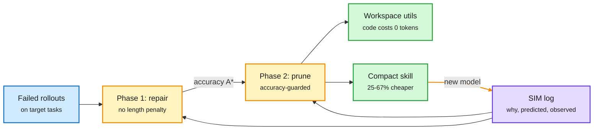

# EfficientSkill and Self-Improvement Memory: two Google papers on harness optimizers

**Sources:** [EfficientSkill, arXiv:2611.19823](https://arxiv.org/abs/2611.19823) (Google + Purdue; Shah, Badhe, Kathrotia, Tiwari) · [Self-Improvement Memory, arXiv:2611.18856](https://arxiv.org/abs/2611.18856) (Google Cloud AI, Google DeepMind, Penn State; Yu, Xia et al.) · DAIR Academy picks ([EfficientSkill, 11-15](https://academy.dair.ai/papers/efficientskill-learning-skills-for-token-efficient-multi-turn-agents-2611.19823), [SIM, 11-13](https://academy.dair.ai/papers/self-improvement-memory-enables-continual-recursive-self-improvement-2611.18856)) · X ([@dair_ai](https://x.com/dair_ai/status/2122703815992602992), [@omarsar0](https://x.com/omarsar0/status/2122701047118635485), [@rohanpaul_ai](https://x.com/rohanpaul_ai/status/2122788106764255456), [@omarsar0 on self-improving memory](https://x.com/omarsar0/status/2122817030277509231)) · raw: `raw/twitter/feed/2026-11-17-evening-*-ranked.json`, `raw/twitter/feed/2026-11-18-morning-ranked.json`

## TL;DR

Both papers are about the *optimizer* that rewrites an agent's harness (its skill files, prompts and tools), not the agent itself.

**EfficientSkill** fixes skill bloat. Reflective skill optimizers (like EvoSkill) add an edge-case rule after every failure, so the skill file grows, every turn replays more tokens, and loops time out. EfficientSkill runs two phases in a fixed order. Phase 1 repairs failed rollouts with no length penalty until validation accuracy reaches a target A*. Phase 2 warm-starts from that skill and prunes it for output tokens under an accuracy guard (stay close to A*), bounds agent turns, and moves reusable code into workspace utilities that cost zero prompt tokens. Pruning from the minimal seed instead stalls on unfamiliar tasks: **learn first, then compress.** Across four models (frontier, mid-tier, open) on MATH-500, ALFWorld and SpreadsheetBench, output tokens fall on 11 of 12 configurations vs EvoSkill (38-80% on 9), mean accuracy rises on every benchmark (+14.3 points Gemini 3.8 Flash and +17.5 points Grok 4.1 Fast on SpreadsheetBench), billed input tokens fall 8-66%, and **serving cost falls 25-67%** with or without prefix caching.

**Self-Improvement Memory (SIM)** fixes harness transfer. An evolved harness can be worse than the seed when the model or benchmark changes: an Opus-evolved workspace harness started at **68.41 on Gemini, below the plain seed's 73.89**. The edited code does not say why each edit was made. SIM is a memory for the harness optimizer that groups past edits by the recurring harness problem they addressed and stores, per edit, the rationale, predicted outcome, observed outcome and evaluation context. Both the proposer and the selector read it before new edits. Across four domains (including Terminal-Bench 2.1 to Terminal-Bench 4), SIM beats harness-only and root-cause-only continuation in six cross-dataset and four Opus-to-Gemini settings; on the Gemini workspace case it reaches 84.75 vs 73.42 without the log. Across ten coding runs, SIM improves 9 of 10 continuations by **2.36 points on average (p=0.003)**.

Learn the skill, compress it, and remember why each edit happened

EfficientSkill orders the optimizer's goals; SIM gives the optimizer a lab notebook.

Blue is the failure signal, amber is the optimizer's two phases, purple is SIM's memory, green is what ships.

## Relation to prior pages

- **Third harness-cost paper in three days, and a pattern now holds.** [SkillCache (11-16)](2026-11-16-skillcache-compiled-skills.md) compiled one completed trace into a replayable capsule (74-81% fewer warm-run tokens). [TokenEconomizer (11-17)](2026-11-17-tokeneconomizer.md) learned repo facts and pruned tools across sessions (18-31% cheaper). EfficientSkill prunes the skill itself after it works (25-67% cheaper serving). All three put the saving in the harness, keep the model fixed, and require a correct artifact *before* compressing. None of them shrinks the model.
- **Contradiction worth naming:** SkillCache found zero-shot compilation *loses* (worse on 58 of 84 tasks), and EfficientSkill found pruning from the empty seed *stalls*. Two independent results say the same thing: compression needs a working solution to compress.
- **SIM answers the 11-17 adoption-gate worry** ([agent shorts](2026-11-17-agent-shorts-memory-teams-evolution.md)): Beneath the Surface found every evolved agent loses some previously solved tasks. SIM's predicted-vs-observed log is the record an adoption gate needs.
- The same-week Meta and RIME memory-design papers ([@omarsar0](https://x.com/omarsar0/status/2122817030277509231)) train memory habits into weights; SIM keeps them in an external log. Two answers to where self-improvement memory should live.
- Counter-signal: TuringPost's roundup argued many self-improving-agent gains are benchmark gains ([@TheTuringPost](https://x.com/TheTuringPost/status/2122706084662239610)). SIM's cross-benchmark design is the right test, but 2.36 points is modest.
- Concept pages: [agent harness engineering](agent-harness-engineering.md), [self-evolving agents](self-evolving-agents.md).

## Gaps

- EfficientSkill's benchmarks are short-horizon; SpreadsheetBench gains may partly reflect replacing stalled loops rather than better reasoning.
- SIM's memory grows without a stated pruning policy; it may need its own EfficientSkill.
