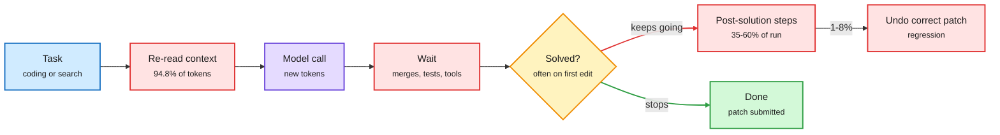

# Where agent compute actually goes: re-reads, idle swarms, late stops and matched baselines

**Sources:** [Re-Reading Is Not Free, arXiv:2611.20873](https://arxiv.org/abs/2611.20873) (Harvard) · [Termination Lag, arXiv:2611.14960](https://arxiv.org/abs/2611.14960) · [More Agents, More Samples, or More Thinking?, arXiv:2611.17610](https://arxiv.org/abs/2611.17610) · [The Critic Can Hurt, arXiv:2611.19037](https://arxiv.org/abs/2611.19037) (Amazon + UMass) · [SWE-CoWork, arXiv:2611.20218](https://arxiv.org/abs/2611.20218) · Hugging Face's 1,000-agent swarm ([@Thom_Wolf](https://x.com/Thom_Wolf/status/2122673947409858730)) · DiamantAI, "When Claude Code subagents help" (Gmail, 2026-11-17) · X ([@rohanpaul_ai on re-reading](https://x.com/rohanpaul_ai/status/2122773095010468026), [@rohanpaul_ai on critics](https://x.com/rohanpaul_ai/status/2122772518683779524), [@omarsar0 on SWE-CoWork](https://x.com/omarsar0/status/2122721966574408112)) · raw: `raw/huggingface/2026-11-17-*.md`, `raw/twitter/feed/*-ranked.json`, `raw/gmail/2026-11-18-newsletters.md`

## TL;DR

Five measurements from one day, all pointing at the same place: most of an agent's compute is not new work.

- **Re-reading (Harvard).** Ten weeks of one engineer's real Claude Code use: about 1B tokens over 42 sessions. **94.8% of processed tokens were re-reads of cached context**, about 260 cached tokens read per generated token, and context grew 5.3x over a session. A cache-aware energy estimator (charges cached tokens for attention reads, not full reprocessing) puts the energy at ~250 kWh, versus ~10 kWh from the output-based EcoLogits estimator: **a 25x undercount**.
- **Swarms (Hugging Face).** Over 1,000 DeepSeek V4.1 Flash agents ran on a couple of B200 nodes building ELIZA-style chatbots (a near-embarrassingly-parallel task). The GPUs were not the bottleneck. Agents waited on git merges (fixed with a centralized merge queue), on tests, and on re-reading each other's context (~130 tokens read per token written). **At any moment only 40-60 of the 1,000 were calling the model.** Then coordination itself hit Brooks's law.
- **Termination lag.** Across five models, two frameworks and three SWE-bench sets, **38-82% of successful runs had a correct patch on their first source edit**, yet post-solution steps were a median 35-37% of the run for Qwen3-Coder and 54-60% for Laguna-XS.2. In 1-8% of cases the extra work undid the correct patch.
- **Multi-agent at matched budget.** A meta-analysis of nine studies and 516 configurations: against baselines matched on sample count or resource budget, multi-agent systems average **-0.042 accuracy** and equal or trail the baseline in **74%** of comparable contrasts. Most reported multi-agent gains came from comparing against a single greedy pass.
- **Critics.** Adding an LLM critic to an AutoML search over 96 pipelines gained at most ~0.005 AUC with an ideal critic; a Llama-3.1-8B critic fell below the no-critic baseline on 7 of 8 datasets, losing up to 0.245 AUC.

The model call is the small slice of an agent's day

Each red box is time or tokens spent on something other than new reasoning.

Blue is the task, purple is the model's new work, amber is the stop decision, red is overhead, green is the exit.

## Relation to prior pages

- **Gives the 11-17 prefix-cache thesis its usage-side number.** [Agent sessions are a prefix-cache problem (11-17)](../inference-efficiency/2026-11-17-agent-sessions-prefix-cache-discipline.md) derived that a 100-turn session recomputes 5,050 units without caching. Harvard measured it on real use: 260 cached reads per generated token. The new point is that cached tokens are cheap in dollars (GPT-6.2 Astra cached input is $0.40/M) but not free in energy or HBM bandwidth.
- **Confirms the single-agent default** from Amazon's controlled SOP study ([11-12](2026-11-12-wikitrace-and-single-agent-default.md): multi-agent designs spend 1.4-4.7x tokens for rarely significant gains) and Anthropic's fold-subagents guide (11-17). The meta-analysis is the first pooled, budget-matched estimate, and it is negative. DiamantAI's "control run" advice (same task, same budget, one agent vs team, run twice) is the practitioner version.
- **Hugging Face's swarm matches Agent37's observation** that a coding agent uses its CPU only ~5% of the time, and NVIDIA's SC26 point that agents lean on CPUs between model steps. Agent fleets are idle-bound, which favors packing many sessions per GPU and per CPU.
- **Termination lag is a stopping problem the harness should own**, the same frame as TokenEconomizer's stuck-loop judge (11-17) and Energy-Based Reasoners' learned stop signal (same day, [shorts](../inference-efficiency/2026-11-18-looped-and-speculative-decoding-shorts.md)).
- **SWE-CoWork** (101 assignments in simulated 26-person teams): the two best models pass ~63% of fail-to-pass tests but finish under 8% of assignments, and giving full requirements up front adds ~16 points of F2P without changing full-task success. Handoff, not coding, is the failure.
- Concept pages: [multi-agent systems](multi-agent-systems.md), [agent harness engineering](agent-harness-engineering.md), [test-time compute allocation](../inference-efficiency/test-time-compute-allocation.md).

## Gaps

- The Harvard study is one engineer, one tool; the 260:1 ratio will vary by workflow.
- The swarm result is a toy task chosen for parallelism; real coordination costs are worse.
- Termination lag does not report the token cost of the lag directly, only step share.
