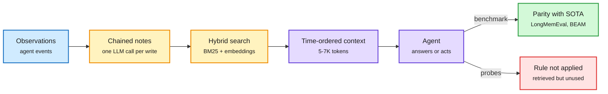

# RAG in a Trenchcoat (BRIDGE, 2611.22179, NeurIPS 2026)

**TL;DR.** Agent-memory research has stacked extraction, supersession, reflection and graph synthesis on top of plain retrieval. BRIDGE strips all of that out: chained observation notes, hybrid BM25 + cosine retrieval, chronological rendering, one LLM call per write or query, about 5-7K reader-prompt tokens per question. It ties the prior best within bootstrap confidence intervals on LongMemEval-S and BEAM and beats the best memory baseline on EverMemBench by 5.7-6.3 points at a matched reader. The authors' real point: benchmarks score what memory *retrieves*, not what it lets an agent *do*. On five adversarial probes where the agent must apply a remembered rule the question never mentions, no design wins everything. LangMem (atomic fact extraction) wins rule application, BRIDGE wins pattern induction, fact extraction loses the shape of a demonstrated pattern, and block summaries retrieve the rule but the agent often fails to apply it. Showing the rule more prominently closes most of that gap.

Most memory machinery does not earn its tokens

Plain notes plus hybrid search tie the fancy systems; the gap is in using what was retrieved.

Blue is raw input, amber the cheap memory steps, purple the agent, green the benchmark result, red the failure the probes expose.

## How it relates to prior wiki pages

- **Confirms** the [11-17 memory update](agent-memory.md): Anthropic's study found a few strategy files beat 400+ archived notes, and MIRIX-2.0 kept complete records with read-time selection. BRIDGE is the cheapest point on that curve.
- **Extends** the [11-15/11-16 intervention-value thread](agent-memory.md) (MemCredit, CoReMem: value a memory by whether removing it changes the next action): BRIDGE's probes are the benchmark version of that argument.
- **Cost angle:** one LLM call per write is the memory analogue of the [94.8% re-read finding](2026-11-18-where-agent-compute-goes.md): most agent memory spend is extraction and reflection that the benchmark does not reward.

**Sources:** [arXiv](https://arxiv.org/abs/2611.22179) · [DAIR](https://academy.dair.ai/papers/rag-in-a-trenchcoat-when-minimal-memory-is-enough-for-agentic-systems-and-when-i-2611.22179) · [@dair_ai](https://x.com/dair_ai/status/2123091409435853190) (X Following feed, 2026-11-18)
