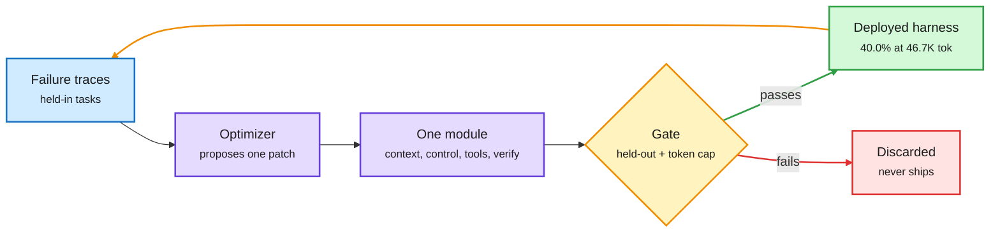

# Self-improving harnesses on a token budget (2026-11-18 cluster)

**TL;DR.** Five artifacts on one day treat the harness (the code around a model that manages context, tools, control flow and verification) as the thing to optimize, and four of them report the cost of doing so.

- **Harnesses That Improve Themselves (Google, 2611.22299, DAIR pick via X).** An optimizer rewrites the harness around a frozen Gemini 3.8 Flash on SWE-bench Lite. A prompt rule file *lowered* held-out accuracy from 5.0% to 2.5%. A full rewrite reached 42.5% at 451.6K tokens per task. **Gated edits** (split the harness into context, control, tools and verification; patch one module per round; deploy only if it passes held-out tasks under a token cap) reached 40.0% at 46.7K tokens per task, about 10x cheaper, and transferred better to Gemini 4 Argon with no new search (37.5% vs 30.0%). Only 40 held-out issues. The paper lists self-edit failure modes: prompt bloat, benchmark gaming, evaluator tampering.
- **ModHarness-RL (2611.18533).** Makes two harness parts learned programs over a typed interaction State: Compression (what history enters context) and Steering (guidance when behavior drifts). Candidate programs come from recent trajectories, are execution-verified and replayed on old ones, so the harness co-evolves with RL. +19% on CodeSearch over the base harness; beats zero-shot GPT-5-mini, which wrote the base harness. Steering helped more on CodeSearch (+15% vs +6%), Compression more on budget-limited ALFWorld (+22% vs +16%). Models 1.5B to 8B only.
- **Do LLM Agents Still Need to Be Told How to Self-Improve? (MIT CSAIL, Tübingen, 2611.23219).** A frozen agent gets a compute budget, tools to collect experience and edit text documents, and no imposed loop or real data. Capable models invent their own self-learning procedure (writing practice games, watching a copy play, editing that copy's prompts and skill files), echoing self-regulated learning and self-generated curricula, and the learned text artifacts transfer to other games and 3D navigation.
- **RepoFactory (2611.21152).** Turns real repositories into 10,159 verifiable build-from-scratch environments across 17 domains. Its Environment Evolution Loop optimizes validity × structural coupling × implementation scope via cheap proxy feedback instead of costly rollouts. Qwen3.5-35B-A3B trained on it gains 22.6 points on NL2Repo-Bench (17.5 without evolution).
- **Hugging Face harness adapters.** Instead of switching harness to get a better model, train one small LoRA (r=32) per harness inside the real, unmodified harness: Qwen3.8-27B goes from 39% to 65% on SWE-bench Pro. Reward = verifier correctness + 0.1 tool-efficiency bonus; async GRPO on 2x B200; a safeagents proxy zeroes reward-hacking tool calls. Second adapter (opencode) followed a day after the pi one.

Patch one module, check it under a token cap, then ship

Gated edits keep 94% of a full rewrite's score for about a tenth of the tokens.

Blue is evidence, purple the proposal, amber the gate, green the shipped harness, red rejected patches.

## How it relates to prior wiki pages

- **Pattern now firmly established (well past three papers):** the harness is a trainable, budgeted object. Yesterday's [EfficientSkill + SIM](2026-11-18-efficientskill-and-self-improvement-memory.md) (Google: learn a skill to full accuracy, then prune it for 25-67% lower serving cost; log why each harness edit was made so edits survive a model swap) and [CompoundingKernel](../hardware/2026-11-18-compoundingkernel-agent-kernel-search.md) (agents fix their own harness at warm restarts) are the same move. Today adds the price tag: 10x tokens between a full rewrite and a gated one.
- **Kurate's rising author** this week is Junjie Wang, whose EvoX ("Rethinking the Agent Harness as a Runtime Policy") was cs.AI #3 then #2 in consecutive weeks: the quality-ranked leaderboard agrees this is the hot frame.
- **Contradiction to track:** the prompt-rule-file result (accuracy halves) cuts against the popular practitioner habit of accumulating CLAUDE.md-style rule files. The [11-17 Anthropic memory study](agent-memory.md) found a few strategy files beat 400+ archived notes, which is compatible: small and curated helps, accumulated rules hurt.
- **Industry match:** Airbnb now chooses coding-agent model and reasoning-effort defaults by measured cost per task on its own evals (AWS post), and Gemini 4 Neon's 12.8% vs 39.0% harness gap is vendor-reported. See [agent-harness-engineering](agent-harness-engineering.md), [self-evolving-agents](self-evolving-agents.md), [agent-training-environments](agent-training-environments.md).

## Gaps

Gated-edit results rest on 40 held-out issues. ModHarness-RL's program space is template-constrained and small-model only. The self-improvement paper uses games; no software-engineering transfer. The HF adapter run stopped at step 191 of 1,000.

**Sources:** [2611.22299](https://arxiv.org/abs/2611.22299) · [2611.18533](https://arxiv.org/abs/2611.18533) · [2611.23219](https://arxiv.org/abs/2611.23219) · [2611.21152](https://arxiv.org/abs/2611.21152) · [HF adapter](http://huggingface.co/harness-hub/Qwen3.8-27B-pi-adapted) · [@omarsar0](https://x.com/omarsar0/status/2123077276350976396) · [@TheTuringPost](https://x.com/TheTuringPost/status/2123092857464422482) · raw: [HF self-improve](../../raw/huggingface/2026-11-18-do-llm-agents-still-need-to-be-told-how-to-self-improve.md), [HF RepoFactory](../../raw/huggingface/2026-11-18-from-repositories-to-training-environments-scaling-long-hori.md)
