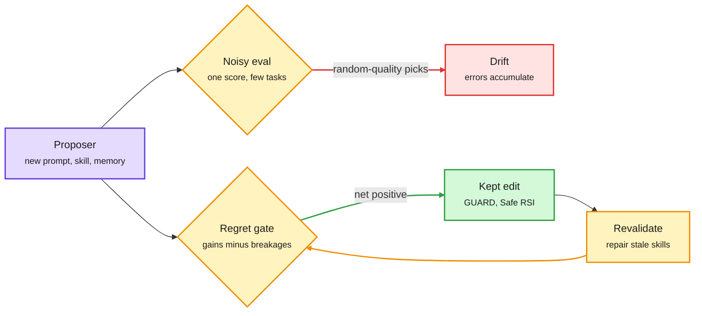

# The Resolution Hypothesis, GUARD, stale skills and gated personal updates (2026-11-20)

**TL;DR.** Five papers from one window make the same point from different angles: self-improving agents rarely fail for lack of good ideas. They fail because the evaluation cannot tell a good edit from a bad one, or because an edit that was good yesterday quietly turns bad. **The Resolution Hypothesis (2611.23068)** runs seven agent-evolution methods on six models (over 10M LLM calls). Helpful candidate artifacts (prompts, skills, memories) exist, but selection picks them no better than random, so errors pile up across rounds. Typical published margins of a few points are smaller than the gap between two runs of the same method. **GUARD (Google, 2611.23476)** answers with a regret gate: it splits each task into self-checks, pins rules the agent already handles, and accepts an edit only if its gains outweigh what it newly breaks (80.8% on 43 hosted-SDK tasks, +6.3 points over Meta-Harness at 54.5% fewer tokens per task). **Stale skills (Amazon, 2611.22525)** shows saved skills turn harmful after an app or API change (a skill worth +4.7 points for Opus became 11.4 points worse than no skill), and selective check-and-repair restores them (Haiku tax-form accuracy 30.5% to 97.5%). **Safe Personal RSI (2611.23651)** gates a health assistant's self-proposed instruction updates and rejected 20 of 21 risky ones. **MLE Agents (Meta, 2611.23910)** ran 1,097 ranking experiments on production search, accepted 325, and lifted live search volume 0.23%, with the authors saying the loop design mattered as much as the model.

The bottleneck is the judge, not the proposer

Every fix in this cluster adds a sharper accept/reject step, not a better idea generator.

Purple proposes, amber judges and revalidates, green is a kept edit, red is the drift a noisy judge causes.

## Relation to prior wiki pages
- **Explains a contradiction this wiki has carried since 10-29.** EMMA (scoped self-edits, 10-29) and Meta-Harness kept trading wins, and Meta-Harness fell from 94.0% to 32.0% on SWE-Bench after five rounds on another task ([11-04](2026-11-04-continual-harness-evolution-forgetting.md)). The Resolution Hypothesis says many of those rankings rest on run-to-run luck.
- **Same lesson as yesterday's quantization paper.** [The Noise Floor of a Quantization Comparison (11-19)](../inference-efficiency/2026-11-19-quantization-noise-floor.md) showed serving-stack noise can be half of a claimed 8-bit effect. Two fields, one week, the same finding: measure the floor before claiming the gain.
- **Extends** [gated harness edits (11-19)](2026-11-19-gated-self-improving-harnesses.md), where one-module-at-a-time edits kept 94% of a full rewrite's score at a tenth of the tokens. GUARD adds regret accounting to the gate.
- [SIM (11-18)](2026-11-18-efficientskill-and-self-improvement-memory.md) logged why each edit was made; stale-skill maintenance logs what each skill assumed about the environment. Both make edits auditable.

## Gaps
- The Resolution Hypothesis diagnoses but does not prescribe a variance-aware selection rule. GUARD's self-checks are model-written, so they can share the model's blind spots.

## Sources
- [Resolution Hypothesis](https://arxiv.org/abs/2611.23068) (HF, raw: `raw/huggingface/2026-11-19-the-resolution-hypothesis-agent-evolution-s-key-is-identifyi.md`)
- [GUARD](https://arxiv.org/abs/2611.23476) · [Stale skills](https://arxiv.org/abs/2611.22525) · [Safe Personal RSI](https://arxiv.org/abs/2611.23651) · [MLE Agents](https://arxiv.org/abs/2611.23910) (X Following feed + DAIR Academy pages)

Concept pages: [self-evolving agents](self-evolving-agents.md) · [agent harness engineering](agent-harness-engineering.md)
