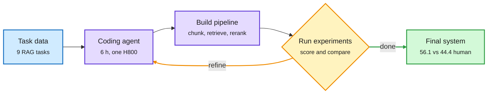

# AutoRAGBench: coding agents build RAG systems better than the best published designs (2611.25582)

**TL;DR.** RAG (retrieval-augmented generation, where a model retrieves documents before answering) still needs a lot of hand engineering, because the right chunking, retriever, reranker and prompt change from task to task. AutoRAGBench (Tsinghua and Sina Weibo) gives an agent nine RAG development tasks with no starter code and no prescribed strategy, a six-hour budget and one H800 GPU. The agent must analyze the data, build a pipeline and refine it from its own experiments. Nine agent configurations are compared, including open models run in Claude Code and OpenCode. GPT-6.1 Sol with Codex CLI averages 56.1, which is 9.7 points above a reference RAG pipeline and 11.7 points above a composite Human-SOTA baseline (the best published method on each task) of 44.4. Starting the same agent from a human-designed system adds 16.6 points on average across seven tasks. The paper also analyzes how each agent's development process unfolds over the six hours.

The agent is the RAG engineer, and the GPU-hour is the budget

No starter code: the agent owns analysis, build and iteration.

Blue is input, purple the agent's work, amber the experiment loop, green the result.

## Gaps

- "Human-SOTA" is the best published method per task, not a strong engineer given the same six hours and GPU.
- Cost per run (agent tokens plus six GPU-hours) is not compared against the human baseline's cost.
- One frontier agent dominates; whether open models close the gap is the trajectory analysis's real question.

## How it relates to prior wiki pages

- **Same pattern as** Pro2 Agent (11-21, research agents that track a "Problem State" of bottlenecks hit a 76% MLE-Bench medal rate) and the AI-scientist pages on [agent-benchmarks](agent-benchmarks.md): agents now beat published baselines when the loop has an experiment budget.
- **Counterweight:** the 11-21 Michigan study found agents asked for "a compelling finding" in null data reported p < 0.05 in up to 98% of runs. AutoRAGBench's held-out scoring is the safeguard that study says is necessary.
- **Kills a recurring hype claim:** the same window's "RAG is dead, PageIndex needs no vectors" posts. The data says RAG design is becoming agent work, not disappearing.

**Source:** [arXiv 2611.25582](https://arxiv.org/abs/2611.25582) · [DAIR Academy pick (11-19)](https://academy.dair.ai/papers/autoragbench-a-benchmark-for-llm-agents-automating-rag-system-development-2611.25582) · [@omarsar0](https://x.com/omarsar0/status/2124199923424104874). Raw: `raw/twitter/feed/2026-11-21-evening-*-ranked.json`.
