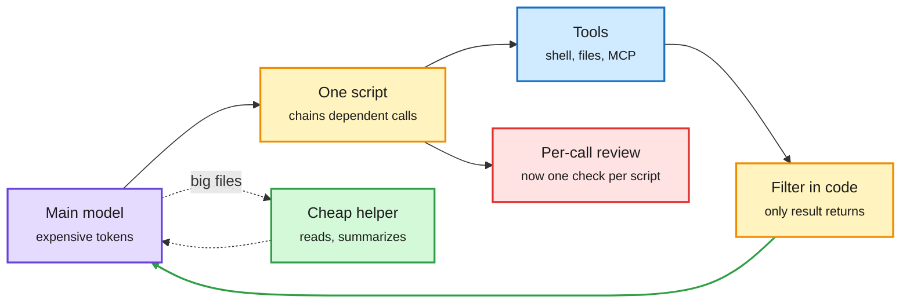

# Claude Code's Code Mode, Spotify's 90% token cut, and where agent tokens actually go

**TL;DR.** Three practitioner items in one window point at the same fact: most agent tokens are spent re-sending context and shuttling tool output, not thinking. **Code Mode** (Claude Code v2.1.323, 11-12, experimental, off by default, interactive terminal only) lets Claude write one JavaScript script that chains dependent tool calls, filters and aggregates inside the script, and returns only what the model reads next. Normally each dependent call costs a model round trip, and every intermediate result lands in context. Ken Huang's write-up corrects the viral "150,000 tokens to 2,000" figure: it comes from Anthropic's earlier code-execution-with-MCP example (tool definitions loaded as files on demand), not from a Code Mode measurement. The control tradeoff is real: one approval covers a whole script, and auto mode's classifier reviews the code once without seeing values the script computes at run time, so per-call hooks no longer see each call. **Spotify's Claude Code setup** (as summarized on X) cut token use about 90% by sending file reading and boilerplate writing to two cheap helper models, enforced by a hook that blocks the main model from opening any file over 350 lines. The honest caveat in the same post: the cheap reader missed a bug the main model found in seconds. **Anthropic's agent-memory guide**, re-shared widely this window, argues for small memory: tell the agent what memory is for, keep an index of about 200 lines, save only what the agent cannot see each turn.

Fewer round trips, smaller context, cheaper helpers

All three cut what the expensive model has to read, not how hard it thinks.

Purple is the expensive model, amber the script loop, blue the tools, green the cheap helper, red the coarser control.

## Key points

- **Code Mode mechanics:** no new tools; existing tools run inside the script under their usual names. Runs only in an interactive terminal session (not headless, IDE panel, Desktop or cloud). Works with Opus 5.5, Sonnet 5.5, Haiku 5.5 and Fable 5.2.
- **Where savings come from:** fewer model turns, so fewer re-sends of the whole context, and intermediate tool output never enters context.
- **Security:** coarser approval granularity; Ken Huang also flags a first-release bug and walks a MAESTRO threat model.
- **Spotify pattern:** routing by task type inside the harness (read/boilerplate to cheap models), enforced by a hook rather than an instruction, because instructions were ignored.
- **Memory guide:** a re-share of Anthropic's 11-09 "components of agent memory" post ([summary](2026-11-09-anthropic-agent-memory-and-google-agent-distraction.md)), not a new paper.

## How it relates to prior wiki pages

- **Confirms** Coca-Cola's latent tool-observation compression and the 11-09 agent-cost shorts: tool output, not reasoning, is the dominant token sink.
- **Routing intersection:** Spotify's helper split is model routing done in the harness by task type, the same idea as Drex Router (11-21, a 12B router picking a model in under 90 ms) but enforced by a file-size rule instead of a learned router. See [llm-routing](../ai-routing/llm-routing.md).
- **Harness thread:** this is the practitioner side of [agent-harness-engineering](agent-harness-engineering.md) and [tool-calling](tool-calling.md): the harness, not the model, decides most of the bill.

**Sources:** [Ken Huang, "Claude Code's Code Mode batches tool calls in one script"](https://kenhuangus.substack.com/p/claude-codes-code-mode-batches-tool) · Spotify summary via [@undefinedKi](https://x.com/undefinedKi/status/2124153368419467742) · viral version [@thedelost](https://x.com/thedelost/status/2123891849366507699) · memory thread [@reinexbt](https://x.com/reinexbt/status/2124159642938818904). Raw: `raw/rss/2026-11-21-agentic-ai-claude-code-s-code-mode-batches-tool-calls-in-one-scrip.md`, `raw/twitter/feed/`.
