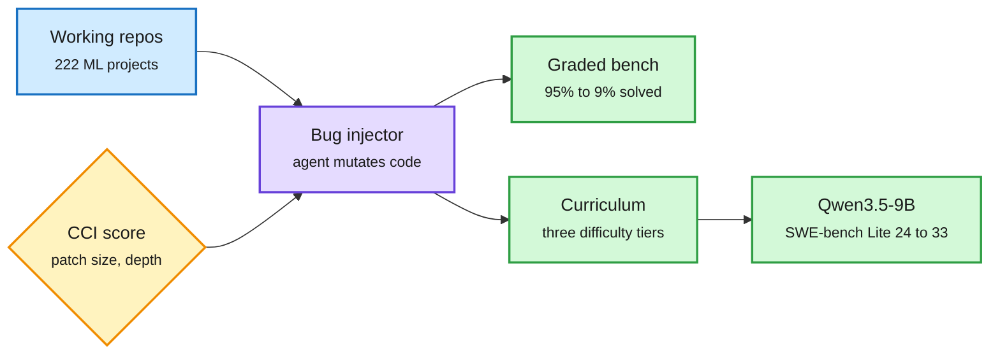

# BuggyMLE: harder ML-engineering tasks by injecting bugs into working repositories

**Source:** [arXiv 2611.25088](https://arxiv.org/abs/2611.25088) (Google Research, Google DeepMind) · [DAIR Academy pick (Nov 18)](https://academy.dair.ai/papers/buggymle-scaling-machine-learning-engineering-difficulty-with-bug-injection-2611.25088) · surfaced via [@omarsar0](https://x.com/omarsar0/status/2124584960464220408), reposted by @dair_ai · raw: `raw/twitter/feed/2026-11-23-morning-ranked.json`. Cross-source: DAIR + social.

## TL;DR

Repository-level coding benchmarks are saturating, and ML-engineering benchmarks usually allow single-file edits only. BuggyMLE first builds a Code Complexity Index (CCI) from ten structural repo features (scale, dependency depth, patch size). CCI predicts average solve rates across eight public coding benchmarks with R² = 0.951, with patch size and complexity the strongest predictors. Agents then inject controlled bugs into 222 working ML repositories, producing more than 6,600 buggy variants and about 260K lines of injected code, with difficulty set by how large and deep the change is. On the graded BuggyMLE-Bench-Lite, the best of 14 models drops from 95% solved on the easiest tier to 9% on the hardest. A Qwen3.5-9B trained on a three-level curriculum over 200 more repositories rivals frontier models there and transfers: SWE-bench Lite 24% to 33%, LiveCodeBench v6 69% to 71%.

The same repo becomes the test and the training data

A difficulty score tells the bug injector how hard to make each task.

Blue is the source repos, purple the injector, amber the difficulty control, green the outputs.

## Gaps

- Injected bugs may not match the distribution of real ML bugs (silent numerical errors, data leakage).
- The 9B model "rivals" frontier models on its own training distribution; the cleaner test is the transfer gain.
- CCI's R² is fit across benchmark averages, not individual tasks.

## How this relates to prior wiki pages

- **Extends [agent benchmarks](agent-benchmarks.md) and [agent training environments](agent-training-environments.md):** a difficulty knob that produces both evals and training data, the same move as synthetic environment generators earlier this month.
- **Cost angle:** a 9B model trained on hard synthetic tasks closing on frontier models is the training-side face of the routing result from the Fable 5 natural experiment (same day, [summary](../ai-routing/2026-11-23-fable-suspension-natural-experiment.md)).
- **Pairs with** Pro2 (11-21, a Google research agent at 76% MLE-Bench medal rate) and AutoRAGBench (11-22): agents are strong on ML work, and benchmarks have to be regenerated to stay ahead of them.
