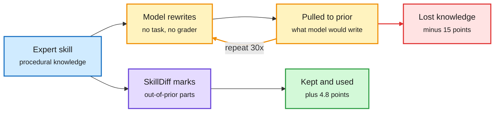

# Harness and RL shorts

## Feedback-free self-evolution erodes skills (2611.25534), cross-source confirmed (HF + DAIR)

Agent skills are documents where experts write down procedures (a `SKILL.md`). Models increasingly rewrite them on their own, with no task run and no grader. This study lets models rewrite expert skills round after round with no feedback. Every model tested got **worse** with the rewritten skills on every benchmark, losing **15 points on average on SkillsBench after 30 rounds**. The mechanism: rewriting pulls a skill toward what the model would write from the topic alone (its prior), and the knowledge outside that prior is dropped first. Putting that knowledge back recovers most of the loss. So an expert skill is valuable mainly for what the model would not write itself. **SkillDiff** marks that out-of-prior knowledge in place and lifts SkillsBench by 4.8 points without changing the skill's text.

Unsupervised rewriting drifts toward what the model already knows

The expert's unique knowledge is the first thing lost.

Blue is the expert's skill, amber is the rewrite loop, red is what is lost, green is the fix.

**Relation to prior pages.** Contradicts the optimistic half of [self-evolving-agents.md](self-evolving-agents.md) and sharpens GUARD (11-20, a Google loop that only accepts a harness edit when its gains outweigh the behaviours it breaks): the difference between those two results is the grader. Self-evolution with a regression gate improves; self-evolution with nothing degrades. A companion DAIR pick, Evolve Where It Matters (coverage-guided skill evolution), points the same way.

## CoEvoBench (Alibaba, 2611.27116)

An LLM "researcher" gets a 9B base model, a starting harness and 24 hours. It can edit the harness, launch training, or both, then submits one model-harness pair for held-out tests (SWE-bench Verified, TB-Lite, AppWorld, tau-bench, BFCL). GPT-6 Astra closed over four-fifths of the gap to an instruct model with a reference harness; Claude Opus 5 over half; Kimi K3, GLM-5.3 and Qwen3.8-max under a third. The harness drove most gains in four of five domains; training carried BFCL. Models make a strong first improvement but cannot yet turn feedback from the improved system into the next round ([@omarsar0](https://x.com/omarsar0/status/2124869837545701845)).

## Context compaction is lossy (CompAct-Bench, 2611.25673) and the lossless alternative (GrepMem, 2611.25123)

CompAct-Bench inserts compaction points into successful agent trajectories, compresses earlier context with the model under test, and checks whether the same executor still finishes. Across 12 models, the best (Claude Opus 5) reaches 68.5% post-compaction accuracy against a 56.7% average. Annotated facts were 69.1% kept, 25.3% dropped and **5.6% distorted**, for example an unresolved issue rewritten as a conclusion. GrepMem (USC) does the opposite: keep an append-only plain-text log of everything and give the agent a regex search tool. No embeddings, no index. With RL on Qwen3.5-9B it reaches 95-97% on ContextBench against at most 21% for lossy baselines, and sits on the accuracy-per-token frontier on all five tasks. Relation: extends the compaction thread in [agent-memory.md](agent-memory.md).

## Budget internalization (JetBrains, CTU; 2611.26172)

RLVR (reinforcement learning with verifiable rewards) usually caps rollout length. That cap becomes a learned constraint. Qwen3.5-4B trained with a 4K cap gains 34.8 AIME points at a 4K evaluation budget but **loses 30.2 points against the base model at 64K**. Across six checkpoints (Qwen, Gemma, Nemotron), gains at the cap range 11.7-46.7 points and deficits at the largest budget 17.2-35.0. The cause is length-censored training data: SFT on artificially truncated traces reproduces it, SFT on naturally short traces does not. Forcing an answer on truncated rollouts removes the effect. Relation: a direct caveat for [test-time-compute-allocation.md](../inference-efficiency/test-time-compute-allocation.md); a model's test-time scaling curve depends on its training budget.

## Also in the DAIR batch

- **Context as a Resource (ClonAct, 2611.26346):** a routerless always-on personal agent that manages context blocks like memory pages. True-conflict repo merges go from 33.3% (router hierarchies) to 63.3%, with 45.9% fewer prompt tokens.
- **Canon Layers at Scale (Allen-Zhu, 2611.24963):** 64 from-scratch runs at 1.3-8B on 1-2T tokens. Canon layers (local token mixing) save about 30% of pretraining tokens at 8B; with Canon, plain gated linear attention matches Gated DeltaNet and beats Mamba2. Linear models that match Transformers on benchmarks still fail 500-token retrieval.
- **SiliconGym (UCSD, Georgia Tech, NVIDIA; 2611.25658):** an RL environment for hardware-design agents from RTL to full SoC flows; 21.9% faster RL batches than ChipSeek; open-source PPA gains do not always survive commercial synthesis.
