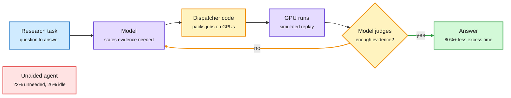

# Research agents waste GPUs

Three papers, all DAIR Academy picks and all amplified on the X feed, measure where an autoresearch agent's compute goes and how the harness fixes it. Surfaced via the social feed; none is on today's HuggingFace list.

## ComputeWise (Salesforce AI Research + Datadog, [2611.31027](https://arxiv.org/abs/2611.31027))

Agents are given GPUs to run their own experiments. Their tokens are cheap next to the GPU hours their experiments burn, so GPU waste is the real bill. ComputeWise builds nine research tasks from recorded GPU runs and a **simulated GPU** that replays those runs to the agent's code, so hundreds of agent experiments run with no real hardware. Score = time to a supported answer divided by the time of a comparison schedule.

- Pooled over 148 unaided runs: **52% of GPU time went to needed work, 22% to unneeded runs, 26% sat idle.** Median run took 44% longer than the comparison schedule.
- **Busy is not efficient.** Of 24 runs that kept GPUs at least 90% busy, 16 were still 25%+ slower than the comparison.
- Hints, "keep every GPU busy" instructions and a job scheduler did not fix it.
- **A harness did.** The model states what evidence it needs and judges results; plain deterministic code dispatches jobs. With three Claude models in Claude Code it improved 25 of 26 model-task pairs and removed about 90% of excess time; across five models, over 80%.

The model asks for evidence; code runs the GPUs

ComputeWise's fix splits judgment from dispatch, and that alone removes over 80% of the wasted time.

Blue is the task, purple are model and GPUs, amber is dispatch and judgment, green is the answer, red is the unaided baseline.

## MLEvolver (HKUST, NVIDIA and others, [2611.28244](https://arxiv.org/abs/2611.28244))

A controlled study of harness memory for long-horizon autoresearch agents, testing each mechanism alone against a recency-truncation baseline on MLE-Bench and KernelBench with gpt-oss-120b, gpt-6-luna and gpt-6-sol.

- **Context:** keeping individually addressable records of past attempts beats a rolling summary. **Context folding** (condense each attempt into a short digest) was best in all six settings, up to +19.2%.
- **Skills:** deleting lessons that stay unused beat consolidating them or promoting them to standing rules.
- **MLEvolver** = folding + deletion: 72.7% medal rate on MLE-Bench Lite and 94% fast_1 on KernelBench Level 3, ahead of AIDE and OpenEvolve at the same inference budget.

## Tea Leaves (CMU, UIUC, UW, [2611.30141](https://arxiv.org/abs/2611.30141))

Can an LLM predict how a training run ends from its first 20%? 682 real runs across pretraining, fine-tuning and RL. The best of 11 LLMs matches the best curve fitter on smooth loss (skill 0.66 vs 0.62) and leads on noisy RL reward curves (0.43 vs 0.13). Related runs in the prompt cut loss-curve error by 39%; tools add little. On sparsely logged runs every method fails, and none reliably flags a failing run in advance. A small open model trained on public runs matches the best LLM on loss curves.

## Relation to prior wiki pages

- **Confirms** the [agent-harness-engineering.md](agent-harness-engineering.md) thesis that the harness sets the bill (11-17, 11-22 updates). ComputeWise extends it from the token bill to the **GPU bill**, which it argues is the larger one.
- **Agrees with** [Skill decay (11-24)](2026-11-24-skill-decay-compaction-and-budget-internalization.md), where feedback-free skill rewriting cost 15 points: MLEvolver finds deleting unused skills beats rewriting or consolidating them. Two papers in two days say skill libraries need pruning more than polishing.
- **Pairs with** [CoEvoBench (11-24)](2026-11-24-skill-decay-compaction-and-budget-internalization.md) and [BuggyMLE (11-23)](2026-11-23-buggymle-bug-injection.md): the autoresearch-benchmark wave now has cost-aware scoring.
- **Tea Leaves** is the missing early-stopping primitive for ComputeWise's waste: 22% of GPU time on unneeded runs is exactly what a run forecaster would cut.
