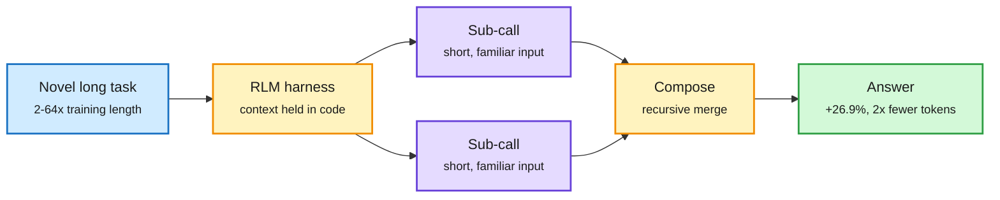

# Harnesses that compose

## Language Model Harnesses can be Compositional Generalizers (MIT CSAIL, [2611.28298](https://arxiv.org/abs/2611.28298))

A standard agent harness keeps appending to the context, so the model is pushed to inputs unlike anything it trained on. A **Recursive Language Model (RLM)** harness manages context in code and splits the task, so every model call sees a short, familiar input even when the whole task is new. Under RL post-training, RLMs trained only on short tasks generalize to tasks **2 to 64x longer** (the base model alone improves less), and training on one domain transfers to new domains with shared structure. For messy tasks, **surrogate harness training** trains individual calls on easier synthetic environments with fake tools and sub-calls. RLM-27B trained this way improves Qwen3.8-27B in the same harness by **26.9%** on hard long-context suites (CTC-Bench, ExpertLongBench) with about **2x fewer inference tokens**.

Every call stays in distribution, even when the task is not

The harness splits the job in code, so the model only ever sees short inputs it was trained on.

Blue is the task, amber is the harness logic, purple are model calls, green is the answer.

## CSPD: Composable Soft-Prompt Distillation ([2611.27376](https://arxiv.org/abs/2611.27376))

RL post-training yields domain experts that must be merged into one model, and the merge has to be redone each time a new expert arrives. CSPD keeps the pre-RL model frozen and distills each expert into **one soft prompt**. Experts compose by concatenating prompts, with no joint training. One prompt recovers at least 90% of the teacher's gain in 22 of 23 math, code and agent settings; the full composition matches multi-teacher on-policy distillation (67.83 vs 67.79) and generalizes best on six held-out benchmarks. Throughput stays within 1.5% of the bare backbone, 2.40x that of rank-4 LoRA. This is a serving win: one frozen base plus swappable prefixes that hit the prefix cache.

## Shorts

- **VideoJSON** ([2611.28167](https://arxiv.org/abs/2611.28167)): a minimal harness beats purpose-built video memory. Each minute of video becomes one JSON record; a coding agent writes Python or Bash to search the records. With DeepSeek V4.1 Flash it beats MAGIC-Video by 7.0 to 24.75 points on ultra-long benchmarks; adding hourly summaries, tools or raw video changes the score by under 1.5 points.
- **Let the Fixer Decide** ([2611.12164](https://arxiv.org/abs/2611.12164), 51 upvotes): train a code localizer on how likely a frozen fixer finds a verified patch given each proposed localization, not on the files the patch edits. Same bug-finding rate with 27.5% less code read, no tests and no RL. Built on Gemma 4 E4B for the Kaggle Gemma-4 agent competition.
- **What makes good data for coding agents?** ([2611.30207](https://arxiv.org/abs/2611.30207)): 74% of SWE-Gym tasks a 9B model never solves have a test that rejects correct fixes. Repairing them gives +2.4 / +2.7 on SWE-bench Verified / Pro at equal size; dropping them does not. About a quarter of passing patches are wrong. Release: SWE-Gym-Verified (1,087 audited tasks).
- **Embo-Harness** ([2611.31201](https://arxiv.org/abs/2611.31201), 90 upvotes): frontier model as robot policy. 83.3% on RoboLab-120 (+26.2 points over the best baseline) by favoring the model's native visual reasoning and tool use over handcrafted plans; accurate spatial targets matter more than low-level trajectory output.
- **MORSE** ([2611.30011](https://arxiv.org/abs/2611.30011)): a self-improving streaming-video harness whose editor groups failures by cause and searches papers, model cards and code for fixes, then optimizes for latency within an accuracy tolerance. 75.1% on OVO-Bench at 0.30 s per query with a frozen Qwen3-VL-8B.

## Relation to prior wiki pages

- **RLM confirms** the [agent-harness-engineering.md](agent-harness-engineering.md) line that harnesses keep mattering even as models improve, and it is the training-side version of NVIDIA's "You don't need long context" result ([CoCa-Cola and compaction, 11-09](2026-11-09-coca-cola-latent-tool-observation-compression.md)), where resetting to a short handoff note matched full history. Both say: keep each call short.
- **VideoJSON** joins GrepMem (11-24) as a "plain records plus code search beats bespoke memory" result; see [agent-memory.md](agent-memory.md).
- **CSPD extends** [knowledge-distillation.md](../inference-efficiency/knowledge-distillation.md): distillation into input space rather than weights.
- **SWE-Gym study pairs with** [BuggyMLE (11-23)](2026-11-23-buggymle-bug-injection.md): reward-label correctness, not task count, is the binding constraint on coding-agent RL.
