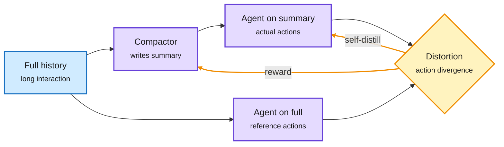

# RECAP, CoT-Proxy and TimeTravelContainer

**TL;DR.** Three agent-infrastructure results that cut what long-horizon agents carry. RECAP trains context compaction so the summary preserves the agent's future behavior, not just the task reward. CoT-Proxy shows you can distill a closed teacher's long-horizon policy from its actions alone, with the chain-of-thought left empty. TimeTravelContainer makes branching a live tool session as cheap as a process fork.

A good summary is one the agent acts the same on

RECAP's reward compares what the agent does next under the summary versus the full history.

Blue is the history, purple are the compactor and agent, amber is the behavior-distortion signal that trains both.

## RECAP ([2611.31258](https://arxiv.org/abs/2611.31258))

- Context compaction replaces history with a summary so long tasks fit in a budget. Learning it jointly with the policy is hard because a summary's effect shows up many steps later.
- Principle: a summary is good if the agent's subsequent behavior under it matches its behavior under the original history. The gradient of this **behavior-distortion** objective splits into two signals: a distortion reward for the summary writer and a self-distillation loss for the actions taken after compaction.
- Qwen3.5-4B: **+4.6 points on BrowseComp-plus and +4.3 on SWE-bench Verified** over task-reward-only RL. Ablations show both signals are needed.

## CoT-Proxy ([2611.33148](https://arxiv.org/abs/2611.33148))

- The strongest teachers hide their chain-of-thought behind an API. Train the student on teacher **actions only**, with its reasoning block left empty, plus a KL loss on a replay buffer of the student's own generations to limit drift.
- **Cross-format transfer:** the policy learned with empty reasoning carries over when thinking is turned back on; the student reasons in its own style but acts like the teacher. AppWorld: Qwen3-4B 7% to 18%, Qwen3-32B 12% to 25% (teacher Qwen3.6-27B). Adding **CoT-proxies**, short summaries of the teacher's reasoning after the empty block, takes Qwen3-4B to 35%.

## TimeTravelContainer ([2611.32255](https://arxiv.org/abs/2611.32255)), cross-source (DAIR + social)

- NVIDIA (Zizheng Guo, Brucek Khailany and colleagues). A rootless container runtime that **live-forks a whole running container** (processes, memory, filesystem, network) with copy-on-write. Clones share pages that stay read-only after the fork; only diverged pages use new memory.
- No kernel changes, hardware virtualization or root. Runs on Linux, macOS (Apple Silicon) and Windows (WSL 2).
- On EDA tool environments: cloning **84.1x faster**, memory **31-72% lower**, end-to-end agent runs **1.7-9.4x faster**.

## Relation to prior wiki pages

- **RECAP fills a gap** flagged on the [agent harness engineering](agent-harness-engineering.md) page: NVIDIA's "You don't need long context" (11-25) showed restarting from a handoff note matches full history, but the note was hand-designed. RECAP is the first to learn the note with a signal that is not task reward. It is the compaction analogue of the 05-14 context-training page.
- **CoT-Proxy contradicts** the default assumption in [knowledge distillation](../inference-efficiency/knowledge-distillation.md) that imitating reasoning traces is what transfers capability. For long-horizon agents, actions carry most of the policy. It pairs with CSPD (11-25), which distilled experts into a soft prompt: both get teacher behavior without the teacher's text.
- **TimeTravelContainer is the systems primitive** the 11-25 ComputeWise result needs: an agent that separates "what evidence do I need" from dispatch can branch environments cheaply. It also matches TTC's own origin, EDA, the hardware-design domain where SemiAnalysis's GDPx says frontier models are already strongest.

## Gaps

- RECAP: only a 4B model, two environments.
- CoT-Proxy: teacher is open (Qwen3.6-27B), so the "closed teacher" motivation is simulated.
- TTC: GPU state is not mentioned; forking a session holding a GPU context is the hard case for ML agents.

Raw: [RECAP](../../raw/huggingface/2026-11-25-recap-training-long-horizon-llm-agents-with-context-compacti.md) · [CoT-Proxy](../../raw/huggingface/2026-11-25-cot-proxy-cross-format-transfer-for-distilling-long-horizon.md) · [TTC on DAIR](https://academy.dair.ai/papers/timetravelcontainer-a-live-forking-sandbox-for-stateful-agent-exploration-2611.32255)
