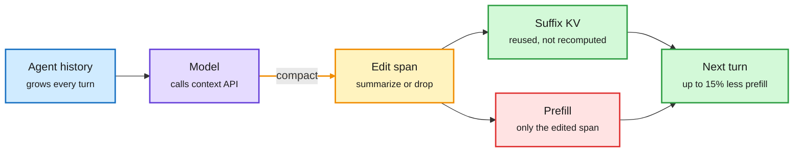

# Letting Models Manage Their Own Context

**TL;DR.** Agent harnesses normally decide for the model when to compact: the window fills, the harness summarizes the history. NVIDIA gave models a context API inside NOOA, its open-source agent harness, so the model decides when and what to compact. On document research and ML-engineering tasks at budgets from 8K to 512K tokens, models that use the API well score higher on fewer tokens, especially at tight budgets. The serving half matters for cache work: after a model-driven edit, the engine reuses the KV cache of the unchanged suffix, cutting prefill compute by up to 15% per request with no accuracy change. Cross-source confirmed (HF + DAIR + social).

Compaction stops being a full re-prefill

The model decides what to compact; the engine keeps the cached part it did not touch.

Blue is input, purple is the model, amber is the model's compaction decision, green is reused work, red is compute still paid.

## Key findings

- **Model-driven beats harness-driven at tight budgets.** GPT 6.1 nearly triples on OfficeQA Pro v2 at a 32K budget (21% to 56%). Kimi gains accuracy with up to 41% fewer input tokens.
- **Models differ a lot.** How often they call the API, how hard they compact, and when they start all vary by model. Small prompt changes shift the timing. This is a training target, not a solved behaviour.
- **Engine co-design.** A summary edit normally invalidates the whole prefix cache after the edit point. Reusing the KV of the unchanged suffix (with positional correction) cut prefill by up to 15% per request, no measurable accuracy change.
- **Framing.** The paper argues for a co-design frontier: train models to manage context, and build engines that make those edits cheap.

## How it relates to prior wiki pages

- **Extends** the [11-05 context-budget compaction page](../inference-efficiency/2026-11-05-context-budget-compaction-and-context-rot.md), which showed harness-triggered compaction loses facts as context rots. Here the model owns the trigger.
- **Confirms** the HKUST and NVIDIA autoresearch-harness ablation ([11-25 digest](../daily-digest/2026-11/2026-11-25.md)): per-attempt foldable summaries beat rolling summaries. Both papers say memory layout, not model size, sets agent cost.
- **Tension with prefix-cache discipline** ([11-17](../inference-efficiency/2026-11-17-agent-sessions-prefix-cache-discipline.md)): that page argued agents should never edit history, to keep the prefix cache hot. NVIDIA's suffix reuse is the first engine-side answer that lets agents edit and still keep most of the cache.
- **Open for routing:** cache-aware routers hash prompt prefixes ([11-27 routing page](../ai-routing/2026-11-27-cache-aware-routing-and-speculative-encoding.md)). A mid-session edit breaks those hashes at the edit point. Nobody yet shows a router tracking model-driven edits.

## Gaps

No per-model cost curve in dollars; suffix reuse measured only on NOOA's engine; no test of whether compaction behaviour transfers across harnesses.

Related: [agent-harness-engineering](agent-harness-engineering.md) · [agent-memory](agent-memory.md) · [kv-cache](../inference-efficiency/kv-cache.md)
