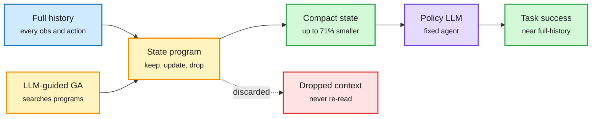

# What an agent needs to carry forward

**TL;DR.** Three items on the same cost question: how much of an agent's history should it re-read each step?

1. **Learned agent state abstractions** ([2611.31800](https://arxiv.org/abs/2611.31800), via X). Agents usually re-read the full interaction history every step. This paper defines agent *state* as the smallest summary of history that keeps a fixed reference agent's task success. It represents candidate abstractions as small deterministic recursive programs (what to keep, update, discard) and searches over them with an LLM-guided genetic algorithm. On ALFWorld and ScienceWorld the learned programs keep near-reference success while cutting mean policy input by up to 71% and 57%. The programs are readable, so you can see exactly what is kept.
2. **Revisiting LLMs as Context Engineers** ([2611.30494](https://arxiv.org/abs/2611.30494), HF). Methods that let an LLM distill reusable instructions or "experiences" from offline trials (LCE methods) have no single winner across tasks at 8B, often fail to beat plain chain-of-thought, and do not improve reliably with more parameters or iterations. Gains correlate negatively with the diversity of failure modes (r = -0.5). Much of the gain is better instruction adherence; the bottleneck is extracting a lesson from varied failures.
3. **RAW-RAG** (X thread, no paper link captured). Chunk raw chat logs at 256 tokens into a flat vector index with a reranker; it beats Mem0, MemOS, EverMemOS and Memora in 6 of 7 settings and ingests a 1M-token workload in 18 minutes vs 18-27 hours. An audit of 460,000 Mem0 write decisions found under 2% were real updates or deletes, and turning those off raised accuracy (67.36% to 69.42%).

Keep what the next step needs, not the whole transcript

A searched program decides what survives; the policy sees only that.

Blue is the raw history, amber is the searched abstraction, purple is the agent, green is what is kept and the result, red is what is dropped.

## How this relates to prior wiki pages

- **Joins the "curate, don't summarize" line** on [agent-memory](agent-memory.md): GrepMem (11-24, keep everything and grep), the 11-25 plain-records-plus-code-search result, MLEvolver (delete unused lessons), and the 11-27 HKUST finding. The state-abstraction paper is the first to *learn* the keep/drop rule as an inspectable program rather than prompt it.
- **Contrasts with NVIDIA's model-driven compaction (11-27)**, where the model itself chooses when to compact and the engine keeps the untouched KV suffix. Learned state programs drop context *before* it reaches the model, which saves prefill entirely but breaks prefix caching on every change. Which wins on dollars depends on the cache-hit rate, which neither paper reports.
- **LCE's negative result** fits the 11-27 Amazon finding that self-revised harnesses barely transfer: lessons extracted from diverse failures generalize poorly.

Related: [kv-cache](../inference-efficiency/kv-cache.md) · [agent-harness-engineering](agent-harness-engineering.md)
