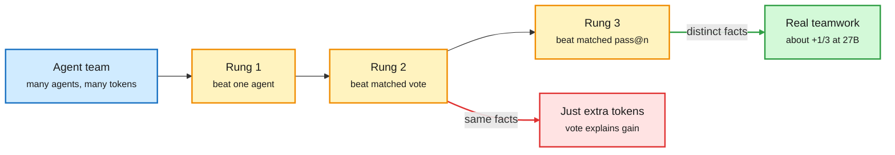

# Agent teams at equal cost, and coding agents as harness optimizers

**TL;DR.** Four items from the X feed (DAIR and Stanford NLP threads, a Rohan Paul thread, and a hype-packaged post) all price agent improvements against what they cost.

1. **Recursive Collective Intelligence: Emergence on an Equal-Budget Ladder** ([2611.32606](https://arxiv.org/abs/2611.32606), Stanford, with Li Fei-Fei and Yejin Choi). It grades agent teams on a ladder of compute-matched baselines: beat one agent, then a majority vote of independent agents with the same token budget, then pass@n (solved if any independent agent solves it). When every agent sees the whole question, teams spend more tokens without beating the vote. Interaction clears the top rung only when agents hold *different* facts and pass them along (about +1/3 at 27B). Identical agents self-organized into hubs (+18 points), and writing that structure into the prompt reached the top rung at under half the budget. Groups can train their next generation on their own verified outputs for 4-6 generations, with shrinking gains.
2. **AGL-SKILL: Coding Harnesses as Agentic Optimizers** ([2611.31794](https://arxiv.org/abs/2611.31794), Microsoft). Give Claude Code, Codex or Copilot a target agent (gpt-5.4-mini), training data, a metric and a $5-25 budget, with no further guidance. It edits the target's prompts, code, tools and skills and beats published skill-optimization methods on all five benchmarks (+3% SearchQA up to +98% LiveMath). An "optimizer skill" or bigger budget did not reliably help, and on two benchmarks the gain came from *removing the model* from the final agent.
3. **HyperHarness** ([2611.29062](https://arxiv.org/abs/2611.29062), Microsoft + Notre Dame). One generator, trained across users, writes each user's retrieval and answer-guidance code in a single pass, without touching the answering model. Best in 7 of 9 settings (up to +5.95) with 90.32% fewer answer-time tokens than long-context stuffing.
4. **"The End of Harness Engineering"** (Chinese 6-page paper, via a hype thread, no link captured). Freeze the big model; a 4B editor reads failure traces, proposes 8 harness diffs, all run on a held-out suite, the best survives. Same propose-test-keep loop as GUARD (Google, 11-27 Media Zone) and AGL-SKILL.

Every rung gives the loners the same budget the team spent

A team gain counts only if it survives the compute-matched vote.

Blue is the team, amber is each test rung, green is a gain that survives the compute match, red is a gain that was only extra tokens.

## How this relates to prior wiki pages

- **Confirms the pooled-negative result.** [Where agent compute goes (11-18)](2026-11-18-where-agent-compute-goes.md) found multi-agent averages -0.042 accuracy against budget-matched baselines and ties or loses in 74% of contrasts. The ladder paper explains *when* it wins: information asymmetry. That is now the fourth source this month on [multi-agent-systems](multi-agent-systems.md) saying untrained teams are mostly extra compute.
- **Pattern crossed (propose, test on held-out, keep).** AGL-SKILL, "End of Harness Engineering", GUARD (11-27 Media Zone) and the 11-27 Amazon self-revised-harness study all use the same loop. AGL-SKILL's finding that guidance does not help, and the 11-27 finding that self-revised harnesses barely transfer, are in tension: one says the loop is easy, the other says its output overfits. Both used held-out evaluation, so the difference is likely the target (one agent vs many games). Unresolved.
- **HyperHarness** extends [agent-memory](agent-memory.md): amortize per-user harness search into one generator, the same move distillation makes for models.

Related: [agent-harness-engineering](agent-harness-engineering.md) · [self-evolving-agents](self-evolving-agents.md)
