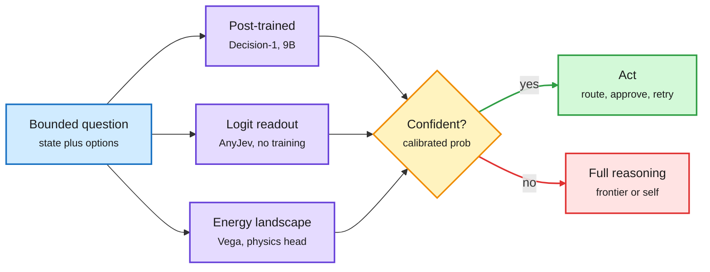

# Decision models become a category

**Sources:** [The Decoder](https://the-decoder.com/microsofts-decision-1-model-enters-the-fast-growing-ai-decision-model-race/) · X Following feed, US day 2026-10-10 (@satyanadella, @yuhasbeentaken, @Sumanth_077, @Nandakishorm1, @aakashgupta, @atomic_chat_hq) · AI Weekly Espresso (Gmail)
**Raw:** `raw/rss/2026-10-10-the-decoder-microsoft-s-decision-1-model-enters-the-fast-growing-ai.md`, `raw/twitter/feed/2026-10-1[01]-*-ranked.json`

## TL;DR

A decision model returns one label from a fixed set plus a calibrated probability, in a single forward pass, instead of writing text. [Jev (09-16)](2026-09-16-jev-decision-only-model.md) introduced the interface; this window it became a product category with a big-tech entrant, a training-free open recipe and an unusual new mechanism.

- **Microsoft-Decision-1.** Post-trained on Qwen3.5-9B for classification, evaluation and routing. Microsoft reports 83.5% accuracy at 85 ms across 36 benchmarks (~150K questions), ahead of Jev 1.13.0 and 2.5x faster than the runner-up H2O-Lightning-4B. $0.042/M input, free output, on Foundry and OpenRouter. Caveats: all numbers are Microsoft's; Cloudflare's open Clef models were left out of the comparison; one early tester reports 200-600 ms in real use. A third-party Space Invaders demo had Decision-1 decide 3.5x faster than OpenAI's Decisions API (300 ms+ per call).
- **AnyJev + Tacit (open source).** Turns any open causal LLM into a decision model with no fine-tuning by reading next-token logits over the allowed answers. Its L0 mode corrects **option-order and label bias** without labelled data (the exact failure the [10-07 audits](2026-10-07-openai-decisions-api-and-decision-model-audits.md) flagged). Tacit is a family of 1.7B-9B self-distilled models that reproduce the decision the base model reaches *after reasoning*, in one pass, and escalate low-confidence cases back to full reasoning.
- **Vega (solo open source, 800M and 4B).** A frozen LM pools five vectors (observation, question, each answer, last token). A 55 MB head turns the observation into an energy landscape with one valley per answer, drops a ball using the question vector, and a small physics engine settles it. The valley it lands in is the answer; Boltzmann occupancy is the probability; a shallow landscape triggers abstain. Single-author benchmarks.
- **Money.** A widely shared post reports TypeSafe (Jev's maker) closed an $870M Series A at $7.5B, 24 days after a $200M-valuation seed. Not confirmed by a primary source in this window.

Three ways to get one calibrated answer

Post-train, read the logits, or settle a ball. All three end in a probability code can branch on.

Blue is the input, purple are the three mechanisms, amber is the confidence gate, green is the cheap path, red is the expensive escalation.

## Relation to prior wiki pages

- **Confirms (pattern, n>5).** Since Jev (09-16): open clones in 72 hours (09-19), OpenAI's Decisions API (10-07), Liquid d1 (10-08), Laya (10-09). Microsoft is the fourth big vendor. The interface is commoditized; differentiation moves to latency and calibration.
- **Gap-filling.** The 10-07 option-label-bias paper showed probabilities follow the option's label, not its definition. AnyJev's L0 debiasing is the first open tool that targets it directly, untested by a third party.
- **Tension.** Arena's Jev Router (10-08) lost to calling a cheap model directly once latency and prefix-cache loss were counted, and System Switch (10-09) showed escalation value tracks AUROC, not accuracy. Microsoft reports accuracy and latency, not AUROC or ECE. The metric this wiki now treats as decisive is still missing from the launch.
- **Tacit vs Thinking Inertia (10-10).** Thinking Inertia found models keep reasoning even with thinking off and lose ~15 points when forced to answer-only. Tacit claims the opposite is trainable: distil the post-reasoning decision into one pass. Who is right likely depends on whether the task is a bounded choice (Tacit's setting) or open-ended (Thinking Inertia's).
