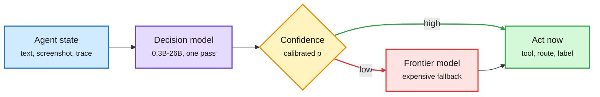

# Decision 3.0, THX-01 and JEV-27B-VL: the routing gate learns to see

**Sources:** vllm-sr [Decision 3.0 collection](https://huggingface.co/collections/vllm-sr/decision-30) ([post](https://x.com/XunzhuoLiu/status/2109207207284027737)) · HAL-X [THX-01 model card](https://huggingface.co/doofz/THX-01) and [API docs](https://api.hal-x.ai/docs/thx-01) · AutoTrust [JEV-27B-VL](https://huggingface.co/autotrust/JEV-27B-VL) · X Following feed, US day 2026-10-11
**Raw:** `raw/twitter/feed/2026-10-11-evening-210003-ranked.json` (private feed capture)

## TL;DR

A **decision model** is a small model that answers one typed question (which model, which tool, is this done, which team owns this ticket) with a probability, instead of generating text. It is the cheap gate that decides when the expensive model is called. Three releases moved the category on the US Sunday. **Decision 3.0** from the vLLM Semantic Router team (`vllm-sr`) makes the open family multimodal in six sizes: d3 (26B), d3-flash (8B), d3-mini (5B), d3-nano (2B), d3-lite (0.9B), d3-edge (0.6B). It claims #1 on both Jev Decision Index boards "in our evaluation". **THX-01** from HAL-X is a 322M non-generative encoder (mmBERT-base plus a 15M decision head) trained with RL whose reward is a strictly proper scoring rule, so honest probabilities are the only way to score well. It answers in about 10 ms per request (1 ms per decision batched) and is the **first launch in the category to publish a calibration number: ECE 0.003** (self-reported). **JEV-27B-VL** from AutoTrust went from 179K to 1.54M downloads and also claims the vision board (77.8% across 13,695 examples), which conflicts with Decision 3.0's claim.

The gate now reads the screen, and says how sure it is

Confident answers act; unsure ones escalate. Calibration is what makes the split safe.

Blue is input, purple is the gate, amber is the confidence split, green is the cheap path, red is the costly fallback.

## Key points

- **Multimodal is the new axis.** [Decision 2.0 (10-05)](2026-10-05-decision-2-and-turn-priced-routing.md) was text-only in six sizes. Computer-use agents decide from what is on screen, so a text-only gate had to call a vision model anyway. A 0.6B gate that reads a screenshot removes that call.
- **THX-01's design choices.** Non-autoregressive, so "nothing to hallucinate"; native `number`, `excerpt` and `cite` question types return values copied from the document with offsets. Trained in 18 languages with Azerbaijani emphasis, ~2.1M training decisions over eight RL stages. Inputs truncate at 1,024 tokens per question, a real limit for long agent traces.
- **Contested leadership.** Decision 3.0 and JEV-27B-VL both claim the Jev Decision Index vision board. Both numbers are vendor-run. Downloads (1.54M) are the stronger adoption signal.
- **Edge side.** Liquid's open d1 (d1-3B, d1-omni-600M with experimental audio) reports 35 ms per image on Jetson AGX Thor, which The Turing Post frames as on-device checks for robots between expensive planner calls.

## Relation to prior wiki pages

- **Answers part of the 10-11 gap.** The [10-11 category page](2026-10-11-decision-model-category-decision1-anyjev-vega.md) noted none of Microsoft-Decision-1, AnyJev or Vega reported AUROC or calibration error, the metrics [System Switch (10-09)](2026-10-09-system-switch-decision-deferral.md) showed predict escalation value. THX-01 reports ECE (expected calibration error, the average gap between stated confidence and actual accuracy). Still no AUROC, and still self-reported.
- **Category count.** Open families now span 0.3B (THX-01) to 27B (JEV-27B-VL), text and vision, plus four large vendors (OpenAI Decisions API, Microsoft-Decision-1, Liquid d1, Jev). Five launches in eight days.

## Concept page updated

[LLM routing](llm-routing.md)
