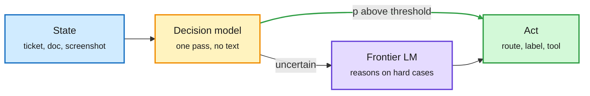

# The decision-model price war: SubQ Snap, Microsoft-Decision-1, Liquid d1 on MLX, SemIf on SageMaker

**Sources:** Gmail (Subquadratic launch email, AI Breakfast 10-12), lab watcher (Liquid AI HF repos, AWS ML blog), X Following feed. Raw: `raw/gmail/2026-10-13-newsletters.md`, `raw/labs/2026-10-13-000834-labs.md`, `raw/twitter/feed/2026-10-1[23]-*-ranked.json`.

## TL;DR

A decision model reads a state (text, JSON, image) plus a fixed set of options and returns a calibrated probability per option in one forward pass, generating no text. It is the cheap gate in front of a frontier model. In one US day the category got prices, a cloud deployment path, and on-device builds:

- **SubQ Snap** (Subquadratic): 384K multimodal context, decision in under a second on 100K tokens (660 ms at 100K, ~2.5 s at 384K, roughly linear, consistent with its subquadratic attention), **$0.05 per million input tokens, output free**. Claims 61.7 on Decision Index v0.2.1 vs 57.9 for Jev, winning 13 of 16 enterprise benchmarks. Vendor numbers.
- **Microsoft-Decision-1**: post-trained from Qwen3.5-9B, **$0.042 per million input, free output**, 32K context, 85 ms p50 / 125 ms p95. 83.5% across 36 benchmarks vs 81.9% for Quyet-1.0-Large, but calibration 92.2 vs Quyet's 93.1. H2O.ai disputes the competitor latency figures.
- **Liquid d1-3B and d1-omni-600M on MLX** (fp16, 8-bit, 4-bit). Several named, typed questions (yes/no/null, choice, score) answered over one state in one pass. The card reports 8-bit moves probabilities by ~0.015 but 4-bit by up to ~0.2, a warning that calibrated outputs are more quantization-sensitive than accuracy.
- **AWS: SemIf on llama.cpp in SageMaker** ([AWS ML blog](https://aws.amazon.com/blogs/machine-learning/deploy-decision-models-with-llama-cpp-on-amazon-sagemaker-ai/)). SemIf (formerly OpenJev) reads final-position logits to return probabilities over declared options without decoding; AWS ships a child image of its llama.cpp container for CPU or GPU. The first hyperscaler deployment recipe for the category.
- **Practitioner test:** one builder put Jev inside an open agent harness and reports Opus-level accuracy on 40 decisions at ~150x lower decision cost, with low-confidence answers routed to review ([X article](https://x.com/akshay_pachaar/status/2109678653974155459)). Small sample.

The gate now has a price per million tokens

Output is free because there is no output: one forward pass, one probability per option.

Blue is the input state, amber is the cheap gate, purple is the frontier model, green is the action.

## Relation to prior wiki pages

- **Continues** [Decision 3.0 / THX-01 (10-12)](2026-10-12-decision-3-multimodal-and-calibrated-gates.md), where the gate learned to read screenshots and THX-01 published an ECE of 0.003. Today the category moved from capability to **price**: two vendors at ~$0.04-0.05/M input with free output. That is ~100x below frontier input prices.
- The 10-12 Looking Ahead asked for an independent calibration audit within 60 days. Microsoft's own table already shows the accuracy leader losing on calibration, and Liquid's card shows 4-bit quantization degrading calibration; the audit question is getting sharper, not resolved.
- **Production echo:** Meta's ads system ([efficiency shorts 10-13](../inference-efficiency/2026-10-13-efficiency-shorts.md)) routes a variable share of traffic to a bigger model based on spare capacity, the same gate-then-escalate shape at fleet scale. AMD's Helion rack (10-13 hardware page) pitches a built-in token router.

## Gaps

All benchmarks are vendor-run on vendor-defined indexes (Decision Index, JevBench). No shared calibration benchmark yet. Latency claims are not measured under the same hardware.

## Related

[llm-routing](llm-routing.md) · [quantization](../inference-efficiency/quantization.md)
