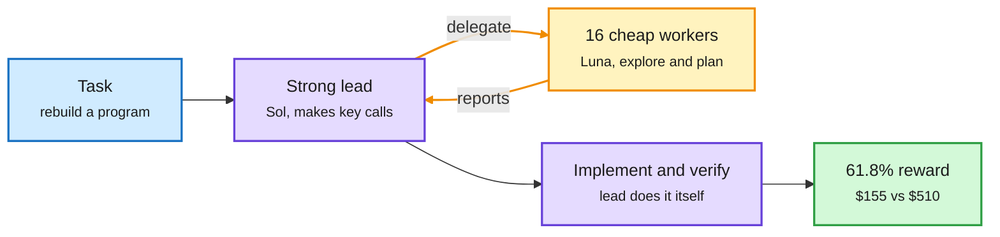

# Routing grows from one call to a whole agent session: Arena Max, Cohere's agent teams, IBM's agent factory

**Date:** 2026-10-14 · **Sources:** Arena blog, Cohere blog, IBM Research blog, Claude Code docs, X feed · **Raw:** [labs 10-14 22:00](../../raw/labs/2026-10-14-220018-labs.md), [labs 10-13 18:02](../../raw/labs/2026-10-13-180211-labs.md), X feed captures (private)

## TL;DR

Three results in one window move routing from "which model answers this prompt" to "which model does which part of a long agent task". **Arena's Max** router is trained on 2.5M real Agent Arena sessions and picks a model per multi-turn task from task type, difficulty and price; Arena reports +14.7% net improvement at a median $3.27 per task, matching Claude Fable 5.1 (Max) at 37% lower cost, and +10.7% at 54% lower cost with only Fable 5 and Kimi K3 in the pool. **Cohere** ran controlled coding-agent teams on ProgramBench (200 programs rebuilt from black-box behavior): teams beat solo agents by up to ~10 points but cost 3-7x more; delegating only exploration and planning matches delegating planning, implementation and verification at half the cost; and a strong Sol lead with 16 cheap Luna planners scores 61.8% vs 63.2% for an all-Sol team at $155 instead of $510. **IBM's agent factory** (one coordinator, four workers, 100 hypotheses) optimized a quantum-error-correction decoder in high-level synthesis: all-open models reached 52x for ~$26, a proprietary frontier setup 204x for $299, with llm-d's cache-aware routing hitting about a 98% prefix-cache rate.

The strong model sits at the bottleneck, not everywhere

Cohere's cheapest near-frontier team: one expensive lead, many cheap workers, workers only on planning.

Blue is the task, purple is the expensive model, amber is the cheap delegated loop, green is the result and cost.

## Key points

- **Arena Max** is model-agnostic and trained on real traffic, not a static benchmark; numbers are Arena's own and an API is promised.
- **Cohere's other findings:** an asynchronous lead (keeps working while workers run) cuts wall-clock; letting workers message each other directly did not help much; per-task score noise is ~6 points but the 200-task average varies only 0.5-1.4 points, so differences above ~2 points are real.
- **IBM:** the open configuration used more tokens yet cost 11.5x less because nearly all input hit the prefix cache at about $0.11 per million tokens. Search breadth per dollar, not best single design, is the metric IBM argues for.
- **Hand-built version shipping now:** Claude Code's advisor setting (Sonnet drives, read-only Haiku subagents explore, Opus consulted only before a plan locks, on repeated errors and before "done") is the same lead/worker split as a user config.

## How it relates to prior wiki pages

- **Contradiction worth naming:** [Vals AI (10-12)](../agentic-systems/2026-10-12-agent-team-costs-and-research-world-models.md) found teams add little once a solo agent runs at maximum reasoning effort, so team size and effort are substitutes. Cohere finds teams +10 points over a solo Sol. The two differ in benchmark (Vals' tasks vs ProgramBench black-box rebuilds) and in whether the solo baseline ran at max effort. Unresolved.
- **Extends the decision-model thread** ([price war, 10-13](2026-10-13-decision-model-price-war.md)): the gate is now cheap enough (~$0.04/M) that the interesting routing decision moves up a level, from prompt to session and role.
- **Confirms the 10-12 GitSwarm idea** ([compounding inference](../agentic-systems/2026-10-12-gitswarm-compounding-inference.md)) from the cost side: IBM's cache hit rate is what makes broad exploration affordable.

## Open questions

- None of the three reports calibration of the routing decision. Max is judged by outcome, not by how often it escalated correctly.
- Does Cohere's "strong lead, cheap planners" result hold when the cheap tier is an open model (Kimi K3, DeepSeek V4.1 Flash) instead of a smaller sibling of the same family?

## Related

[llm-routing.md](llm-routing.md) · [multi-agent systems](../agentic-systems/multi-agent-systems.md) · [test-time compute allocation](../inference-efficiency/test-time-compute-allocation.md)
