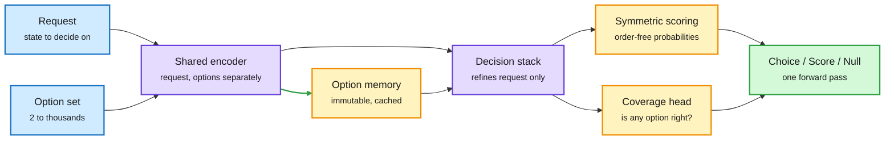

# Jeva and the System One cluster: the decision-model category gets its first-principles paper

**Date:** 2026-10-15 · **Sources:** HuggingFace Daily Papers (14 Oct, #1 at 272 upvotes), Kurate cs.AI weekly top-20 (#3) · **Cross-source confirmed (HF + Kurate)**
**Papers:** [Jeva (2610.18773)](https://arxiv.org/abs/2610.18773) · [Reading Right, Acting Wrong (2610.18579)](https://arxiv.org/abs/2610.18579) · [VideoJev (2610.18615)](https://arxiv.org/abs/2610.18615) · [JevGPT (2610.18272)](https://arxiv.org/abs/2610.18272)
**Raw:** `raw/huggingface/2026-10-14-jeva-system-one-models-from-first-principles.md`, `raw/huggingface/2026-10-14-reading-right-acting-wrong-*.md`, `raw/huggingface/2026-10-14-videojev-*.md`, `raw/huggingface/2026-10-14-jevgpt-*.md`, `raw/kurate/2026-10-15-cs-ai.md`

## TL;DR

A "System One" or decision model reads a request plus a fixed list of options and returns one calibrated probability per option in a single forward pass, never writing text. Since [Jev (09-16)](2026-09-16-jev-decision-only-model.md) the category has been built by vendors and logit-reading hacks. **Jeva** (Qi Li, Xinchao Wang) is the first paper that asks what the architecture *should* be, and names four requirements that serialized-text decision models violate: **null-aware** (tell "none of these" apart from "unsure between these"), **permutation-invariant** (reordering options must not change the answer), **option-scalable** (thousands of candidates without redefining the output), and **cacheable** (option representations reused across requests). Jeva encodes the request and each option separately with a shared encoder, refines only the request state against an immutable option memory, aggregates symmetrically, and adds a separate coverage head for explicit null outcomes. Reported: near-perfect null detection, zero decision flips under any tested permutation, scaling to thousands of candidates, and large latency cuts through cross-request reuse. The same HF day carried three companions: **VideoJev** (decision heads on video MLLMs, 2.8-3.1x faster with cached and joint inference), **JevGPT** (fast System One evidence judges under a slow System Two planner for research agents), and **Reading Right, Acting Wrong** (17 fast decision systems fail mostly *after* reading the state correctly).

Options are encoded once and reused; only the request is refined

The option memory is request-independent, which is what makes it cacheable and order-free.

Blue is input, purple is the model, amber is the reusable memory and the two output heads, green is the decision.

## Key points

- **The four requirements are a diagnosis of the clone wave.** The [10-07 decision-model audits](2026-10-07-openai-decisions-api-and-decision-model-audits.md) found option-order and label bias in production decision APIs; AnyJev's L0 mode ([10-11](2026-10-11-decision-model-category-decision1-anyjev-vega.md)) patched it after the fact. Jeva removes it by construction: options never sit in a sequence, so there is no order to be biased by.
- **Null is a first-class output.** Most decision models normalize probabilities over the given options, so "none fit" shows up as a flat distribution indistinguishable from "two fit equally." Jeva's coverage estimate separates the two. For a router this is the abstain signal: route to the frontier model when no cheap option covers the request.
- **Caching is the efficiency lever.** In routing, the option set (the model pool, the tool list, the skill library) changes rarely while requests change constantly. Jeva computes option representations and layer projections once and reuses them across requests and across newly assembled option sets. Cost then scales with the request, not the option count.
- **VideoJev** replaces autoregressive answer decoding on Qwen-family video MLLMs with a shared head that scores temporal intervals and text options. +6.7 and +10.8 mIoU on temporal grounding (4B and 35B-A3B), Thinking-mode-level video QA, 2.8-3.1x measured speedups from caching visual computation across follow-up queries.
- **Reading Right, Acting Wrong** pairs each next-action question with factual probes about the same agent state, across 17 fast systems and one reasoning model. Most wrong actions follow a correct reading of the state, and the better the system, the larger that share. Where the facts provably determine the action, composing the model's own probe answers in code repairs the failure. On real states, what is missing is often the next sub-goal, not a fact.
- **JevGPT** puts parallel System One judges under a System Two planner for fixed-corpus research QA: leading accuracy, faster completion, lower cost than comparable research agents.

## Relation to prior wiki pages

- **Extends** [Jev (09-16)](2026-09-16-jev-decision-only-model.md) and the [open clones (09-19)](2026-09-19-jev-open-clones-commoditization.md), which converged on "stop sampling, read the logits." Jeva argues logit-reading is the wrong end state: a serialized-text backbone cannot be permutation-invariant or cacheable over options.
- **Answers part of** the [10-13 price war](2026-10-13-decision-model-price-war.md) question of what differentiates decision models once input costs hit $0.04-0.05 per million tokens. Jeva's answer: structural guarantees (no flips, explicit null) and option caching, not price.
- **Contradicts nothing yet, but sharpens** [Gavel (09-16)](2026-09-16-gavel-native-skill-routing-frozen-llm.md), which reads routing signal from a frozen agent's hidden states for free. Gavel inherits the backbone's order sensitivity; Jeva does not. The head-to-head the routing page has asked for since 09-16 still does not exist.
- **Reading Right, Acting Wrong confirms** the 10-11 "harness ceiling" finding in [agent-harness-engineering](../agentic-systems/agent-harness-engineering.md): failures are integration failures, not perception failures. For routing it says a decision model's errors cluster on specific states shared across systems, which is exactly where an escalation gate should fire.
- **Caveat:** Jeva's numbers are the authors' own; no independent rerun yet. The brand overlap (Jeva, VideoJev, JevGPT, JevEval on the same day, plus promotional X posts pushing "JEV engineering") reads partly as an ecosystem push. Treat the four requirements as the durable contribution.

## Research angle

- Does option caching survive when the option set is itself dynamic (a router whose pool changes with price and load)? Jeva claims reuse across "newly assembled sets"; the latency curve versus churn rate is the number to ask for.
- Calibration under quantization: [Liquid's d1 card (10-13)](2026-10-13-decision-model-price-war.md) showed 4-bit moves decision probabilities by up to ~0.2. A coverage head is a second calibrated output that would need the same check.

Concept page: [LLM routing](llm-routing.md)
