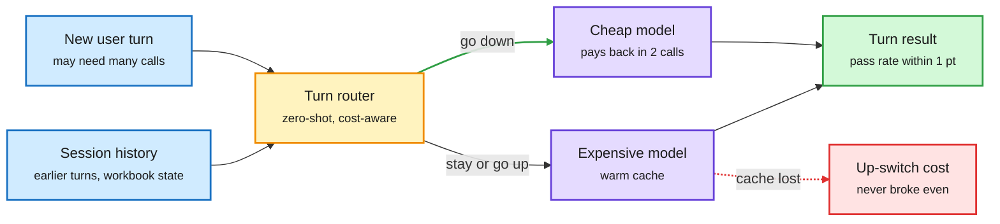

# Whose Turn Is It? and agentic auctions: routing becomes a sequential, market-priced decision

**Date:** 2026-10-16 · **Source:** X following feed (DAIR.AI picks, @dair_ai) · **Papers:** [Whose Turn Is It? (Microsoft), arXiv 2610.19292](https://arxiv.org/abs/2610.19292) · [Price of Anarchy of First-Price Auctions in Agentic Markets (Google DeepMind), arXiv 2610.20587](https://arxiv.org/abs/2610.20587)
**Raw:** `raw/twitter/feed/2026-10-16-morning-ranked.json` (enriched abstracts)

## TL;DR

**Whose Turn Is It?** studies zero-shot, cost-aware routing for stateful agents at the user-turn boundary. A turn can involve several model and tool calls, its difficulty depends on earlier turns, and switching models throws away the prompt cache. Tested on multi-turn SheetCopilot and SpreadsheetBench 2 with model pairs that differ in size, reasoning effort or provider:
- At a matched offloading rate, a router that **reads the session history passes 3.3 points more tasks** than one that sees only the current request, gains for every model pair, and stays **within one point of always using the expensive model**.
- **Cost depends on execution, not token price.** The cheap model's per-task advantage shrinks from **6.8x to 3.2x** on longer sessions (it takes more calls).
- A closed-form cache analysis: **switching down (expensive to cheap) recovers its cache cost within two calls; switching up never broke even** in their conditions.

**Agentic auctions (DeepMind)** models a decentralized market where agents bid for each prompt, bidding expected reward minus inference cost. First-price auctions are simple but not truthful, so a prompt can go to the wrong agent; the loss is the price of anarchy. Two market features shrink it: a **competitive floor** (many agents are near the best, e.g. because strong models are distilled into cheap ones) drives the loss toward zero, and **near-independence** (value mostly set by prompt difficulty) gives efficiency approaching **1 - 1/e² (~86%)** of optimal versus the general 1 - 1/e (~63%). Simulations on the EmbedLLM routing dataset match the theory.

The switch has a price, and only one direction pays it back

A history-aware router decides per turn; the cache cost makes down-switches cheap and up-switches costly.

Blue is input, amber is the routing decision, purple is a model, green is the result, red is the switching cost.

## Relation to prior wiki pages

- **Directly extends the 10-14 session-routing entry** on the [LLM routing page](llm-routing.md): Arena's Max router picks one model per *session* (+14.7% at $3.27/task) and Cohere's study routes by *role*. Whose Turn goes one level finer, per *turn*, and adds the missing piece: the cache-switch cost. This is the first paper in the wiki to put prompt-cache economics inside the routing objective.
- **Gemini 4 Argon (10-14) prices cached input 95% off.** At that discount, an up-switch that drops a warm cache is expensive; Whose Turn's asymmetry result is the theory for why.
- **Fewer Bits, More Tries (10-15)** found a small model with verified retries can replace routing up on code. Whose Turn's 6.8x to 3.2x shrinkage is the counterweight: a cheap model's extra calls eat its price advantage on long sessions.
- The auction paper gives the **economic justification for distillation markets**: the more teacher capability is distilled into cheap students, the higher the competitive floor and the more efficient a decentralized routing market gets.

## Gaps

Whose Turn: spreadsheet agents only; zero-shot routers, no trained router compared. The auction paper is theory plus simulation on EmbedLLM; no live market.

## Research angle

A turn-level router should carry a cache-state feature and an asymmetric switching penalty. Nobody has trained one with that objective. The obvious test bed is Arena's Max router data.
