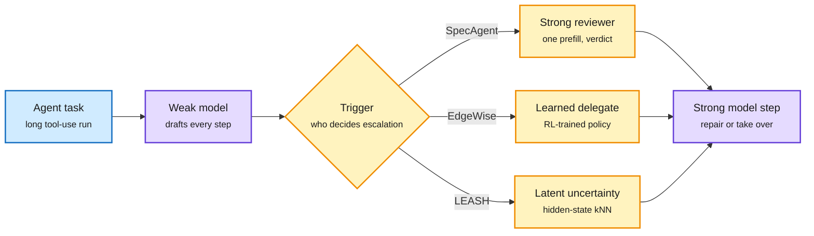

# Weak model drafts, strong model reviews: SpecAgent, EdgeWise, LEASH

**TL;DR.** Three papers on the same HF day (2026-10-16) make the cheap model the default worker in a long agent run and call the strong model only for some steps. They differ in *what triggers the strong model*. **SpecAgent** turns the strong model into a reviewer: the weak model drafts a run of grounded steps, the strong model verifies the whole segment in one prefill pass and repairs the first bad step. **EdgeWise** trains the small on-device model with step-level RL to decide for itself when to delegate to a cloud LLM. **LEASH** is training-free: it compares the weak agent's hidden states with stored states from past successes and failures, escalates when the state looks like a failure, then keeps watching the strong black-box agent with a shadow observer. LEASH is also on Kurate's cs.AI top-20 (#18), so it is cross-source confirmed (HF + Kurate).

Three triggers for the same escalation

The weak model always works by default. Only what calls in the strong model differs.

Blue is the task, purple is a model doing work, amber is the escalation decision.

## Key findings

**SpecAgent (arXiv [2610.21463](https://arxiv.org/abs/2610.21463)).**
- The weak model runs read-only tool calls while it drafts, so every drafted step is grounded in real observations. It stops at the first action that would change the environment.
- The strong model checks the drafted segment in a single prefill pass, commits the longest valid prefix, and rewrites the first rejected step. It decodes only short verdicts and repairs.
- On τ²-Bench it comes within one point of the strong model's success rate while roughly halving memory traffic and wall time. On AutomationBench and VitaBench it recovers 44-75% of the quality gap. In an edge-cloud setup on MCP-Atlas it closes 53-75% of the gap with the strong model generating at most half the tokens.

**EdgeWise (arXiv [2610.17560](https://arxiv.org/abs/2610.17560)).**
- Finding: calling the cloud LLM on a small subset of key steps matches full-LLM execution.
- Step-level RL jointly optimizes task solving and delegation, with credit assigned to each delegation decision. No extra router model at inference.
- Matches or beats pure-LLM execution while cutting inference cost up to 62% on SWE-Rebench and 34% on Terminal-Bench 2.1. Also studies when to delegate, what context to share, and how often.

**LEASH (arXiv [2610.22280](https://arxiv.org/abs/2610.22280)).** Cross-source confirmed (HF + Kurate cs.AI #18).
- Three layers: task-level uncertainty for early routing, step-level uncertainty for runtime escalation, and a shadow observer that keeps monitoring the strong black-box agent after handoff.
- Uncertainty = similarity of the current hidden state to hidden states from past failed vs successful trajectories. It reuses activations already produced, so no extra forward pass and no trained monitor.
- On OSWorld across four backbones, beats random escalation by 6.55-11.94 points at matched escalation rate. Qwen3.5-35B-A3B + LEASH: 73.66% at $0.41/task, matching always-on Claude Opus 5 (72.90%) at 19.2% lower cost.

## Relation to prior wiki pages

- **Extends the granularity ladder.** The [10-16 routing page](2026-10-16-whose-turn-routing-and-agent-auctions.md) completed request → session → role → turn. These three go one finer: the *step inside a turn*, and SpecAgent even batches steps into verified segments.
- **Fills the 10-15 gap on where to fire.** Reading Right, Acting Wrong (10-15) found most wrong next actions follow a correct reading of the state and cluster on the same states. LEASH's failure-memory kNN is a direct way to detect those states; it does not cite that result.
- **Speculative decoding at the trajectory level.** SpecAgent is the speculative-decoding pattern ([speculative-decoding](../inference-efficiency/speculative-decoding.md): cheap draft, parallel verify) lifted from tokens to tool-calling steps. Verification by prefill instead of decode is the same cost trick.
- **Confirms the asymmetric-switch result.** Whose Turn (10-16) showed switching up mid-session loses the prompt cache. SpecAgent sidesteps this: the strong model reads the drafted segment once as prefill, so it pays a prefill but not a full re-decode.
- **Tension.** [Fewer Bits, More Tries (10-15)](../inference-efficiency/2026-10-15-fewer-bits-more-tries-verified-retry.md) argued retrying a small model can replace escalation on verifiable tasks. These papers assume the strong model is needed for some steps. Both may hold: retry for verifiable steps, escalate for unverifiable judgment steps.

## Gaps

- No head-to-head among the three triggers on one benchmark.
- LEASH's failure memory needs labeled past trajectories in the same environment; transfer to a new task family is untested.
- SpecAgent stops drafting at the first write action, so write-heavy tasks get less benefit.

Concept page: [llm-routing](llm-routing.md).
