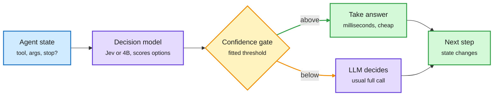

# JevAgentHarness: a decision model takes the routine forks of an agent run

**TL;DR.** UIUC (Kunlun Zhu, Tao Feng, Jiaxuan You, Heng Ji and colleagues) ask how an agent harness can hand its routine multiple-choice decisions (which tool next, which argument, stop or continue) to a fast decision model such as Jev instead of calling the big LLM every step. Three pieces. **AgentDecisionBench** tests decision models at three levels: isolated questions, recorded agent states, and live control of a running agent. **JevAgentHarness** sends each choice to the decision model and uses its answer only if confidence clears a threshold *fitted on the agent's own trajectories*; otherwise the LLM decides. **AgentDecision-4B** is an open 4B decision model trained with SFT then GRPO inside the agent loop, on states the agent reaches after its own mistakes, with Jev's answers as labels. Surfaced via DAIR.AI's curated X feed (DAIR Academy pick, 10-17).

The big model only sees the forks the small one is unsure about

The threshold is fitted per decision point on the agent's own runs. A fixed 0.5 cutoff loses 21.5 points.

Blue is the agent state, purple is a model, amber is the gate, green is the cheap path and the next step.

## Key findings

- **Isolated accuracy misranks decision models.** Across nine decision models, isolated-question accuracy spans 5.1 points but task success spans 57.5 points. StartLux-9B was most accurate on BFCL tool choice (92.2%) yet solved only 69.5% of agent tasks.
- **The fitted threshold is the whole trick.** With Gemini 3.5 Flash as the agent, Jev made 27.2% of tool choices and 20.8% of argument choices, cutting cost 14.2% **without changing the outcome of any of 500 tasks**. Letting Jev make every tool choice lost 19.0 points; a fixed 0.5 threshold lost 21.5. Of 40 point-mode combinations, only the tool and argument cascades plus a reflection trigger passed.
- **Training on the agent's own mistake states beats the teacher.** AgentDecision-4B solved 91.5% of shifted tasks vs 82.0% with Jev, and answered 67.4% of must-ask states correctly vs 58.3%.
- **Per-agent 4B models cut cost 81-89%.** On customer-service and household tasks, 4B models trained on each agent's states made agents 81.1-89.0% cheaper and up to 2.5x faster, within 3 points of success.
- **Transfer is not shown.** Refitted on tau-bench, the cheapest passing delegation lost 8.1 points.

## How it relates to prior wiki pages

- **Extends the step-level routing ladder.** [SpecAgent, EdgeWise, LEASH (10-17)](2026-10-17-weak-drafts-strong-review-specagent-edgewise-leash.md) routed agent *steps* between a weak and a strong LLM. JevAgentHarness goes one level finer: it routes individual *decisions inside a step* to a non-generative scorer. Request → session → role → turn → step → decision.
- **Answers the calibration question the [llm-routing](llm-routing.md) page has carried since 10-13.** The decision-model price war (10-13) put gates at ~$0.04/M input but no one reported whether their confidence was usable. This paper shows raw confidence is not usable (fixed 0.5 loses 21.5 points) and a per-decision-point fitted threshold is.
- **Confirms [Reading Right, Acting Wrong (10-15)](2026-10-15-jeva-system-one-models-first-principles.md)**, which found fast decision systems' errors cluster on the same states. Training on post-mistake states is the direct fix.
- **Same move as [Hy-Memory-30B-A3B (10-17)](../agentic-systems/agent-memory.md)**: a small model trained on the deployed harness's own states replaces a frontier model for one narrow job.
- Feeds [agent-harness-engineering](../agentic-systems/agent-harness-engineering.md): the harness, not the model, decides where cheap compute is safe.

## Gaps

Authors' numbers only; one agent backbone for the 500-task zero-change result; thresholds must be refit per agent and per decision point, and tau-bench refit lost 8.1 points.

Source: [arXiv 2610.21412](https://arxiv.org/abs/2610.21412) · [DAIR Academy page](https://academy.dair.ai/papers/jevagentharness-benchmarking-deploying-and-training-decision-models-that-share-c-2610.21412) · [@dair_ai post](https://x.com/dair_ai/status/2111496216567742892)
