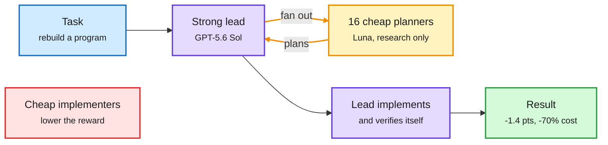

# Where agent compute should go: Cohere's coding teams and a token audit of security agents

**TL;DR.** Two papers ask the same question from two angles: where does an agent's inference spend actually pay off? **Cohere's "Scaling Inference-Time Compute with Teams of Coding Agents"** treats team design as a compute-allocation problem. A lead agent hands subtasks to workers, and the authors vary one thing at a time: the stage workers help with (planning, implementing or verifying), the worker model, and the worker count. On ProgramBench (rebuild a whole program from its executable and docs), teams beat a solo agent but cost 3 to 7 times as much. The efficient design is a strong lead with cheap planners: a GPT-5.6 Sol lead with 16 cheap Luna planners comes within 1.4 points of an all-Sol 5-agent team at 70% lower cost. **"Where Do the Tokens Go?"** measures 200 runs of four security agents hunting bugs and finds 60.4% of tokens go to understanding code and reasoning about how to trigger the bug. Generic cost tricks kept success at lower cost in only 24.4% of comparisons. A targeted tool, AVRI, which returns related code together and remembers the path from program input to the unsafe operation, cut cost 18.0% for Codex and 23.7% for OpenCode with no loss in success.

Cheap models plan, the strong model builds

Workers help most at the planning stage, and that is the only stage where a cheap model does not hurt.

Blue is the task, purple is the strong model, amber is the cheap planning fan-out, green is the result, red is the design that fails.

## Key findings

- **Planning is the most valuable job for workers.** A lead that delegates only planning matches a lead that delegates every stage, at half the cost.
- **Cheap models pay off only as planners.** A strong lead with cheap planners recovers 47.5% of the all-strong team's reward gain for 13.9% of its extra cost. Cheap implementers lower reward.
- **Planners keep scaling; implementers and verifiers plateau** beyond four workers.
- **Security agents spend 60.4% of tokens on comprehension and trigger reasoning.** Only 24.4% of generic cost-saving comparisons preserved success. AVRI's targeted reuse saved 18.0-23.7%.

## Relation to prior wiki pages

- **Third rung in a week of routing inside the agent.** SpecAgent, EdgeWise and LEASH (10-17) had a weak model draft whole steps and a strong one review. JevAgentHarness (10-18) handed single tool choices to a 4B model behind a fitted confidence threshold. Cohere routes by **role**: the cheap model is safe for research and planning, not for writing the code. See [llm-routing](llm-routing.md).
- **Echoes** the 10-05 [kv-cache](../inference-efficiency/kv-cache.md) entry "fewer tokens is not a cheaper agent": AVRI shows generic token cuts rarely help, and the saving comes from removing repeated comprehension.
- **Counterweight:** Anthropic's Project Deal (circulated this window) found Haiku agents lost money against Opus agents in negotiations without users noticing. Cheap-model roles are safe when an outcome is checked by a stronger model, as in Cohere's lead, and risky when no one checks.

## Gaps

One benchmark (ProgramBench) and one model pair. No wall-clock numbers for the 17-agent team. AVRI is tested on 20 new tasks only.
