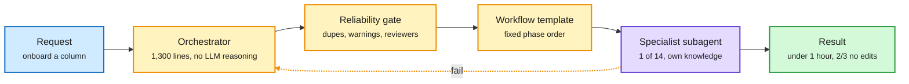

# Meta's Thin Orchestrator: a router that does no domain work

**Source:** Meta Engineering, 2026-10-19 ([post](https://engineering.fb.com/2026/10/19/ml-applications/thin-orchestrator-ai-agent-architecture/)). Raw: [`raw/labs/2026-10-20-100728-labs.md`](../../raw/labs/2026-10-20-100728-labs.md)

## TL;DR

Meta automated data-column onboarding across its recommendation pipelines (three repos, three languages, up to six stages). One all-knowing agent worked in demos and hallucinated in production: past a context threshold, more domain knowledge made it worse, mixing naming conventions and code patterns across subsystems. A single-agent alternative hit 70-80% only with a hand-written prompt per task and 10-20% without. The fix was a **1,300-line deterministic orchestrator** that routes 20+ workflows to **14 specialist subagents** and does zero domain reasoning. It classifies intent, gathers fields, checks for duplicates, runs reliability gates and delegates. Only the delegate step uses an LLM, inside an isolated subagent that loads only its own knowledge files (a few thousand tokens each). Column prep went from 3-4 days by hand to **under an hour**; about **two-thirds of changes land without significant human edits**. New use cases are new workflow templates (state machines over existing agents), not new agents.

The router is the dumbest box, on purpose

Six of seven steps are deterministic; the LLM only runs inside an isolated specialist.

Amber is deterministic control, purple is the only LLM reasoning, green is the outcome.

## Key findings

- **"Which subagent handles this?" is a routing decision, not a reasoning task.** Do it with keyword matching and intent classification, not an LLM.
- **Context isolation is the reliability mechanism.** The population agent for source A never sees source B's patterns.
- **Workflow templates scale capability:** pipeline migration shipped with zero new agent code, just a new ordering of the same 14 agents.
- **Knowledge loads at runtime** from 25+ files, so an update takes effect next session without redeploying the orchestrator.
- Meta cites a Mount Sinai preprint: orchestrated multi-agent systems held 65.3% accuracy on 80-task batches where single agents fell to 16.6%, with up to 65x fewer tokens.

## How this relates to prior wiki pages

- **Fourth routing-inside-the-agent design in four days**, and the first from a production system with operating numbers. SpecAgent/EdgeWise/LEASH (10-17) had a weak model draft and a strong model review; JevAgentHarness (10-18) sent routine forks to a 4B decision model behind a fitted threshold; Cohere (10-19) found cheap models are safe only as planners. Meta removes the model from the routing decision entirely. See [llm-routing](llm-routing.md).
- **Confirms the context-interference finding** behind Memorilla (10-19) and today's CarryOn and Skip-the-Compressor: more context is not free, and the cheapest fix is deciding what each worker sees. See [agent-harness-engineering](../agentic-systems/agent-harness-engineering.md).
- **Tension with "harness is dead" chatter on X:** the most reliable production agent here is almost all harness.

## Gaps

- No ablation of orchestrator vs single agent on the same task set with numbers beyond the anecdotal 10-20% / 70-80%.
- Narrow domain (config-as-code onboarding). Whether deterministic intent classification survives open-ended user requests is untested.
