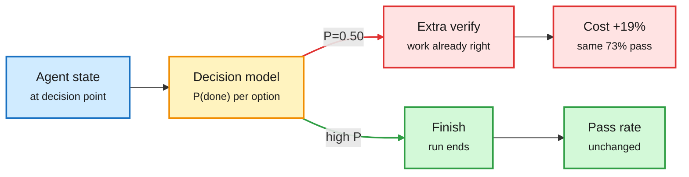

# Decision models under audit: Good Judgment Bad Advice, DecisionPivot, System One reranking

**Sources:** HuggingFace daily papers 2026-10-21: [Good Judgment, Bad Advice: Decision-Model Controllers Raise Agent Cost Without Improving Success, 2610.24649](https://arxiv.org/abs/2610.24649); [DecisionPivot: A Diagnostic Benchmark for Decision Models in LLM Systems, 2610.28522](https://arxiv.org/abs/2610.28522); [Multimodal Reranking Is a System One Decision, 2610.28435](https://arxiv.org/abs/2610.28435). Counterpoint via the X feed: [JEV-as-a-Judge, 2609.26550](https://arxiv.org/abs/2609.26550). Related Kurate cs.AI #8 this week: [A general-purpose System One decision model for clinical records, 2610.27099](https://arxiv.org/abs/2610.27099). Raw: `raw/huggingface/2026-10-21-*` matching slugs.

## TL;DR

Decision models (small models that map a state plus a typed question to one probability per option, without generating text, e.g. Jev) are being sold as the cheap layer that routes, stops and verifies inside agent loops. Three papers test that claim.

- **Good Judgment, Bad Advice** (pre-registered, Terminal-Bench 2.1, Claude Sonnet 5.5 agent): five controller arms, the loop held fixed. On 21 held-out tasks (315 trials), the Jev 1.13 controller **raised cost per attempt 19%** (ratio 1.19, 95% CI 1.02-1.36) at an **identical 73.0% pass rate**. It was cheaper than a Haiku 5.5 controller (0.81x) but 22% more expensive than a placebo that samples Jev's own choice frequencies. Offline Jev ranked finish requests well (AUROC 0.78 vs 0.62 rules, 0.60 Haiku) but was badly calibrated: mean P(complete) 0.50 when 87% of those runs passed, so it kept asking for verification of correct work. No controller ever abandoned a run.
- **DecisionPivot**: 48 tasks, 40,033 items, 7 decision roles, 40 decision models and 14 general models. Two 27B models 2.6 points apart on aggregate score differ by **70.1% vs 44.2% contrast-group accuracy**. Perplexity Decider ranks the positive above the negative in 92.3% of pairs yet gets both right only 74.1% of the time. GLM-5.3: 93.5% at high reasoning vs 81.5% at lowest effort.
- **System One reranking**: ask a general VLM one multiple-choice question over the top 16 candidates and rank by label probabilities from one forward pass. Zero-shot Qwen3.8-27B beats the supervised Qwen3-VL-Reranker-2B on all three benchmarks and ties Reranker-8B on MMEB-V2 visual documents (84.79 vs 84.78 nDCG@5) at 1.1-1.5x its latency. One choice question beats a yes/no per candidate by 5.4-7.3 hit@1.

- **Counterpoint, JEV-as-a-Judge** (via X, widely shared): as an eval judge, Jev lands within 3 points of GPT-6 where the verdict can be read off the text, at **0.36% of the fee and 0.15 s median latency**; it falls behind where the verdict must be derived (math, code, logic), and its confidence marks that boundary. With a threshold **frozen in advance**, accept-confident/escalate-rest is 0.9 points more accurate than GPT-6 at 41% of its fee on 1,610 held-out pairs. Same model family, opposite verdict to Good Judgment, and the difference is again a fitted threshold.

Ranking well is not the same as advising well

Jev's signal was informative offline; miscalibration turned it into extra verification turns.

Amber is the decision model, red is the miscalibrated path that costs money, green is the intended exit.

## How this relates to prior wiki pages

- **Direct contradiction of [JevAgentHarness (10-18)](2026-10-18-jevagentharness-decision-model-delegation.md)**, which reported 14.2% cheaper with zero outcome changes on 500 tasks by fitting a confidence threshold per decision point. Good Judgment uses Jev's raw probabilities at fixed decision points with no per-point threshold fitting. The likely reconciliation is calibration: JevAgentHarness fitted thresholds, which absorbs miscalibration; this paper did not. JEV-as-a-Judge (fitted, frozen threshold, wins) sits on the same side as JevAgentHarness. Both may be right, and the lesson is that a decision model is only cheap after calibration.
- **Confirms the [09-23 ECE numbers page](2026-09-23-decision-model-ece-numbers-arrive.md) and the 10-07 decision-model audits**, which flagged calibration as the weak spot.
- **Fits the 10-20 [llm-routing](llm-routing.md) ladder** (weak-draft/strong-review 10-17, per-decision thresholds 10-18, role routing 10-19, Meta's deterministic Thin Orchestrator 10-20): routing decisions should be cheap and fitted or fixed. Today adds the negative case: unfitted learned routing can cost more than none.

## Gaps

- 21 held-out tasks is small; CIs on cost barely exclude 1.0.
- Good Judgment did not test a recalibrated Jev, which is the obvious fix.
- DecisionPivot's contrast groups are generated; transfer to production routing traffic is untested.

## Research angle

The useful experiment is the 2x2: raw vs fitted thresholds, crossed with Jev vs small LLM. If fitted thresholds close the gap for both, the value is in the fitting, not the decision model.
