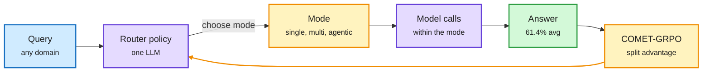

# Routing: modes, tools, and the reading tax

## RouteWeaver (2610.19705, HF 10-23)

LLM routers usually assume one execution paradigm: single-round (pick a model once), multi-round (call models in sequence), or agentic (a router that plans calls). RouteWeaver puts all three modes inside one LLM routing policy that learns *which mode* to use and *which models* to call within it. Training uses **COMET-GRPO**, which splits the trajectory-level advantage into a mode-selection signal and a within-mode execution signal, so each decision gets its own credit. **Progressive exploration** first assigns modes externally, then hands mode choice to the policy. Result: 61.4% average accuracy across math, code, knowledge, logic and factual recall, an 11.03% relative gain over the strongest baseline and best in all five domains. Without progressive exploration the policy collapses to single-round routing every time.

The router first learns each mode, then learns when to use it

Credit is split between the mode decision and the calls inside it.

Blue is the query, purple are the router and the models it calls, amber are decisions and the training loop, green is the result.

**Gap:** no cost or latency numbers in the abstract. A router that picks "agentic" more often may win accuracy by spending more calls, so the accuracy-per-dollar frontier is the number to ask for.

## Small models for tool selection (Meta + CMU, 2610.31483; DAIR pick via X)

With more than 10,000 tools, descriptions do not fit in context and a retriever only ranks by relevance. Many systems hand the choice to Claude or GPT. This paper trains Qwen3 models on a Plan, Retrieve, Select loop: split the instruction into substeps, retrieve candidates per substep, commit one tool each. SFT on ~20K curated ToolBench instructions, then RL with a reward for gold-tool coverage and rank. Qwen3-8B goes from 36.2% (SFT) to 41.5% (RL) on ToolBench G3, above prompted Llama-4-Maverick (402B). The selector transfers to new retrievers and new tool domains.

## Production: route the reading to small models

- **Shopify** (secondhand thread): their agent reads ~40 tokens for every one it writes. They split work: the frontier model talks to the user and plans; reading-heavy subtasks go to small task-trained open models, and only results return to the planner. Reported 7x faster and ~90% fewer tokens. An LLM judge tuned from 37.7 to 74.5 agreement with experts (frontier model: 73) scores changes, and nightly reruns of failed conversations repair 69% of failures and become training data ([thread](https://x.com/undefinedKi/status/2113689331412156666)).
- **Mubit** launched a one-line base-URL swap that mines your OpenAI/Anthropic traffic for repeated tasks and trains small owned models for them; everything else still goes to the frontier model ([@rohanpaul_ai](https://x.com/rohanpaul_ai/status/2113698187471143299)).
- **Gemini Smart Routing** (Google Cloud): per-subtask routing to the cheapest capable model plus hard real-time spend caps ([video](https://www.youtube.com/watch?v=BQgm_qLll3A)).
- **IF-MAP** (2610.24383, HF): which agent in a multi-agent system to upgrade first. It perturbs each agent's prompt, fits a local response model, and ranks by sensitivity. Upgrading the chosen agents gives 7.62-16.42 point gains vs 3.81-8.62 for uniform choice, with 74.2% fewer tokens than optimizing every agent on Qwen3-8B. Routing the *improvement budget*, not the query.

## Relation to prior wiki

- **Pattern now firmly established (≥3 sources this week):** cheap decision models doing the expensive model's chores. Ken Huang's Jev clicker for a 40B coding model (10-23/24), NeMo Switchyard on DGX Sparks (10-23), Claude Code's Opus-plans-Haiku-reads setting (10-23), and today Shopify, Mubit and the Meta tool selector. The industry version of routing is by *subtask*, not by query.
- **RouteWeaver extends** the 10-18 "routing reaches the single decision" thread: routing the execution mode is one level above routing the model.
- **Tension:** the 10-23 TDS note that mid-session model switches discard prefix cache applies directly to subtask routing. Shopify's split keeps the planner's context intact by only returning results, which is the cache-friendly version.

→ Concept page: [llm-routing](llm-routing.md)
