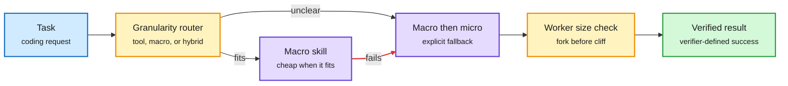

# Routing inside the coding agent: skill granularity and the context-price cliff

**Sources:** arXiv [2610.31461](https://arxiv.org/abs/2610.31461) Adaptive Skill Granularity (Zhang, Jiang, Wang, Zhou; SJTU, Warwick, Kuaishou), Kurate cs.AI weekly #20 and a DAIR.AI Academy pick ([DAIR page](https://academy.dair.ai/papers/adaptive-skill-granularity-for-coding-agents-runtime-routing-and-macro-to-micro-2610.31461), surfaced via [@dair_ai](https://x.com/dair_ai/status/2114050546189709424)); practitioner thread on Claude Code subagent sizing ([@Sprytixl](https://x.com/Sprytixl/status/2114094189977723325)) · raw: `raw/kurate/2026-10-25-cs-ai.md`, `raw/twitter/feed/2026-10-25-morning-ranked.json`
**Topic:** routing, agent harness, cost control

## TL;DR

Two routing decisions inside one coding agent. **Adaptive Skill Granularity** treats "how big a step to take" as a runtime policy: primitive tool calls, a macro skill, or a macro that falls back to primitive steps when it fails. A feature-based controller picks the level from task structure, execution state and earlier macro failures; a finite-state executor makes the fallback an explicit transition rather than an ad hoc retry. In a 12-task routing study a learned router reaches 100% success where a hand-written heuristic fails, and macro-to-micro fallback recovers controlled macro failures that fixed granularity leaves unresolved. **The context cliff thread** claims a cheap model's price jumps 5x past a context threshold, so an orchestrator should fork workers before they cross it; the poster reports one job at $6.15 as a single agent versus $0.85 split across nine. The linked Claude Code model-config page does not show that tier, so treat the numbers as the poster's.

Two routers, one agent loop

One picks the step size; the other keeps each worker under a price threshold.

Blue is input, amber are routing decisions, purple is execution, green is the result; the red arrow is the failure path.

## Key points

- Fixed macro execution is efficient when the skill fits and brittle under mismatch: the classic routing trade-off, now at the skill level.
- Evaluation is deterministic with verifier-defined success, total cost, macro adoption, recovery, route match and transition correctness.
- The study is small (12 tasks, controlled failures). Kurate's AI rating is low (3.5/10); the DAIR pick is the stronger quality signal.
- The context-cliff pattern generalizes the 10-23 "Opus plans, Haiku reads" note on the [routing page](llm-routing.md): add a size constraint per worker and route by projected context, not only by task difficulty.

## Relation to prior wiki pages

- **Extends** RouteWeaver (10-24, one policy picks the execution mode) down one level: the mode router picks single-round vs agentic; this router picks tool vs macro inside the agentic mode. Routing-by-subtask is now n≥7.
- **Connects** to Anthropic's "fold subagents into the main loop" guidance (10-24, [summary](../agentic-systems/2026-10-24-naive-rag-harness-cost-fold-subagents.md)): skills are the unit that replaces subagents, and this paper is the first to treat skill execution as a recoverable policy.
- **Open:** neither the router reward nor the cliff heuristic prices prefix-cache loss when a worker forks, the gap flagged on 10-23/24.
