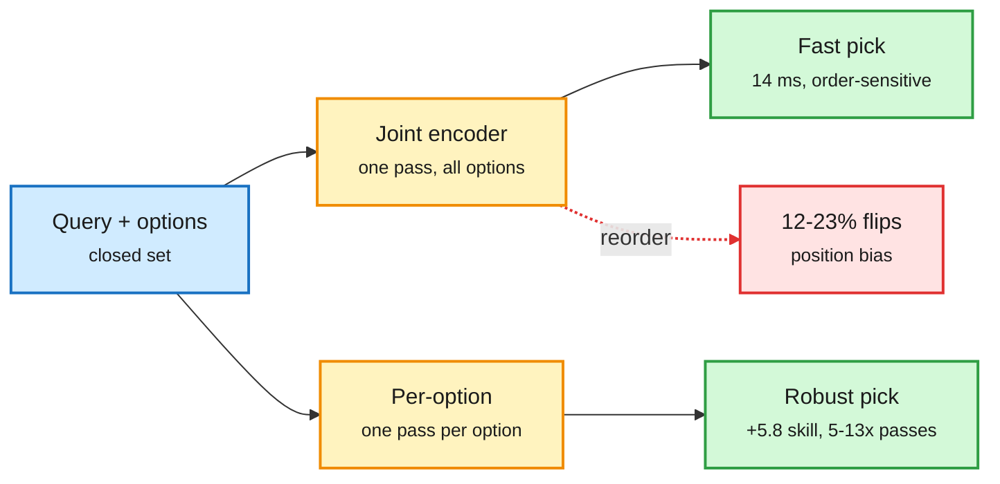

# Small decision models as routers: per-option encoders, rerankers, Jev

**TL;DR.** Four items on the "closed-set decision" layer that routers, tool pickers and rerankers share. **Joint or Per-Option? (2610.30970)** asks how small an encoder for tool-selection-style decisions can be. Per-option scoring (read each option with the query, like a reranker) beats joint scoring (read all options at once) by 5.8 points of chance-corrected skill at 32M parameters, but only with reranker initialization, and needs 5-13x more encoder passes. Its released joint encoders at 68M and 150M beat a 435M DeBERTa-v3 zero-shot classifier by 4.9-5.9 points on 209 System1-Arena tasks; the smallest answers in 14 ms on 16 CPU threads versus 728 ms. Reordering options flips 12-23% of joint answers, none of per-option. **Decision models vs rerankers (2610.32318)**: across six Qwen backbones (0.6B-27B) and ten TREC DL / BEIR collections, a plain reranker fine-tune beats a "decision" fine-tune by 5-29 nDCG@10 up to 9B; they tie at 27B. "If you need a reranker, fine-tune a reranker." **Jev-as-a-Judge (2610.20634)**: a label-only verifier lands within 0.6 points of GPT-6 Astra on 495 RAG claims at 187x lower cost, but approves 23.2% of unsupported claims versus 14.1%, and its confidence-gated cascade saved about as much as routing at random. **Production:** Jev Router puts 10,000+ tools behind one MCP server (vendor claims 28x more tasks per dollar than Claude), and Google's A2UI uses Jev for layout decisions (up to 80x lower latency than generating JSON).

Per-option reading is order-proof but costs passes

The router's architecture choice is a latency-vs-robustness trade.

Blue is input, amber are the two router designs, green is the pick, red is the order bias.

## Relation to prior wiki pages
- [LLM routing](llm-routing.md): extends the 10-24 small-tool-selector result (an RL-trained 8B beat a prompted 402B on ToolBench) down to 68M-150M encoders on CPU.
- Jev-as-a-Judge's "confidence gate ties a coin flip" is a direct warning for cascade routers that gate on self-reported confidence.
- Decision models (System One, first released September 2026) are now being tested as general routers/rerankers; today's two papers say: specialize the head for the task.

Raw: [Joint or Per-Option](../../raw/huggingface/2026-10-27-joint-or-per-option-compact-encoders-for-closed-set-decision.md) · [arXiv 2610.30970](https://arxiv.org/abs/2610.30970) · [arXiv 2610.32318](https://arxiv.org/abs/2610.32318) · [arXiv 2610.20634](https://arxiv.org/abs/2610.20634) · [A2UI](https://developers.googleblog.com/fast-reliable-a2ui/)
