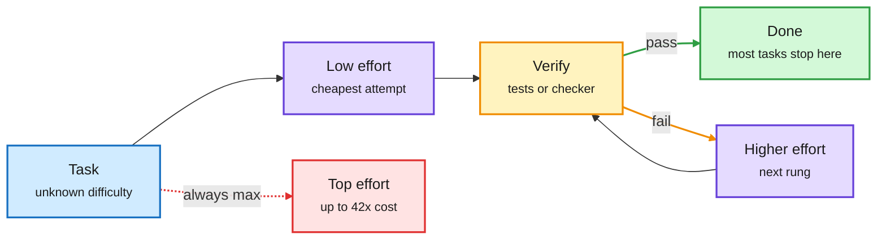

# Reasoning effort is a credence good; escalate, don't max out (plus GitHub Copilot Fusion)

**Sources:** [arXiv 2610.34491](https://arxiv.org/abs/2610.34491) (HuggingFace 2026-10-28) · [@rohanpaul_ai on Copilot Fusion](https://x.com/rohanpaul_ai/status/2115612239193686050) · [AI Breakfast on GPT-6.1 Terra](https://openai.com/index/introducing-gpt-6-1-terra/). raw: `raw/huggingface/2026-10-28-what-effort-level-should-i-choose-on-the-economics-of-reason.md`, `raw/gmail/2026-10-29-newsletters.md`.

**TL;DR.** Models now expose a "reasoning effort" dial. The paper calls effort a credence good: you see the outcome but never learn whether the extra compute was needed. Measuring counterfactuals on proprietary and open models across four benchmarks (single-call and agentic), it finds (1) higher effort raises aggregate accuracy but often *fails tasks that lower effort solved*, (2) on easy tasks every level solves, top effort costs up to 42x the lowest, and (3) higher effort changes behaviour: agents self-verify more and search more instead of working the problem, lengthening trajectories without changing outcomes. The fix is a router over effort levels: start at the lowest effort and escalate only after a *verified* failure. It matches or beats fixed top effort on every model and benchmark, at lower cost for most proprietary models. The same day, GitHub shipped **Copilot Fusion**, which routes coding work between Claude and GPT models: 60 vs 62 for Claude Code on Artificial Analysis's Coding Agent Index, at $5.59 vs $11.42 per task and about half the tokens (7.2M per task).

Climb the effort ladder only when a check fails

The verifier is what makes cheap-first routing safe.

Blue is input, purple are effort rungs, amber is the check and the escalation loop, green is the exit, red is the fixed-max baseline.

## Relation to prior wiki
- **Confirms** the [test-time compute allocation](../inference-efficiency/test-time-compute-allocation.md) thread: CLEAR (batch-level shadow pricing of compute) and this paper agree that uniform max compute is wasteful; this one shows it is also *not monotone* per instance.
- **Pairs with** the 10-28 harness-verification paper (an independent critic beat gates on accuracy per dollar). Escalate-on-verified-failure is the same idea applied to effort instead of models.
- **Production**: Copilot Fusion is the first big-vendor coding agent that routes across labs and publishes cost per task. GPT-6.1 Terra (mid-tier, $1/$5 per million tokens, matching GPT-6 Astra on Agents' Last Exam at ~1/10 the price) makes the cheap rung much stronger. See [LLM routing](llm-routing.md).

## Open questions
Escalation needs a verifier. The 10-28 Jev-as-a-Judge result (cheap verifiers approve 23% of unsupported claims) is the risk: a lenient check stops the ladder too early.
