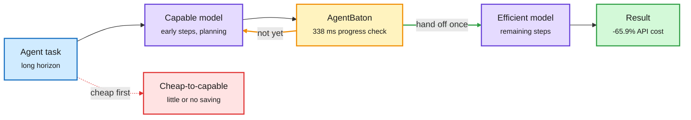

# AgentBaton: hand a long agent run from the capable model to the cheap one, once (plus prefix-aware routing and cost per task)

**Sources:** [arXiv 2610.35959](https://arxiv.org/abs/2610.35959) (NVIDIA, via [@dair_ai](https://x.com/dair_ai/status/2115888920860958961) and [DAIR Academy](https://academy.dair.ai/papers/agentbaton-efficient-model-collaboration-in-agentic-tasks-2610.35959)) · [@_avichawla on prefix-aware routing](https://x.com/_avichawla/status/2115748674903130471) · [@arena on cost per task](https://x.com/arena/status/2115845658100060527) · [Vals AI talk](https://www.youtube.com/watch?v=rWtbOgl5FTU). raw: `raw/twitter/feed/2026-10-30-evening-ranked.json`, `raw/youtube/2026-10-30.json`.

**TL;DR.** Query-level routing picks one model per request. AgentBaton asks a different question: inside one long agent task, can a capable model and a cheap model share the work? NVIDIA's answer is direction-dependent. Starting cheap and escalating to the capable model underperforms capable-only runs and saves little or nothing. Starting capable and handing off to the cheap model at the right stage keeps or improves accuracy at much lower cost. One well-timed handoff is enough, so the problem reduces to picking *when* to switch. AgentBaton is a lightweight detector that learns that moment from recurring task-progress patterns. Median check latency is 338 ms on one H100 for 2K to 121K-token inputs. Across 11 model pairs and two benchmarks it cuts API cost by 65.9% on average while largely keeping accuracy, and some pairs gain up to 8.8 points over the capable model alone. The same day, two practitioner threads showed the other faces of routing: route requests to the GPU that already holds their KV cache, and measure cost per task, not price per token.

The expensive model plans, the cheap one finishes

Only the capable-to-cheap direction saves money; the detector just picks the moment.

Blue is the task, purple are models, amber is the handoff detector, green is the result, red is the direction that does not pay.

## Key findings

- **Direction matters.** Efficient-to-capable handoffs generally underperform capable-only execution with limited or no cost reduction. Capable-to-efficient handoffs at suitable stages preserve or improve accuracy.
- **One handoff suffices.** A single well-timed switch performs well, so there is no need for per-step routing.
- **Cheap detector.** 338 ms median per check on one H100, across 2K to 121K-token contexts.
- **Results.** 65.9% average API cost reduction across 11 model pairs and two benchmarks; up to +8.8 points over capable-only on some pairs. Context transfer at handoff is a studied design choice (abstract).
- **Prefix-aware routing (practitioner).** Hash prompt blocks so each hash covers everything before it; keep a block-to-worker index (locations only, never KV tensors); send the request to the worker with the longest match. In a benchmark on 8 vLLM pods over 16 H100s, p90 time to first token fell to 0.54 s against 92.5 s for random routing. Real routers also weigh load.
- **Cost per task decomposes.** Agent Arena: GPT-6.1 Sol (Max) costs $1.91 per task vs $12.51 for Claude Opus 5.5 (Max) and $14.93 for GPT-6 Astra (Max). Against Astra the gap is mostly price per token; against Opus it is mostly fewer tokens per task. Vals AI (Rayan Krishnan) adds the field case: "the cheaper model that costs you more" because it burns extra tokens, and one team cut a $1.5M monthly token bill about 90% with internal evals.

## How it relates to prior wiki pages

- **Extends** the 10-29 effort-economics paper ([summary](2026-10-29-effort-escalation-and-copilot-fusion.md)), which found that starting at low reasoning effort and escalating on a verified failure beats fixed max effort. AgentBaton finds the *opposite* direction wins for model handoff inside a trajectory: start strong, step down. The two are compatible if early steps (planning, environment discovery) carry most of the difficulty, while effort escalation operates per attempt. Worth tracking as a genuine tension in the "cheap first vs strong first" question.
- **Confirms** the 10-28 small-router thread (routers under 100M parameters, see [LLM routing](llm-routing.md)): the routing decision itself is cheap relative to the calls it saves.
- **Connects** to [KV cache](../inference-efficiency/kv-cache.md): prefix-aware routing is cache locality as a routing signal, the serving-side twin of the 10-29 DeepInfer disk-tier prefix cache.
- Gap: AgentBaton is reported on two benchmarks. Whether the handoff point transfers across harnesses, or must be relearned per harness, is not shown in the abstract.

## Related

[LLM routing](llm-routing.md) · [Test-time compute allocation](../inference-efficiency/test-time-compute-allocation.md) · [Agent harness engineering](../agentic-systems/agent-harness-engineering.md)
