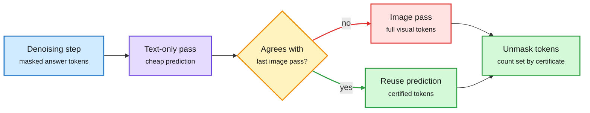

# LOWN: look at the image only when needed (2026-10-31)

**Source:** HuggingFace Daily Papers, 2026-10-30 (94 upvotes) · [arXiv 2610.36671](https://arxiv.org/abs/2610.36671) · [project](https://hyeon9698.github.io/LOWN/) · raw: `raw/huggingface/2026-10-30-look-only-when-needed-certificate-guided-visual-routing-for.md`

## TL;DR

Diffusion vision-language models (DVLMs, which unmask an answer over many denoising steps instead of writing it left to right) reprocess their whole input at every step. Visual tokens are 89-97% of that input, so most compute re-reads the same image. Measuring LLaDA-V with and without the image at every step, removing the image changes a newly unmasked token on only 22.8% of steps on average (7.9% on some benchmarks). LOWN decodes each step text-only first, and processes the image only when that text-only prediction disagrees with the last image-conditioned prediction. Agreement acts as a certificate that the earlier prediction can be reused, and the number of certified tokens sets how many get unmasked that step. Training-free and threshold-free: 99.6% of LLaDA-V's score on ten benchmarks at 35.3% of decoding FLOPs. Composes with visual token pruning and with KV caching.

The router asks one question: would the image change anything?

Cheap text-only pass first; the expensive image pass only on disagreement.

Blue is the step input, purple the cheap pass, amber the routing check, red the expensive path, green the output.

## Key findings

- Image need varies by benchmark (7.9% to much higher), so a fixed "look every N steps" schedule is wrong; the per-step adaptive check is the contribution.
- 35.3% FLOPs, 99.6% score retention, no training, no tuned threshold.
- Orthogonal to visual token pruning (which drops tokens but still re-reads the rest every step).

## Gaps

Only LLaDA-family DVLMs. Wall-clock speedup under real serving is not in the abstract (the text-only pass is not free, and agreement checking adds a serial dependency). Autoregressive VLMs, which cache the image once, gain less from this idea.

## Relation to prior wiki

- **Extends** [llm-routing](llm-routing.md) from "which model" to "which input, per step": the same disagreement-as-trigger logic as the 10-29 SPOT result (diffusion LM tokens are already right at 90%+ of positions, so only the commit order needs predicting), applied to modality.
- **Echoes** the 10-30 AgentBaton finding (a capable-to-cheap handoff inside one agent trajectory cuts 65.9% of API cost): spend the expensive resource early or on disagreement, then coast.
- Related: [kv-cache](../inference-efficiency/kv-cache.md), [test-time-compute-allocation](../inference-efficiency/test-time-compute-allocation.md).
