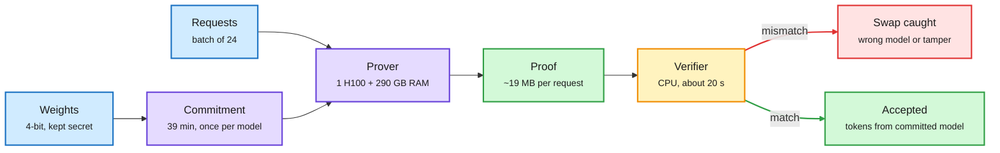

# FlashProve: provable inference for a 400B MoE on one H100

**Source:** Anthropic Research, 2026-11-02 ([post](https://www.anthropic.com/research/provable-inference), [technical report](https://www.anthropic.com/document/flashprove-technical-report)) · raw: `raw/labs/2026-11-03-145824-labs.md`
**Authors:** Roy Rinberg, Alex Allain (Anthropic); Alessandro Chiesa, Giacomo Fenzi, Guy Weissenberg (EPFL); Miranda Christ (MIT); Rahul Dalal; Ben Mayer

## TL;DR

FlashProve is an open-source (Apache 2.0) zkSNARK system that lets a provider commit to hidden model weights and attach a proof to each response that those weights produced those tokens. On Llama 4 Maverick (400B MoE, 4-bit), one H100 plus ~290 GB host RAM proves a batch of 24 x 1,024-token requests in ~223 s (~110 tokens/s), about 72x (66-94x) the GPU time of vLLM serving the same load in FP8. Proofs are 18.78 MB and verify on a CPU in 17-21 s. Claude did much of the optimization; top-level security claims are stated in Lean.

Commit once, prove every batch, verify on a CPU

The expensive part runs on the provider's GPU; the user only checks a 19 MB proof.

Blue is input, purple is the provider's compute, amber is the user's check, green is a valid result, red is a caught swap.

## Key points

- **Construction:** an IOP (code proximity tests, linear constraints, lookup arguments) compiled with hashes, so post-quantum in the random-oracle model. Offline commitment ~39 min per model, good for ~16M requests; client downloads ~6.5 MB.
- **Why it is fast:** cost scales with ~17B active params per token while hiding which experts ran; post-hoc batched proving opens the weight commitment once per batch; layers streamed from host memory in segments.
- **Prior art:** zkLLM ~2.5 tok/s (13B, A100); VerInf ~0.02 tok/s on Maverick (14.3 h per 1,000 tokens, 93.6 GB proof); DeepProve ~1.4 tok/s Gemma 3 (31 tok/s distributed); Attestable 53-77 tok/s on Gemma 4 31B (closed).
- **Limits:** integer weights under greedy decoding only; 1,024-token context; architecture not hidden; MoE assumed; side channels out of scope; fast C++ verifier unproved (only a slow Lean verifier is sound); zero knowledge not formally checked on the prover.
- **Related project:** Anthropic met its RSP goal (prototype by 2026-09-30) via a separate system that signs inference traffic and recomputes on a trusted server; the goal was renamed "inference verification" on 10-19.

## Relation to prior wiki pages

- **Fills a gap in [LLM routing](llm-routing.md):** every routing paper so far (AgentBaton 10-30, Copilot Fusion 10-29) assumes the routed-to model is the one that ran. FlashProve is the first practical way for a buyer to check that a router or reseller did not substitute a cheaper model.
- **Extends the oversight thread** on [responsible AI](../responsible-ai/responsible-ai.md): tamper detection for inference servers complements the 10-31 to 11-01 supply-chain and monitor-evasion findings.
- **Hardware angle:** streaming layers from host RAM to fit one GPU is the same memory-hierarchy move as DeepSeek serving KV from SSD (10-28); see [memory hierarchy](../hardware/memory-hierarchy.md).

## Open questions

- Can the overhead fall below ~10x, which would make proving every request plausible for regulated traffic?
- Sampled decoding and floating-point kernels: what does a proof mean when serving is nondeterministic?
