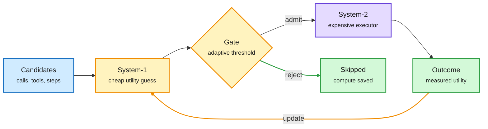

# System-1 gates System-2: the economics of routing, and buyers acting on it

**Sources:** [arXiv:2610.39497](https://arxiv.org/abs/2610.39497) (Does Scaling Toward AGI Depend on What System-1 Lets System-2 Execute?), [arXiv:2610.42053](https://arxiv.org/abs/2610.42053) (REA), [arXiv:2610.39006](https://arxiv.org/abs/2610.39006) (Blind Spots, DAIR pick); OpenRouter, Arena and The Information for market evidence · raw: `raw/huggingface/2026-11-02-does-scaling-toward-*.md`, `raw/huggingface/2026-11-02-rea-*.md`, `raw/dair/2026-11-02-230356-dair-academy.md`, `raw/rss/2026-11-02-the-information-it-s-contract-*.md`

## TL;DR

The System-1 paper formalizes routing as predict-gate-execute-update: a light predictor scores candidate interactions, an adaptive threshold admits some to an expensive executor, outcomes retrain the predictor. With ideal screening and equal costs, execution compute falls by up to 1/ρ_u, where ρ_u is the density of utility-relevant interactions; selection regret is bounded by predictor error. It proposes "informative compute" as the scaling coordinate. REA (embodied) applies the shape with route memory and a boundary-triggered judge: 95.9% on 3,000 LIBERO-Pro episodes vs 94.7% best single policy, 25% fewer control steps, 17% less control time. Blind Spots warns small models are weaker selectors: they recover 28-31% of the random-to-oracle gap vs 53% for GLM-5.2, and are more overconfident (Brier 29.1% worse).

Predict first, spend only on what passes the gate

The loop closes: outcomes retrain the cheap predictor.

Blue is the candidate pool, amber is the cheap predictor and gate, purple is the expensive model, green is saved compute and feedback.

## Market evidence (same day)

- OpenRouter: users spending $100+/month use a median of 6 model families, double a year ago.
- The Information: enterprises hesitate to raise annual commits because the best model changes week to week.
- Arena Agent Arena: same intelligence can cost 10x more, need 6x more output tokens, take 2x longer; output tokens barely predict the bill.

## Relation to prior wiki pages

- Gives the theory behind [LLM routing](llm-routing.md) results: AgentBaton (10-30, capable-to-cheap handoff cut API cost 65.9%), small decision-model routers (10-28), Routed Continual Learning (11-01).
- Tension with Blind Spots: a cheap gate is also a worse judge, so the ρ_u bound assumes predictor quality that small models may not have.
- Connects to [test-time compute allocation](../inference-efficiency/test-time-compute-allocation.md): the gate is an allocation policy over calls rather than tokens.
