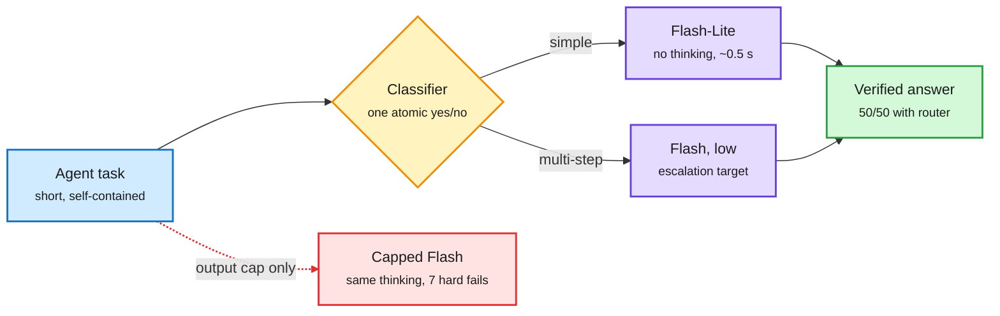

# Cost per task: a cheap classifier routes across Gemini models and thinking levels (Google Developers)

**Source:** [Google Developers Blog, "Cost per task: Using cheap classifiers to route across Gemini models and thinking levels" (Sergio Villani, Google Cloud AI, 2026-11-03)](https://developers.googleblog.com/cost-per-task-using-cheap-classifiers-to-route-across-gemini-models-and-thinking-levels/) · raw: `raw/labs/2026-11-04-172215-labs.md`

**TL;DR.** Google's Cloud AI team argues that price per million tokens no longer governs agent economics; **cost per successful task** does (all loop iterations, tool calls, retries and thinking passes divided by tasks that pass verification). They put a single-forward-pass structured classifier (TypeSafe's Jev, used as an example; Google stresses no partnership) in front of Gemini calls inside a coding-agent harness and ran a 50-question auto-graded suite. Four findings. (1) A hand-written regex plus prompt-length router scored 93.8% on the 16 tasks it was written on, then fell 23.2 points to 70.6% on 34 held-out tasks; one atomic classifier question ("does this need more than one sequential calculation, simulation step or deduction?") agreed with hand labels on 34/34 held-out and 48/50 overall. Broad "simple or complex" questions collapsed to "simple". (2) **`maxOutputTokens` is a ceiling, not a thinking-budget dial**: capping Gemini 3.8 Flash at 300 tokens spent almost the same thinking tokens on easy tasks as a 4,096 cap, cost slightly more, and broke 7 of 25 hard tasks (6 ran out of room mid-reasoning). (3) The baseline a router must beat is the strongest no-router setup, here Gemini 3.8 Flash on *low* thinking, which solved 50/50. Routing everything to Flash-Lite first and escalating only classifier-flagged tasks to Flash-low also solved 50/50, with lower cost and latency; Flash-Lite alone missed 6 of 25 hard tasks and the classifier flagged all 6. The keyword router was cheaper only because it was wrong (48/50). (4) **Routing and caching pull in opposite directions**: context caching cuts resent-prefix cost 75-90%, but a cache belongs to one model, so turn-by-turn model switching either doubles caches or forfeits the discount. Limits stated by the authors: one run per setup, 50 short prompts, hand-assigned difficulty.

The router only pays if the cheap path really thinks less

An output cap does not lower thinking spend; a cheaper model or a lower thinking level does.

Blue is the task, amber is the routing decision, purple is a model setting, green is the verified result, red is the false economy of an output cap.

## Key points

- **Metric:** cost per successful task, not cost per token. This is the same reframing as [OPTIMA's cost-per-task benchmarking (08-16)](../ai-industry/2026-08-16-optima-cost-per-task-benchmarking.md), now stated by a hyperscaler for its own model family.
- **Router design rule:** decompose the routing question into one atomic, checkable predicate. Broad meta-judgments collapse to the majority class.
- **Overfit heuristics:** a rule set tuned on its own development tasks loses ~23 points on unseen agent traffic, because real "easy" prompts are long (YAML, diffs, tracebacks) and real "hard" prompts can be short (Python dict key hashing, C short-circuit evaluation).
- **Thinking budget:** the cheap path must change the model or the thinking level. A token ceiling does not shorten reasoning on easy prompts and truncates reasoning on hard ones.
- **Escalation target:** a heavier escalation (Flash default thinking) cost more than running Flash-low everywhere, which already solved all 50. Escalate to a heavier tier only once the low tier fails.
- **Cache conflict:** routing gains on short standalone calls; caching gains on long repeated prefixes. The practical split is to route the short side-calls and keep the main long-context loop on one cached model.

## Relation to prior wiki

- **Confirms** the [Jev router line](2026-10-08-routing-graded-jev-router-local-routing.md) (10-08, a decision model used as a router in front of LLM calls) and [JevAgentHarness (10-18)](2026-10-18-jevagentharness-decision-model-delegation.md), which delegated harness micro-decisions to a decision model. Google's post is the first hyperscaler-authored measurement of that pattern on its own models.
- **Matches** the 11-03 System-1/System-2 paper ([summary](2026-11-03-system1-gates-system2-routing-economics.md)), which bounds a gate's saving at up to 1/ρ of execution compute. Google's numbers show the other side: when the cheap tier is already good (Flash-low solves everything), the saving left for a router is small, and latency becomes the main benefit.
- **New tension:** routing versus prompt caching. The wiki's caching evidence ([KV cache](../inference-efficiency/kv-cache.md); Agent Arena's 93 input tokens read per token written, 11-03) says cached input is where agent cost lives. A router that switches models per turn breaks the cache, so cache-aware routing (stay on one model for the long loop, route only side-calls) is the deployable design.
- **Pairs with** the [Skill++ / HarnessRouter page](2026-11-04-skill-routing-interference-and-harnessrouter.md) the same day: routing now spans models, thinking levels, skills and harnesses.

See also: [LLM routing](llm-routing.md), [test-time compute allocation](../inference-efficiency/test-time-compute-allocation.md).
