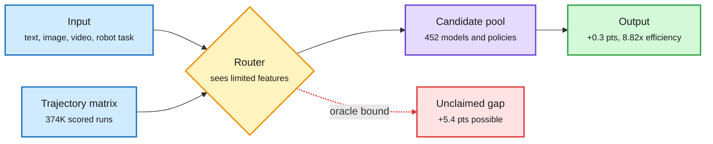

# Route Anything: model and policy routing across 25 benchmarks and every modality

**Source:** [arXiv:2611.05275](https://arxiv.org/abs/2611.05275) · HuggingFace Daily Papers (2026-11-04, #1 by upvotes) · raw: `raw/huggingface/2026-11-04-route-anything-a-study-of-model-and-policy-routing-for-gener.md`

**TL;DR.** Route Anything is the largest routing study the wiki has seen. It builds an "omni-modal trajectory matrix": 374,401 scored runs from 452 candidate configurations (models, tools and robot policies) across 25 benchmarks spanning language understanding, image, video and speech generation, coding and workplace agents, and robot manipulation. It pairs that with a theory of optimal routing under a quality-cost trade-off, showing how the information available to the router bounds what it can achieve. Headline numbers: a per-input oracle router beats the best single candidate by 5.4 points; learned routers beat it by 0.3 points across 16 benchmarks (2.1 on video generation, 1.1 on robot manipulation with 24% less policy time); and routing raises efficiency 8.82x on average against the reference model. The gap between 5.4 (oracle) and 0.3 (learned) is the real finding: almost all of the routing value is still on the table.

The oracle leaves a 5.4-point gap; learned routers capture 0.3 of it

Most of the payoff today is cost, not quality: 8.82x efficiency at roughly equal scores.

Blue is input and training data, amber is the router, purple is the candidate pool, green is today's result, red is the value routers still miss.

## Key claims

- Routing generalizes beyond LLM text: the same framework routes image/video/speech generators and robot policies.
- Theory: the router's attainable performance is set by the information it sees about the input. Better features, not bigger routers, raise the ceiling.
- Oracle per-input routing: +5.4 points over the best fixed candidate. Learned routers: +0.3 (16 benchmarks), +2.1 (video generation), +1.1 (robot manipulation, 24% less policy time).
- Efficiency: 8.82x average versus the reference model.

## How it relates to prior wiki pages

- **Extends** the Google cost-per-task study (11-04), which showed a one-question classifier routes coding tasks between Flash-Lite and Flash more cheaply. Route Anything says the same economics hold across modalities, and puts a number on the remaining headroom.
- **Confirms** the AgentBaton finding (10-30, capable-to-cheap handoff saved 65.9% of API cost): today the cost side of routing is mature, the quality side is not.
- **Connects** to Skill++ (11-04): there, adding options broke routes. Here, 452 options exist and the router barely beats the best single one. Both say routing quality degrades as the candidate pool grows unless the router's information improves.
- **Fills the data gap** Agent Arena's cost-per-hour numbers (11-04 evening, $10.51 to $31.08 per agent-hour) pointed at: a public matrix for training difficulty-aware routers.

## Gaps

No cost accounting for the router itself on generative modalities. The candidate set is fixed; no test of adding candidates over time (the Skill++ interference question). The matrix release terms are not stated in the abstract.

Related: [LLM routing concept](llm-routing.md) · [Google cost-per-task routing](2026-11-04-google-cost-per-task-classifier-routing.md) · [Skill++](2026-11-04-skill-routing-interference-and-harnessrouter.md)
