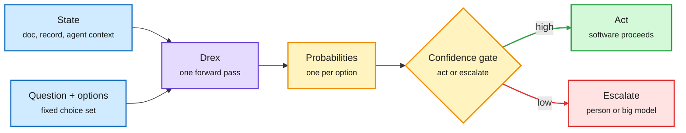

# Drex: open decision models that pick and never write

## TL;DR

Nace AI released the Drex paper and weights: four open **decision models** (8B DLM, 9B v1.5, 35B-A3B v2.0 and 27B Max). A decision model takes a state (a document, record or agent context, optionally images) plus questions with a fixed option set, and returns one probability per option in a single forward pass. Nothing is generated, so nothing needs parsing. Drex Max scores 67.52 on the public Decision Index 0.4.1 suite against 60.70 for Jev 1.14.0, is statistically tied with GPT-6 Sol and d3-turbo on Decision Bench v4, and trails Claude Opus 5.5 by 1.6 points. It answers in 183 ms for about $0.06 per 1K decisions, against about 3.5 s and $10.17 for Opus. Training is supervised fine-tuning plus **RLAF** (reinforcement learning from adjusted feedback): a teacher proposes a probability per option, the verified answer adjusts it, and the model trains on those soft calibrated targets instead of one-hot labels. RLAF adds 2.0 Decision Index points; a consistency loss cuts option-order flips from 6.3% to 4.2%. The same day, HKU's **AgentPilot** repo made the related bet for agent loops: a 9B model chooses the next strategy and a frontier model writes the code.

The model reads once and returns a distribution

No decoding loop. The calibrated confidence is what makes it usable as a gate.

Blue is input, purple is the model, amber is the distribution and gate, green is the cheap path, red is the escalation path.

## Key claims

- **Four sizes, all open.** 8B, 9B, 35B with 3B active, and 27B Max (with vision tuning). Weights on Hugging Face (`nace-ai/drex-max-v1`), code at github.com/nace-ai/drex-decision-models.
- **Accuracy vs chat models.** Decision Bench v4: tied with GPT-6 Sol and d3-turbo, 1.6 points under Opus 5.5. Best accuracy among decision models on DecideBench. On the independently run Artificial Analysis Decision Index it scores 64 against 65 for the three leaders.
- **Cost and latency.** 183 ms typical; about 2.0 s for GPT-6 Sol and 3.5 s for Opus 5.5. About $0.06 vs $10.17 per 1K decisions (per a launch thread, not the abstract).
- **Calibration, with a caveat.** The reliability chart is roughly diagonal (70% confident is right about 70% of the time), but Max runs 5 to 9 points over-confident in four of five domains.
- **The ceiling.** Without chain of thought or tools, Max answers 21% of sampled HLE questions against 56% for Opus. Decision models are for many small choices, not hard reasoning.

## AgentPilot (HKU, github.com/HKUDS/AgentPilot)

A 9B "strategy model" decides what to try next, how to spend the trial budget and when to stop. A frontier model (DeepSeek V4 in the demo) executes. The 9B model learns online from each trial's outcome. It plugs into Codex, Claude Code, DeepSeek Harness and others. The repo is popular (about 7.8K stars at capture) but publishes no independent benchmark yet, so the "better and faster" claim is the authors'.

## Relation to prior wiki pages

- **Extends** [Drex 1.0/1.1 (09-26)](2026-09-26-drex-diffusion-decision-model.md), when Nace led Decision Index 0.2 with a sub-10B model described as diffusion trained with RL. The paper turns that product into an open family and a training recipe.
- **Confirms** [small decision models as routers (10-28)](2026-10-28-small-decision-models-as-routers.md) and the [decision-model price war (10-13)](2026-10-13-decision-model-price-war.md): the price per decision keeps collapsing while accuracy approaches frontier chat models on bounded choices.
- **Answers part of** the 10-12 question in [calibrated gates](2026-10-12-decision-3-multimodal-and-calibrated-gates.md): calibration is now published per domain, and the over-confidence is quantified rather than hidden.
- **AgentPilot** is the agent-loop version of [System 1 gates System 2 (11-03)](2026-11-03-system1-gates-system2-routing-economics.md): the small model owns the decision, the big model owns the execution.
- Concept page: [LLM routing](llm-routing.md).

## Gaps

The cost-per-decision figures come from Nace's own setup. Decision Index is partly Nace-adjacent; the independent Artificial Analysis number (64 vs 65) is the one to trust. No study yet of how Drex gates behave when the option set itself is wrong.
