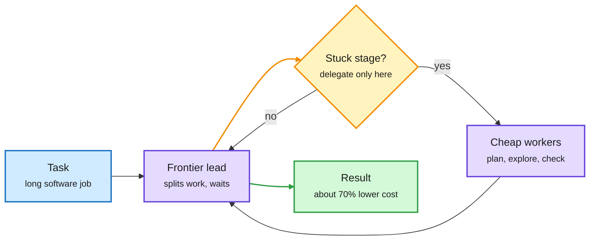

# Frontier lead, cheaper workers: ~70% lower cost for close to all-frontier results

**TL;DR.** Nouha Dziri (Cohere) presented hundreds of experiments on teams of coding agents on ProgramBench and Commit0. A lead agent splits the work and workers explore, build and check in parallel. Teams can beat one agent on long software tasks but cost several times more. Three rules decide where extra workers pay off: delegate only the stage where the task is stuck; use a lead that waits for its workers instead of running ahead; and pair a strong lead with cheaper planning workers. That last pairing gets close to an all-frontier team at about 70% lower cost. Source is the talk description; no paper was captured.

Only the lead needs to be expensive

The routing decision happens inside the harness, per role, not per query at an API gateway.

Blue is the task, purple are models, amber is the delegation gate, green is the outcome.

## Relation to prior wiki pages

- **Routing by role is now a pattern.** Claude Code moved background status updates to Haiku 5.5 for ~99% lower cost per update (11-07). Drex (11-07, [summary](2026-11-07-drex-open-decision-model-family.md)) answers bounded choices with a 27B model at ~1/170 the cost. HKU's AgentPilot (11-07) lets a 9B model steer a frontier coder. Cohere's result is the fourth instance in a week of routing by *role inside the loop* rather than by *query difficulty at the gateway*.
- **Same week, same message from harness work.** Hugging Face found "same open model, different harness, very different results" and shipped "harness adapters" ([@Thom_Wolf](https://x.com/Thom_Wolf/status/2118863053001531676)). Garry Tan removed a skill because Opus 5.5 does it better unaided. The harness, not the model string, sets cost.
- **Open question.** The 70% figure has no published per-benchmark breakdown. Whether "delegate the stuck stage" can be detected automatically (a learned gate) is the routing research question.

Concept page: [llm-routing](llm-routing.md).
