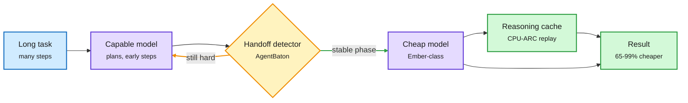

# Muse Ember, AgentBaton and CPU-ARC: put the cheap model where the volume is

**Date:** 2026-11-10 · **Sources:** [Meta Muse Ember blog](https://research.meta.ai/blog/muse-ember) (via [@AIatMeta](https://x.com/AIatMeta/status/2119853595453702580), [@shengjia_zhao](https://x.com/shengjia_zhao/status/2119859580981407871), [The Decoder](https://the-decoder.com/meta-launches-muse-ember-a-small-ai-model-built-for-the-repetitive-work-agents-actually-do/)) · AgentBaton ([arXiv 2610.35959](https://arxiv.org/abs/2610.35959)) · CPU-ARC ([arXiv 2611.09891](https://arxiv.org/abs/2611.09891)) · Inkling 2 Small ([Arena](https://x.com/arena/status/2119840698614817076)) · raw: `raw/twitter/feed/2026-11-10-morning-ranked.json`, `raw/huggingface/2026-11-09-agentbaton-*.md`, `raw/huggingface/2026-11-09-cpu-arc-*.md`

## TL;DR

- **Muse Ember** is Meta's smallest Muse model, built for what agents repeat all day: tool calls, coding subtasks, routing, extraction, long-document parsing. Price: $0.10 per million input tokens, $0.50 per million output. On the Artificial Analysis Intelligence Index it scores 33.9 at $0.116 per task and 35.8 at $0.136. Claude Haiku 5.5 needs $0.248 per task to reach 34.3, so Ember matches Haiku at about a third of the cost, and beats every GPT-6 Luna setting. Agents benchmarks (max effort): AutomationBench-AA 37.8 vs Haiku 13.9, OSWorld 2.1 69.5 partial, Terminal-Bench 4.0 40.9 vs 39.2. It is weaker on FrontierCode (27.2 vs Haiku's 34.9). Meta pitches pairing it with the larger Muse Wonder: "wonder can plan, ember can handle the volume." It ran as the anonymous "crouton-alpha" and processed over 5T tokens in testing.
- **AgentBaton** asks whether two models can share one long agent task. Handing off from cheap to capable mostly fails: little saving, lower accuracy. Handing off from capable to cheap at the right moment keeps or improves accuracy. A small learned detector picks that moment from task-progress patterns. Across 11 model pairs and two benchmarks it cuts API cost by 65.9% on average.
- **CPU-ARC** (agentic reasoning caches) separates solving a task from applying the solution. Once an LLM has reasoned through a task type, the trace is compiled into a CPU-executable cache that handles new instances. It matches frontier LLMs on hard math and science tasks at 16-291x lower invocation cost.

Plan once with the big model, then hand the volume down

Three results agree on the direction of the handoff: capable first, cheap after.

Blue is the task, purple is a model, amber is the routing decision, green is cached or finished work.

## Relation to prior wiki pages

- **Pattern (N-of-a-kind, now four):** lead-plus-workers routing keeps showing up. Cohere's Nouha Dziri talk (11-09: frontier lead plus cheaper workers nears an all-frontier coding team at about 70% lower cost), HKU's AgentPilot (11-07: a 9B model chooses strategy and stopping while a frontier model executes), Claude Code routing status updates to Haiku (11-09: about 99% cheaper per update), and now AgentBaton's capable-to-cheap handoff (65.9% savings). The open question is no longer "should we route inside a task" but "when."
- **Contradiction:** AgentPilot puts the *small* model in charge of control decisions; AgentBaton finds small-first handoffs fail. They differ on what the small model does (control vs execution), which may reconcile them. Unresolved.
- **CPU-ARC** is the strongest version of the decision-reuse idea from HarnessMM (10-27: the harness skips LLM calls whose outcome it already planned, 88% fewer tokens). CPU-ARC removes the LLM from repeated task types entirely.
- **Inkling 2 Small** (Thinking Machines, weights coming): #31 in Agent Arena, would be #9 among open models, $0.25 median per task, 70% below Kimi K3. A second cheap-volume model in the same window.
- Concept: [llm-routing](llm-routing.md).

## Gaps

Ember's numbers are Meta's, at "proposed pricing" estimates on the AA chart. AgentBaton's detector is trained per pair; transfer to unseen pairs is not shown in the abstract. CPU-ARC's "robust to perturbations" claim needs checking on tasks whose structure varies, not just their numbers.
