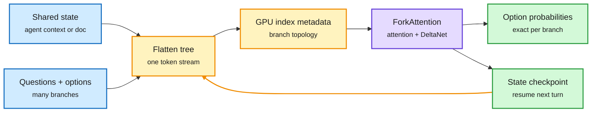

# Flide: serving decision models without recomputing the prefix

## TL;DR

Decision models (small models such as Jev and Drex that read a state plus a question with options and return a probability over the options, instead of generating text) are becoming the fast "System One" gate in agent stacks: tool choice, stopping, routing. Serving engines built for generation handle them badly. A decision request is a tree: one shared state, many questions, each with several options. Generation engines either recompute the shared prefix per branch, or batch branches in ways that distort the output probabilities. Flide flattens the whole tree into one token stream and records the tree structure as GPU-resident index metadata. Its ForkAttention kernel follows those indices through both standard attention layers and recurrent Gated DeltaNet layers (a linear-attention layer whose state is a fixed-size matrix, not a growing cache). It guarantees, in exact arithmetic, that each branch computes the same result as an isolated forward pass. A small set of pre-recorded CUDA graphs covers diverse request mixes, and growing agent histories resume from checkpoints saved in earlier passes. It answers queries up to 9.5x faster than vLLM and SGLang while staying closest to a float32 reference in total variation distance.

One stream, many branches, no recompute

The tree lives in metadata. The kernel reads it, so every branch is exact and the prefix runs once.

Blue is the request, amber is the structure Flide builds, purple is the kernel, green is the output and the reusable checkpoint.

## Key findings

- Up to 9.5x faster than vLLM and SGLang on public hybrid and decision models.
- Closest to an fp32 reference in total variation distance: batching does not bend the probabilities, which matters because a router's threshold sits on those numbers.
- Works through recurrent Gated DeltaNet layers, where prefix sharing is harder than with a paged KV cache because the state is overwritten, not appended.

## Relation to prior wiki

- **Infrastructure for the decision-model thread.** [Drex (11-07)](2026-11-07-drex-open-decision-model-family.md) released open decision models; the 10-28 [small decision models as routers](2026-10-28-small-decision-models-as-routers.md) page argued calibrated option probabilities are what make them usable as gates. Flide is the first serving engine built for that workload, and its exactness claim protects calibration.
- **Same primitive as Octopus and Shepherd.** DAIR's Octopus (2611.06956) shares KV pages across sub-agent threads with O(1) forks; [Shepherd (11-10)](../agentic-systems/2026-11-10-boxbox-shepherd-harness-runtime.md) forks agent runs with about 95% KV reuse. Three systems in a week treat "fork the state, keep the prefix" as a first-class serving operation.
- Updates [LLM routing](llm-routing.md).

## Gaps

The comparison is against generation engines on a workload they were not built for. No end-to-end agent latency numbers. Hybrid-model coverage is limited to Gated DeltaNet.

## Links

- Paper: [arXiv 2610.42148](https://arxiv.org/abs/2610.42148)
