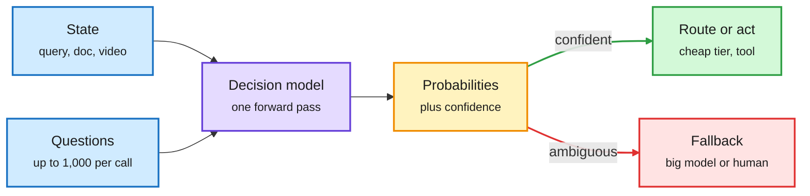

# Gemini Decision 1 and the decision-model wave

## TL;DR

A decision model reads a state plus a set of questions with fixed options, and returns a probability for each option in one forward pass. It never generates text. In one window, Google shipped **Gemini Decision 1** behind a new Decisions API (up to 1,000 yes/no, choice and rubric questions per request, across text, images, audio, video and PDFs, 150-250 ms end to end, $0.10 per million input tokens, zero output tokens billed, about 5x cheaper than Gemini 3.5 Flash-Lite on Google's benchmark suite). Meta released **MetaEncoder v1** on Hugging Face, a multimodal embedding model with a Jev-compatible `decide()` call that scores options by cosine similarity against a softmax at temperature 0.02. inclusionAI released **Sing VL S1**, a 4B Qwen3.5-based multimodal decision model that leads its size class on the Public Decision Index 0.3 (69.76 text, 73.94 vision). Hugging Face added a decision-model class to Transformers. Google says its own Gemini Notebook already uses the API as a real-time router, serving everyday queries with up to 40% lower latency and reserving deep reasoning for hard ones. Separately, Meta Engineering described Intelligent Delivery, a system that allocates ads-serving compute to the requests with the highest predicted marginal utility; it is the same "score first, then spend" idea applied to compute instead of models.

The router stops talking and starts scoring

One prefill, many questions, a probability per option. Decode cost drops out of the routing bill.

Blue is input, purple is the model, amber is the confidence gate, green is the cheap path, red is the escalation.

## Key points

- **Gemini Decision 1:** three question types (`noul` yes/no, `choice` with 2 to 255 options, `score` ordered rubric), up to 256K input tokens, latency nearly flat from 1 to 100 questions, lowest calibration error on Google's suite. Gemini Notebook routes queries to model tier and thinking level with it. ([Google](https://blog.google/innovation-and-ai/technology/developers-tools/gemini-decisions-api/))
- **Price ladder:** Jev 4.2 cents per million input tokens, OpenAI's GPT-6 Luna decision model and Gemini Decision 1 at 10 cents; output free on all three. Jev is text/JSON only, OpenAI adds images, Gemini covers all five modalities. Gemini returns hedged probabilities (0.92 rather than 1.0) on yes/no. ([Simon Willison](https://simonwillison.net/2026/Nov/11/gemini-decisions-api/))
- **MetaEncoder v1:** 6656-dim L2-normalised embeddings for text, image, video and documents, with `encode`, `retrieve` and `decide`. Decisions are cosine scores against option descriptions; `calibrate()` refits the temperature on labelled data. One 80 GB GPU holds it in bf16. ([HF](https://huggingface.co/facebook/meta-encoder-v1))
- **Sing VL S1 (4B):** one Transformers forward pass per question; 96.8 on BFCL tool-call exact accuracy in its non-skill setting; beats TypeSafe Jev 1.14 (60.70 text) and a 4B Perplexity Decider on the index. ([HF](https://huggingface.co/inclusionAI/SingVL_S1_4B))
- **Meta Intelligent Delivery:** a Resource Core Model (6B sparse, 20M dense parameters) runs once per ad request and predicts outcome, compute and latency per resource setting; a hierarchy of decision engines then moves compute across regions, models and ranking stages. About 10% incremental ranking performance since 2017; about 20% better at finding the highest-impact requests than the prior production model. ([Meta Engineering](https://engineering.fb.com/2026/11/11/ml-applications/intelligent-delivery-serve-better-ads/))

## Relation to prior wiki pages

- **Confirms and completes a pattern.** Drex (11-07: open decision models, Max ties GPT-6 Sol at about $0.06 per 1K decisions) and Flide (11-11: an exact serving engine for decision-model request trees, 9.5x over vLLM) made the open and the serving layers. Today adds the hyperscaler API layer (Google), an embedding-based variant (Meta), and the library layer (Transformers). Four layers in six days is a category forming.
- **Extends the 11-04 Google cost-per-task study** (one classifier question routed a coding suite between Flash-Lite and Flash at lower cost than the best no-router setup). Gemini Notebook is that idea in production.
- **Tension with Route Anything (11-05):** a perfect per-input router beats the best single model by 5.4 points, but learned routers gained only 0.3. Calibrated decision models make the cheap-path decision more trustworthy. They do not obviously raise the quality ceiling.
- **Open:** a calibration comparison across Jev, GPT-6 Luna, Gemini Decision 1, MetaEncoder and Drex on the same routing set. Embedding-based `decide()` (MetaEncoder) versus a trained option-scoring head (Sing VL, Gemini) is an untested design axis.

Concept page: [LLM routing](llm-routing.md).
