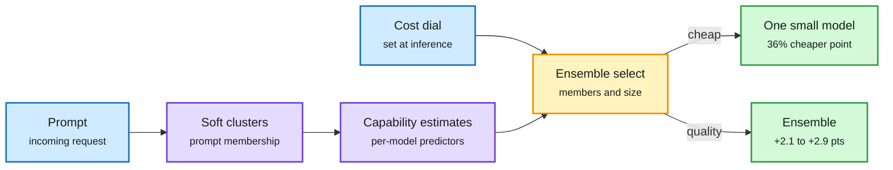

# PISA-E, PolyRoute, and the Hydrogen/Carbon Orchestrator

## TL;DR

Three routing results in one window, at three layers. **PISA** (2611.10193) estimates each model's capability on a prompt by combining soft cluster memberships with per-model predictors; **PISA-E** extends it to choosing an ensemble, both which models and how many, under a cost/quality dial you set at inference time with no retraining. On four routing benchmarks PISA has the best cost-performance hypervolume among single-model routers in- and out-of-distribution; PISA-E beats the best ensemble methods by 2.09 (ID) and 2.87 (OOD) points at the quality end, and at cheaper settings matches them while cutting cost about 36% and 25%. **PolyRoute** (2611.13843) is the first fixed yardstick for typed-decision encoders (yesterday's decision models) outside English: 12 languages, 9 scripts, code-mixed text such as Hinglish. The English checkpoint scores 61.2%, the shipped multilingual one 77.3%, the best fine-tune 96.6%, and plain TF-IDF plus logistic regression 91.9%. **Google's Orchestrator** in Antigravity routes inside one session between Gemini 4 Carbon (coordinator) and the new Hydrogen (workers and verifiers), reaching near-Carbon success on Terminal-Bench 4.0 with 24% less quota and 19% faster.

Routing now picks a team, not a model

PISA-E chooses which models and how many; the dial is set per request.

Blue is input and the user's cost dial, purple is capability estimation, amber is the selection step, green is the served answer.

## Key findings

- PISA-E's ensemble-success surrogate avoids ensemble-specific training, so new models can be added by fitting one predictor.
- PolyRoute: a 3.7-point gap separates TF-IDF (91.9%) from the best fine-tune (96.6%), and the shipped multilingual decision encoder (77.3%) loses to TF-IDF. Typed-decision encoders are not yet robust multilingual routers out of the box.
- On code-mixed text the English checkpoint (85%) is nominally ahead of the multilingual one (79%, p=0.134, not significant).
- Orchestrator: the first hyperscaler-shipped intra-session routing between a frontier and an execution model with a published quota saving (24%).

## Gaps

- PISA-E's benchmarks are offline routing datasets; no live-traffic or latency cost of running several models.
- PolyRoute's texts and labels are all LLM-generated, and the split resolves only differences above about 4 points.
- Orchestrator numbers are Google's own, on one benchmark.

## How it relates to prior wiki pages

- **Extends** [LLM routing](llm-routing.md): Route Anything (11-05) found a perfect router gains 5.4 points over the best single model while learned routers gain 0.3. PISA-E attacks the gap from a different side: ensembles raise the ceiling, and adaptive cardinality keeps the cost bounded.
- **Tests** the 11-12 decision-model wave ([Gemini Decision 1](2026-11-12-gemini-decision-1-and-the-decision-model-wave.md)): PolyRoute is the first public check of those encoders off-English, and the shipped multilingual checkpoint underperforms a 1990s baseline. Kurate's cs.AI #17 this week (Nudging Decision Models, whether digital nudges steer generation-free agents) is a second early robustness probe.
- **Confirms** the role-routing pattern (Cohere lead-plus-workers 11-08, AgentBaton 11-10): Orchestrator is Google productizing "frontier lead, cheap workers".
