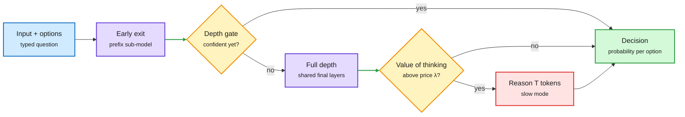

# Decision models grow up (11-14)

Decision models (also called System One models) answer with a typed output, such as a probability for each option, in one forward pass, without generating text. They took over the routing, gating and judging slots in agent stacks between mid-September and November. Five HuggingFace papers in one window, plus the first hard usage data, move the conversation from "they are cheap" to "where can you trust them, and how cheap can they get".

## TL;DR

- **SO-Arena (2611.15777, HF #1):** 11 domains, 5 capability families, 21 models. Measures accuracy *and* reliability: does the decision stay the same when the option set changes, and does the model recognize when no valid option exists. **The best-performing System One model ranks only seventh in reliability.** Gains from scale and from added reasoning vary a lot by domain.
- **Adaptive computation (2611.16321):** decision information concentrates in intermediate layers. **The final six layers can be removed without loss.** Independently trained smaller models mostly imitate the full model rather than learning their own decision skill. The authors jointly train a full model with prefix sub-models that share its final layers and decision head via self-distillation, plus a gate at each exit that decides if more depth is needed. Matches or beats separately trained models at every depth across seven decision benchmarks.
- **The Value of Thinking (2611.16961):** "zero-or-T thinking". One frozen backbone either answers from one forward pass (zero tokens) or runs full autoregressive reasoning (T tokens). A small self-routing block estimates the *value of thinking* and pays for slow mode only when that value exceeds a per-request price λ. CDPO trains the block from episode returns when no per-decision label exists. HDM-4B scores **0.857 vs Jev's 0.851 on JevBench at a median 0.179 s vs 0.652 s (-72.5%)**.
- **Actor, Judge, or Teacher? (2611.17167, also a DAIR Academy pick):** as actors on ALFWorld, all six models (three decision models, three LLMs) chase an easier subgoal before the one that must come first. As judges that see the full trajectory, the same models credit the right steps, especially when asked "did this action help" rather than "will the task succeed". As a GRPO teacher, JEV lifts Qwen2.5-1.5B from **72.8% to 82.9%** on ALFWorld and **56.8% to 71.4%** on WebShop.
- **Optical spectra invariance (2611.00428):** same spectrum shown as tables in nm, μm, scientific notation, eV, or as plots. **Changing only the representation moves accuracy by up to 41 points within one model** (d3-nano, Jev 1.13, GPT-6 Luna configs). Unadapted models rarely answer "undetermined" when data is missing, and LoRA fine-tuning learned the shortcut "abstain whenever the input is truncated".

Pay for depth and thought only when the gate says so

Two papers cut decision cost from two sides: fewer layers and zero tokens by default.

Blue is input, purple is compute, amber is a gate, red is the expensive path, green is the answer.

## The industry data (AI Weekly, Vercel gateway report)

- Vercel routes 100T+ tokens a month. Decision models arrived mid-September; by October there were 15 from eight vendors, taking **26% of all requests for 0.53% of spend**, roughly 1/70th the cost per request of a language model.
- Jev alone got nearly 4x the requests of all Anthropic models combined, but for every $1 spent on Jev teams spent **$64 on Anthropic**. About 11% of paid teams used decision models and no text model at all.
- Adoption scales with size: just over 1 in 5 teams under 10M tokens/month used one, 7 in 10 teams above 10B.
- On Artificial Analysis' Decision Index v2, Claude Haiku 5.5 (77) and GPT-6 Luna (76) still lead the best decision model (Drex Max v1.1, 73), at about 15x the cost ($1,530 vs $102 per million tasks) and 11.34 s vs 275 ms.
- Sebastian Raschka counted 16 vendor launches between 09-23 and 11-11 (Together, Alibaba, Liquid, Databricks, AWS, Cloudflare, Perplexity, OpenAI, H2O, Snowflake, Microsoft, IBM, Baseten, Salesforce, Google).
- **Perplexity Decider v1.3** (open, Apache 2.0) adds `locate`, returning matching spans with character offsets, and is 6.54 points more accurate than the classifiers Perplexity runs in production.
- **dspy-wsp (Cmpnd):** a frontier writer model (GPT-6 Astra, ~25 forward passes, about $5-10) edits a decision model's weights directly. Every one of five open decision models improved by 1.9-16.1 points on Typed Decisions, and 6.5-20.0 with ReAnchor threshold refitting.

## Relation to prior wiki pages

- **Contradicts the cheap-is-enough framing** from the 11-12 Decision API wave ([summary](2026-11-12-gemini-decision-1-and-the-decision-model-wave.md)), which led with price and latency. SO-Arena and the spectra paper say accuracy leaderboards hide the property a router most needs: stability under option changes and abstention. This is the **third** reliability warning in a week after PolyRoute (11-13: decision encoders lose to TF-IDF outside English) and the AI Weekly "Jeva" design note (a decision model should be permutation-invariant and able to say "none of these"). Pattern threshold crossed.
- **Extends the System 1 gates System 2 line** ([11-03 summary](2026-11-03-system1-gates-system2-routing-economics.md)). HDM makes that gate internal to one model with a per-request price, which turns routing into a single-model cost dial.
- **Confirms "a poor actor can still teach well"**, the same split as AgentBaton (11-10, capable-to-cheap handoffs save 65.9% but cheap-to-capable do not): judgment in hindsight is cheaper and more reliable than judgment in the moment.
- **Gap-fill:** the 11-13 Looking Ahead asked whether a decision encoder would match TF-IDF on PolyRoute within 60 days. Not resolved today, but dspy-wsp's 1.9-16.1 point weight edits are a cheap new lever toward it.

## Open questions

- No paper yet measures what happens to a *router* (not a classifier) when its decision model is unstable under option reordering: how much routing quality is lost to instability rather than to accuracy?
- Early-exit and zero-or-T thinking were tested on decision benchmarks. Do they keep calibration when exits are taken, which is what threshold-based routers depend on?
