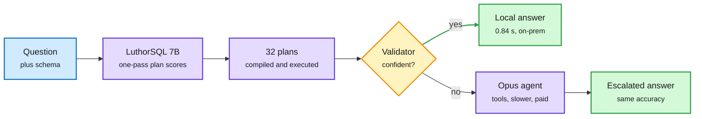

# LuthorSQL: a one-pass local text-to-SQL model as System 1 for a slower LLM agent (2611.17780)

**Source:** [arXiv:2611.17780](https://arxiv.org/abs/2611.17780) · HuggingFace Daily Papers 2026-11-16 · raw: `raw/huggingface/2026-11-16-luthorsql-a-one-pass-text-to-sql-model-as-system-1-for-a-slo.md`

## TL;DR

A Claude Opus 5.5 agent answering 10,000 database questions a day costs over $70,000 a year at list price and sends sensitive queries to an external API. LuthorSQL is a 7B **non-autoregressive** text-to-SQL model: instead of writing SQL token by token, one forward pass scores slots in a bounded grammar of query plans. It compiles and executes up to 32 candidate plans and a trained validator picks the answer. Alone it reaches 68.03% execution accuracy on BIRD's hidden test set at 0.84 s per question on one GPU, keeps that accuracy in 9 GB with 8-bit weights, and transfers zero-shot to Snowflake, BigQuery, MySQL, PostgreSQL and DuckDB within 3.1 points of its SQLite score. As a **confidence cascade** (answer locally when confident, escalate to Opus otherwise), pre-registered over 227 questions on databases published after Opus's training cutoff, it answers nearly half the questions locally and cuts API cost 33.3% at the same accuracy. A contamination probe finds Opus reproduces 48-92% of public benchmark gold queries verbatim without seeing the schema, though its tool-assisted accuracy holds on renamed schemas (95.6-97.4%).

Half the questions never leave the building

The router is the local model's own confidence.

Blue is input, purple is compute, amber is the routing decision, green is an answer.

## How this relates to prior wiki pages

- **Confirms** the decision-only-compute thread from the [11-16 Media Zone](../media-zone/2026-11/2026-11-16.md): Claude Code's advisor mode (consult the strong model only at checkpoints) and Perplexity's single-pass Decider. LuthorSQL is the domain-specific, measured version: a cheap one-pass model gates the expensive agent.
- **Echoes Satya Nadella** (Pragmatic Engineer, 11-16), who described Microsoft building "hybrid intelligence": a router choosing between unmetered local models and paid cloud models.
- The contamination finding is a caution for every router trained or evaluated on public text-to-SQL benchmarks: the strong model's "ground truth" advantage may be memorized.
- Concept page: [LLM routing](llm-routing.md).

## Gaps

- 227 cascade questions is small; the 33.3% saving has wide uncertainty.
- The grammar is bounded; queries outside it must always escalate, and the paper's share of those is the cap on local coverage.
