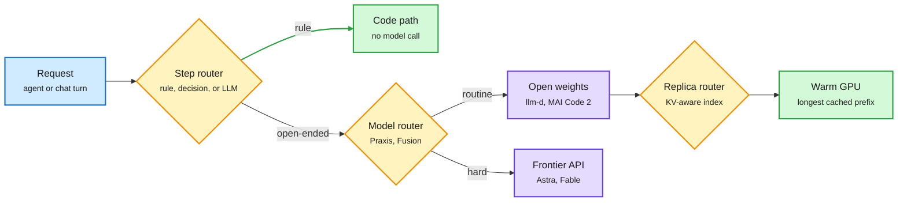

# Routing goes cache-aware and open-weight: SageMaker KV-aware routing, Red Hat's 70/30 flip, MAI Code 2, inference engineering

**Sources:** [SageMaker KV cache aware routing](https://aws.amazon.com/blogs/machine-learning/amazon-sagemaker-ai-real-time-endpoints-now-support-kv-cache-aware-routing/) · [Managed NVIDIA Dynamo on HyperPod](https://aws.amazon.com/blogs/machine-learning/managed-nvidia-dynamo-on-amazon-sagemaker-hyperpod-inference/) · [Code for rules, models for judgment](https://aws.amazon.com/blogs/machine-learning/cut-generative-ai-costs-code-for-rules-models-for-judgment/) · [AgentCore JSON token costs](https://aws.amazon.com/blogs/machine-learning/reducing-token-costs-and-latency-in-amazon-bedrock-agentcore-json-workloads/) · Red Hat EnMaaS pilot ([@RedHat_AI](https://x.com/RedHat_AI/status/2122728721618731169)) · [Pragmatic Engineer: Inference engineering for software engineers](https://newsletter.pragmaticengineer.com/p/inference-engineering-for-software-engineers) · Microsoft Ignite ([The Information](https://www.theinformation.com/briefings/microsoft-let-customers-customize-ai-models-weights), [@StockSavvyShay](https://x.com/StockSavvyShay/status/2122758628545614185), [GitHub changelog](https://github.blog/changelog/2026-11-17-mai-code-2-and-mai-code-2-flash-in-github-copilot)) · [Copilot Fusion](https://docs.github.com/copilot/concepts/models/copilot-fusion) · Karpo-Decision-31B ([@rohanpaul_ai](https://x.com/rohanpaul_ai/status/2122770273879658621), [HF](https://huggingface.co/MachinePulseAI/karpo-decision-31B)) · raw: `raw/labs/2026-11-18-103604-labs.md`, `raw/rss/2026-11-17-pragmatic-engineer-*.md`, `raw/twitter/feed/*-ranked.json`

## TL;DR

Routing showed up at three layers on one day.

**Replica routing (which GPU).** Amazon SageMaker added a `KV_AWARE` routing strategy for real-time endpoints. The vLLM container publishes a KV-cache event on every store and evict; SageMaker keeps a managed index of truncated one-way hashes (never prompts or tensors) per instance; each request is tokenized, matched against the index, and sent to the instance with the longest cached prefix that is not too busy, falling back to load-aware routing. It fixes two failure cases of the earlier hash-the-first-N-bytes `PREFIX_AWARE` router: the router keeps sending traffic to an instance that has already evicted the cache, and a short early-turn conversation lands on a different instance each turn until it grows past the prefix length. The same day, **managed NVIDIA Dynamo on HyperPod** brought disaggregated prefill/decode with Dynamo's KV-aware router (prefix reuse plus worker load) and KV transfer over EFA.

**Model routing (which model).** Red Hat ran its engineering org as "customer zero" on its Praxis gateway in front of llm-d and vLLM: **over 1T tokens in 30 days**, usage flipped from **70/30 frontier to 30/70 self-hosted open weights**, and effective token spend fell **40-70%** depending on caching and routing. Microsoft unveiled six in-house MAI models at Ignite, including **MAI Code 2 (reported 98% of GPT-6.1 Sol at 40% of the cost)**, made them GA in GitHub Copilot, and said it will **license model weights** for customer customization. GitHub's **Copilot Fusion Max** (a routed ensemble) claims 71.2% on Terminal-Bench 4.1, 5.4 points over Opus 5.5 and Fable 5.2 at 88% less than Fable 5.2. Pragmatic Engineer's deep dive with Modal, Fireworks and Baseten frames smart routing as the first cost lever (Uber's ~50% per-token cut), followed by dedicated GPUs once rate limits and cache-hit rates bite, then speculative decoding when decode has spare compute.

**Step routing (model or no model).** AWS's "code for rules, models for judgment" asks three questions per workflow step before choosing a model: can a rule check it, can a model write the rule once, is it a pick from a fixed list. Only open-ended steps get a right-sized model. AgentCore's JSON post moves megabyte payloads to S3 and gives the model a handle plus a summary. Karpo-Decision-31B (Gemma 4 31B base) replaces decoding with a readout head over option codes: zero generated tokens, 73.9 on the Decision Index (tied #1 of 300), 95 ms median vs 196 ms for Jev 1.14.

One request, three routing decisions

Each layer is a separate router; all three were productized in the same 24 hours.

Blue is the request, amber are the three routers, purple are model choices, green are the cheap exits.

## Relation to prior pages

- **Resolves the 11-17 prediction partially.** The 11-17 digest predicted a major harness would ship cache-hit telemetry within 60 days. SageMaker shipped the server-side half one day later: cache state reported by the container and used for placement. Harness-side telemetry is still open.
- **Confirms the [11-14 metastability finding](../inference-efficiency/2026-11-14-prefix-cache-metastability-bursts.md)** from the router's side: a prefix router blind to evictions keeps sending traffic to cold instances, the same feedback loop that left vLLM at ~10% hit ratio for 70 minutes. Event-driven KV-aware routing is the fix that paper implied.
- **Red Hat's flip is the largest first-party model-routing number in the wiki** since Uber's ~50% (summer) and Ramp's router; it lines up with Pragmatic Engineer's Pinterest (-90%) and AT&T (-56%) figures. All are vendor- or company-reported; none publishes quality parity.
- **Decision models keep commoditizing** the routing layer ([11-14 decision models](2026-11-14-decision-models-reliability-depth-roles.md); [Jev clones, 09-19](2026-09-19-jev-open-clones-commoditization.md)). Karpo is the first open decision model topping a 300-model board on a Gemma base.
- **Microsoft licensing weights** is industry moving where research already was: customers fine-tune and route to their own variant, which is what [LuthorSQL (11-17)](2026-11-17-luthorsql-system1-cascade.md) showed pays.
- Concept: [LLM routing](llm-routing.md), [KV cache](../inference-efficiency/kv-cache.md).

## Gaps

- SageMaker publishes no hit-rate or TTFT numbers for KV-aware vs prefix-aware routing.
- MAI Code 2's 98%/40% is a secondhand summary of Microsoft's own claim.
- Copilot Fusion's cost comparison depends on its routing mix, which is not disclosed.
