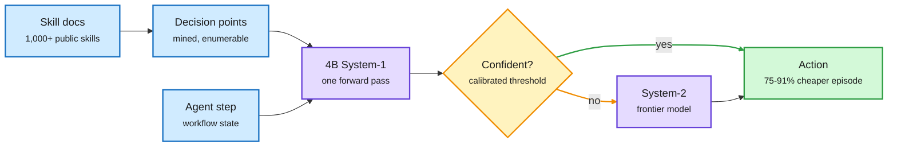

# AnyS1: One System-1 for the Decision Points of Any Agent Workflow (2611.23751)

**TL;DR.** Agents call a big model (System-2) at every step, even when the step is just picking among a few known options. Dual-system agents already hand those picks to a small model (System-1), but each environment needs hand-written hooks. AnyS1 finds the decision points automatically from human-written procedural skills, whose instructions already say where choices arise and which options apply. Offline, it mines enumerable decisions from over 1,000 public skills, collects execution-grounded states in isolated containers (the Any-DP dataset) and trains one calibrated 4B pointer model with label smoothing. At run time, routine decisions resolve in one forward pass of the 4B model, with fallback to System-2 when confidence drops below a calibrated threshold. On three unseen benchmarks and several System-2 families, episode cost falls 75-91% and model-call time 63-92% versus an uncompiled System-2 agent, with reliability preserved and the threshold transferring zero-shot.

Skills already say where the cheap decisions are

A 4B pointer model answers enumerable choices; the big model only sees the rest.

Blue is input, purple is a model, amber is the confidence router, green is the action.

## Relation to prior wiki pages
- **Confidence cascades, generalized.** [LuthorSQL (11-17)](2026-11-17-luthorsql-system1-cascade.md) answered text-to-SQL locally when a validator was confident and cut API cost 33%. AnyS1 applies the same escalate-on-low-confidence rule to every enumerable step of any workflow.
- **Same day as** Claude Code's advisor tool going viral on X (Sonnet runs the session, Opus is consulted only at decision points) and an "Drex Router" step-level model picker: the step, not the query, is becoming the unit of routing.
- Builds on the decision-model ("System One", e.g. Jev) line tracked on the [routing page](llm-routing.md) since 11-14.

## Gaps
- Only enumerable choices qualify; open-ended generation steps still go to System-2. The cost cut is against an uncompiled agent, not against a prompt-cached or smaller-default baseline.

## Sources
- [Paper](https://arxiv.org/abs/2611.23751) · raw: `raw/huggingface/2026-11-19-thinking-fast-anywhere-one-system-1-for-the-decision-points.md`

Concept page: [LLM routing](llm-routing.md)
