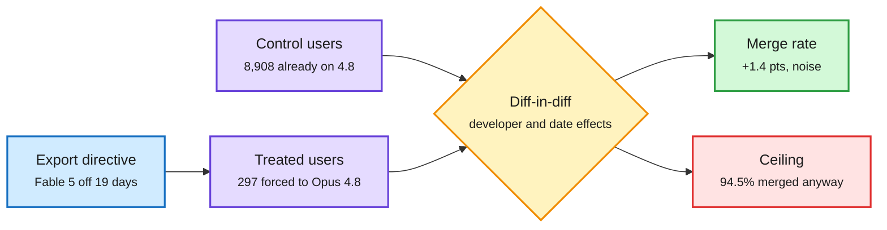

# A better coding model did not get more PRs merged: the Fable 5 suspension as a natural experiment

**Source:** [arXiv 2611.23216](https://arxiv.org/abs/2611.23216) (Harvard), surfaced via the X Following feed ([@rohanpaul_ai](https://x.com/rohanpaul_ai/status/2124546211290243569)) · raw: `raw/twitter/feed/2026-11-22-evening-230004-ranked.json`. Related same-day reporting: [The Decoder on a simulated-workplace coding benchmark](https://the-decoder.com/ai-coding-agents-ace-isolated-tests-but-complete-fewer-than-one-in-ten-tasks-in-a-simulated-workplace/), [Ken Huang on Gemini 4 Neon's 23 benchmarks](https://kenhuangus.substack.com/p/google-gemini-4-neon-model-and-23).

## TL;DR

In June 2026 a US export-control directive cut off Claude Fable 5 for 19 days, and most of its users fell back to Opus 4.8, which scores about 11 points lower on SWE-Bench Pro. A Harvard team used this as a natural experiment. It compared 297 Fable 5 users with 8,908 developers who stayed on Opus 4.8, using difference-in-differences (comparing the change in the treated group against the change in a control group) with developer and date fixed effects. Access to Fable 5 raised the 7-day pull-request merge rate by only 1.4 points, within noise, and weekly merged PRs did not move significantly. Across five other 2026 model upgrades, all five estimates were slightly negative. The big caveat: about 94.5% of PRs were merged anyway, so merge rate has little room to rise.

The shock did the randomizing

An outside cutoff moved one group to a weaker model. Comparing its change with a control group isolates the model's effect.

Blue is the outside shock, purple the two groups, amber the estimator, green the result, red the measurement ceiling.

## Key findings

- Fable 5 access: +1.4 points on 7-day merge rate, not significant. Weekly merged PRs: no significant change.
- Five other 2026 upgrades: all five point estimates slightly negative.
- Benchmark gap behind the switch: about 11 points on SWE-Bench Pro.

## Gaps

- Merge rate is near ceiling (94.5%), so it cannot see gains in speed, size or quality of PRs.
- Public GitHub only; agent-heavy private work could differ.
- 19 days is short; developers may adapt workflows over longer horizons.

## Same-day context: benchmarks versus work

- **Simulated workplace (The Decoder):** a new test drops coding agents into a mock developer job with colleagues, project boards and incomplete handoffs. Opus 5.5 and GPT-6.x Astra finish fewer than one in ten tasks completely, though they ace standalone assignments.
- **Neon's 23 benchmarks (Ken Huang):** private test sets, LLM judges, version changes and harness effects move scores, sometimes by multiples. A score needs its version, harness and access level beside it.

## How this relates to prior wiki pages

- **Extends [LLM routing](llm-routing.md):** the routing page has scored routers per solved task (11-14, 11-19). This is the first field evidence that the top-model premium does not show up in a coarse production outcome. It supports cheap-first cascades for routine coding traffic.
- **Confirms the [agent benchmarks](../agentic-systems/agent-benchmarks.md) measurement-crisis thread:** benchmark gaps and real outcomes diverge, now from a causal design rather than a survey.
- **Contrasts with** AutoRAGBench (11-22, agents beating the best published RAG designs 56.1 vs 44.4): strong agents win on hard, measured tasks, while routine merged work does not move.
