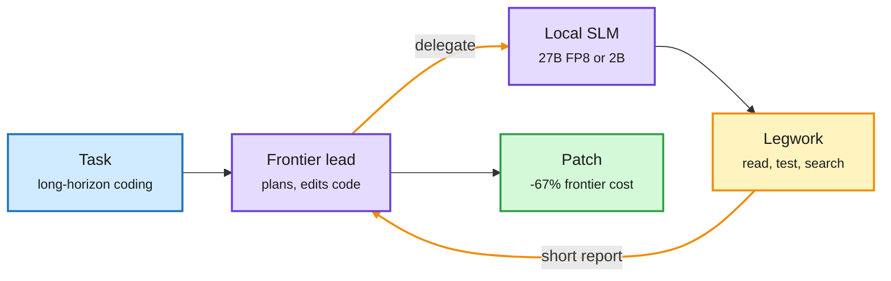

# Delegent and in-agent delegation

**TL;DR.** Lingwei Gu and Jimmy Lin (Waterloo) build Delegent on Claude Code. The frontier model plans and makes the main code changes, then hands focused subtasks (reading code, running tests, searching a corpus) to subagents that run a small language model on hardware you already own. Unlike a router or a cascade, which picks one model for the whole task, the frontier model never gives up control. With a **27B FP8** local model, frontier cost fell **67% on long-horizon coding and 59% on agentic search with no loss in task performance**; a **2B** laptop-sized model still cut coding cost **66%**. No router and no model were trained. One short instruction (keep the main coding edits on the frontier model) accounts for most of the savings. At API prices the 27B subagent adds 3 to 10 cents per coding task.

The router lives inside the trajectory, not in front of it

The expensive model keeps every decision. Only the reading and running moves to the cheap one.

Blue is the task, purple are the two models, amber is the delegated loop, green is the result.

## Why it works

The frontier model re-reads its whole context at every step. Most of those steps are legwork whose output is a short fact ("test 14 fails on line 30"). Delegation means the long, cheap-to-produce context (file dumps, test logs) lives in the small model's window, and the frontier model only reads the summary. The savings scale with how much legwork a task has, which is why long-horizon coding benefits most.

## Companion signals in the same window

- **Effort escalation (recirculating; first covered 10-29).** Johns Hopkins and Together AI's "What Effort Level Should I Choose?" ([2610.34491](https://arxiv.org/abs/2610.34491)): across 8 models, higher reasoning effort often fails tasks lower effort solved; on tasks every level solves the top setting costs up to 42x the lowest; starting low and escalating only after a verified failure matched or beat fixed top effort everywhere, at a median 41.5% lower GPQA cost. See [2026-10-29 effort escalation](2026-10-29-effort-escalation-and-copilot-fusion.md).
- **NVIDIA + CodeRabbit + Baseten** customized Nemotron 3.5 Lightning for code-review routing "at about half the inference cost" ([post](https://x.com/NVIDIAAI/status/2125707678244892736)). No numbers beyond the headline were captured.
- **Claude Code advisor mode** (11-25): cheap model drives every turn and calls Opus only at decision points; Haiku 19.7% to 41.2% on BrowseComp at 85% less per task than Sonnet. This is the inverse layout of Delegent (cheap lead, expensive advisor).

## Relation to prior wiki pages

- **Confirms and sharpens** the [LLM routing](llm-routing.md) page's 11-12 to 11-20 "decision model" wave (Gemini Decision-1, AnyS1 system-1 decision points), which moved routing from per-query to per-step. Delegent is the first to show per-step routing needs **no trained router at all**, just a role split in the harness.
- **N-of-a-kind (3 in two days):** advisor mode (cheap leads, expensive advises), Delegent (expensive leads, cheap does legwork), effort escalation (same model, cheap setting first). All three bound expensive compute to the decision points. Combined with NVIDIA's "You don't need long context" handoff result (11-25), the field has converged on "the expensive model should see less", not "the expensive model should be smarter about what to read".
- **Tension:** Eugene Yan's eval essay (same window) argues cost per task is a misleading metric because cheap agents fail cheaply. Delegent reports no loss in task performance, so the critique does not bite here, but any cost-only routing paper should report reliability across repeats.

## Gaps

- Two task families only (coding, agentic search). No repeated-run reliability.
- "No loss" is aggregate; per-task disagreements between delegated and frontier-only runs are not reported in the abstract.
- Local SLM cost is priced at API rates, not measured power or latency on owned hardware.

Raw: [X feed capture](../../raw/twitter/feed/2026-11-26-morning-ranked.json) · [DAIR](https://academy.dair.ai/papers/delegent-a-multi-agent-harness-that-reduces-cost-without-sacrificing-performance-2611.33098)
