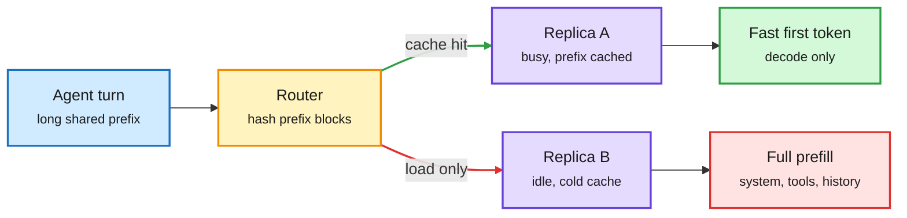

# Cache-aware routing and speculative encoding

**TL;DR.** Two practitioner threads landed on the same point within hours: in a multi-replica deployment, each replica keeps its own KV cache, so a load balancer that ignores caches sends a follow-up agent turn to the right replica only about 1/N of the time (12.5% with 8 workers). The rest re-prefill the whole system prompt, tools and history. Google's Antigravity team gave the anchor number: 4.5% more cache hits for Neon meant 28% more tasks within quota. Separately, Elvis Saravia pointed to "speculative encoding", which translates one model's cached representation of a context into an approximate cache another model can use, the missing piece for routing between models mid-task.

The busy replica with the cache beats the idle one without it

Cache-aware routers score remaining prefill plus load, not load alone.

Blue is the request, amber is the routing decision, purple is a replica, green is the cheap path, red is the re-prefill cost.

## Key points

- **Ladder of fixes** (Pachaar): prefix affinity (same client to same worker; one heavy client overloads it), consistent hashing on a session key or prompt start, then full prefix-aware routing that tracks hashed prompt blocks and cache add/evict events from workers and scores both remaining prefill work and current load.
- **Worked example** (Chawla): three replicas, least-busy balancing, high time-to-first-token for agent traffic. The answer is that the balancer ignores which replica holds the prefix.
- **Google's number**: +4.5% cache hit rate for Neon in Antigravity, which Google says means 28% more tasks within quota. Google did not say how.
- **Speculative encoding** (Saravia, paper not linked in capture): one model reads a long context once; its internal state is translated into an approximate cache another model can read. Open questions: end-to-end savings over a workflow, quality drift across repeated handoffs, when translation costs more than prefill.

## How it relates to prior wiki pages

- **Confirms** [11-14 prefix-cache metastability](../inference-efficiency/2026-11-14-prefix-cache-metastability-bursts.md) and [11-17 agent-session cache discipline](../inference-efficiency/2026-11-17-agent-sessions-prefix-cache-discipline.md): agent cost is mostly prefill locality.
- **Gap-filling for routing.** The [llm-routing](llm-routing.md) page has treated model choice and cache placement as separate problems. A router that moves a long task to a cheaper model throws the cache away. Speculative encoding plus Stanford Hazy Research's result reported the same day (one rotation plus a global scale lets one LLM read another's hidden states, across 12 base models) are the first hints that cross-model cache reuse is possible.
- **Tension** with NVIDIA's model-driven compaction ([11-27](../agentic-systems/2026-11-27-model-driven-context-management.md)): edits break prefix hashes at the edit point.

## Gaps

All practitioner explainers; the speculative encoding and Hazy Research papers were not captured with links or numbers.

Related: [llm-routing](llm-routing.md) · [kv-cache](../inference-efficiency/kv-cache.md)
