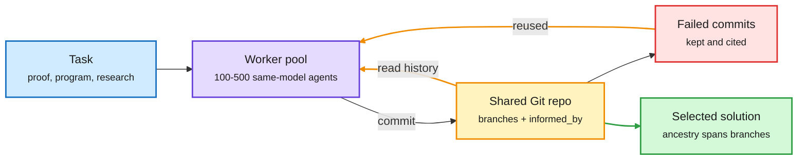
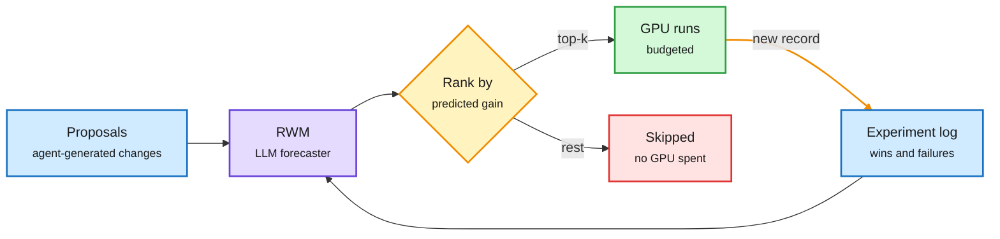
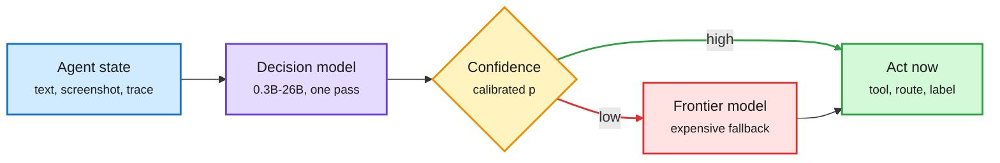
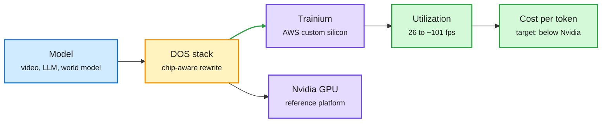

# cere-bro | 2026-10-12

> A Sunday about not wasting compute you already paid for. Meta's GitSwarm keeps every agent attempt, failures included, in one shared Git repo and turns them into later wins. Amazon's Research World Models use the experiment log to skip runs that would not pay. Vals AI shows the opposite case: agent teams that only talk to each other cost up to 5.1x more for one significant gain in four. On the supply side, Amazon is reportedly paying about $7B for Decart, a company whose real asset is the software that keeps Trainium busy.

🎯 Today's 5 for you

<ol>
<li>Read<strong>Decision 3.0 and THX-01: the routing gate goes multimodal and reports calibration.</strong> Open decision models from 0.3B to 26B now read screenshots. THX-01 publishes ECE 0.003, the first calibration number in the category, which is the metric your routing work said was missing. <a href="../../ai-routing/2026-10-12-decision-3-multimodal-and-calibrated-gates.md">Summary</a></li>
<li>Read<strong>Amazon's ~$7B Decart talks.</strong> Hardware economics in one number: real-time video from 26 fps on GPUs to ~101 fps on Trainium. Amazon is buying utilization software to push its chip's cost per token below Nvidia's. <a href="../../hardware/2026-10-12-decart-trainium-and-agent-cpu-demand.md">Summary</a></li>
<li>Read<strong>GitSwarm: compounding inference.</strong> Test-time compute where failed work is reused, not thrown away: 70% of failed commits get cited later. Your harness-engineering theme, now as shared memory for 500 agents. <a href="../../agentic-systems/2026-10-12-gitswarm-compounding-inference.md">Summary</a></li>
<li>Skim<strong>Vals AI: agent teams cost 1.8-5.1x for one win in four.</strong> The cost counterweight to GitSwarm. At max reasoning effort, teams add nothing. Team size and thinking effort substitute for each other. <a href="../../agentic-systems/2026-10-12-agent-team-costs-and-research-world-models.md">Summary</a></li>
<li>Track<strong>Research World Models (Amazon).</strong> An LLM predicts whether an experiment will pay before you spend GPU hours. Past logs plus low effort beat max effort without logs. Skip the "Unlimited OCR eats 100-page PDFs" hype thread and the fake "Karpathy says keep Graphs" talk promo. <a href="../../agentic-systems/2026-10-12-agent-team-costs-and-research-world-models.md">Summary</a></li>
</ol>

---

## TL;DR

- **GitSwarm (Meta)**: 500 agents sharing one Git repo beat a single long-running Codex agent on ProgramBench, 79.4% vs 65.1%, at similar budget.
- **Vals AI**: teams of GPT-6 Sol or Opus 5.5 cost up to 5.1x more. Only one of four tests showed a real gain.
- **Research World Models (Amazon)**: an LLM reading past experiment logs ranks new experiments well enough to skip bad GPU runs.
- **Decision 3.0 and THX-01**: open routing gates now read screenshots, and one finally publishes a calibration error number.
- **Amazon and Decart**: a reported ~$7B deal for software that nearly quadruples video throughput on Trainium.
- **Inference pricing**: investors call hosted inference a reverse auction, and agent swarms push vendors from per-seat to metered pricing.

---

## Deep Dives

### GitSwarm: compounding inference

> Throwing away a failed attempt wastes the compute that produced it. GitSwarm keeps every attempt as a Git commit, and 70% of failed research commits ended up cited by later winning work.

**Source:** X Following feed (@omarsar0, @rohanpaul_ai) · DAIR.AI Academy pick (Oct 11)
**Links:** [Paper](https://arxiv.org/abs/2610.04862) · [DAIR take](https://academy.dair.ai/papers/gitswarm-decentralized-compounding-inference-2610.04862) · [Wiki summary](../../agentic-systems/2026-10-12-gitswarm-compounding-inference.md)

Every attempt becomes a commit the next agent can build on

No planner. Workers pick their own move and cite what they used, failures included.

Blue is the task, purple is the agent pool, amber is the shared-memory loop, red is failed work that still gets reused, green is the result.

**What is it about?**
Meta Superintelligence Labs (with Mila, CMU and Princeton) runs hundreds of copies of one model as asynchronous workers on a single Git repository. Each worker reads the history, decides whether to explore, verify, refine or combine, and commits its result with an `informed_by` field naming the earlier commits it used.

**What problem does it solve?**
Most extra test-time compute (compute spent at answer time, not training time) goes into separate attempts. Best-of-N sampling or a "keep going" prompt discards the partial work and dead ends of every run. The next run then pays to rediscover them. The paper calls the fix compounding inference: make intermediate work persist so later compute can build on it.

**What's the core novelty?**
The memory is version control, not a chat log. Commits are atomic, branchable and carry declared dependencies across branches, so the paper can measure whether work actually accumulates. There is no central planner choosing tasks, although the harness still schedules and validates runs.

**Key takeaways**
- All 30 IMOProofBench-Advanced problems solved in one run, with GPT-5.5 Codex workers.
- ProgramBench: 79.4% vs 65.1% for one Codex agent told to keep going at similar budget.
- Scaling holds: 73.1% at 100 workers, 79.4% at 500.
- Later workers built on 94.7% of contributions. 70.1% of failed research commits were cited by later accepted work.

**Gaps in the study**
No dollar or wall-clock table for 500 frontier workers, so "similar budget" is a token claim. All workers are the same model, so a cheap-worker swarm with one strong verifier is untested. Reuse is self-declared by the agents, which is not the same as causal contribution.

**Industrial implication**
Agent platforms will start keeping a persistent, queryable record of every attempt, failures included, instead of a disposable transcript. This is the third paper in four weeks to pick Git as that record (after Agora on 09-17, which stored autoresearch as an append-only Git graph for 13 workers over 12 days, and GitHarness on 10-05, which versioned a personal agent's harness in Git). Expect "agent memory as a repo" to show up in coding-agent products within two quarters.

→ [Full summary](../../agentic-systems/2026-10-12-gitswarm-compounding-inference.md)

---

### Agent teams: 1.8-5.1x the bill for one significant win in four

> When the solo agent already thinks at maximum effort, adding teammates buys nothing measurable. Team size and reasoning effort are substitutes.

**Source:** The Decoder on a Vals AI report · Claude Opus 5.5 system card
**Links:** [The Decoder](https://the-decoder.com/ai-agent-teams-waste-massive-tokens-for-barely-measurable-quality-gains-research-finds/) · [Vals AI report](https://www.vals.ai/blogs/multi-agent-vibe-code-bench) · [Wiki summary](../../agentic-systems/2026-10-12-agent-team-costs-and-research-world-models.md)

**What is it about?**
Vals AI ran GPT-6 Sol and Claude Opus 5.5 alone and as teams, at medium and maximum reasoning effort, on Vibe Code Bench (building working apps). That gives four team-versus-solo comparisons.

**What problem does it solve?**
Labs and tool vendors are selling multi-agent setups as the next scaling lever. Until now, most evidence came from the vendors themselves, without a cost column. This is an outside test with the bill attached.

**What's the core novelty?**
It holds the model fixed and varies only team versus solo and reasoning effort. That isolates what the team itself adds.

**Key takeaways**
- Teams cost 1.8x to 5.1x more than single agents.
- Only GPT-6 Sol at medium effort improved significantly, by 7.3 points.
- At maximum effort, teams gave neither model a real advantage.
- Anthropic's own Opus 5.5 data agrees: knowledge-base score goes 0.53 (1 agent) to 0.70 (10) to 0.74 (100). Most of the gain arrives by 10 agents.

**Gaps in the study**
One benchmark and two models. The article gives no per-cell cost breakdown. The teams here coordinate by messaging, which is not how GitSwarm's swarm works.

**Industrial implication**
Default to one agent at high effort, and add teammates only for work that splits cleanly (web research, proof search). This lines up with the 10-06 swarm-scaling estimate from Toby Ord that 10x agents give only 3-5x the gain of 10x tokens on one agent. GitSwarm is the counterexample, so the open question is the substrate: message-passing teams pay a coordination tax, while artifact-sharing swarms seem to compound.

→ [Full summary](../../agentic-systems/2026-10-12-agent-team-costs-and-research-world-models.md)

---

### Language Models as AI Research World Models

> The cheapest GPU hour is the one you never spend. An LLM reading past experiment logs at low effort out-predicts the same model thinking at maximum effort without the logs.

**Source:** X Following feed (@rohanpaul_ai) · alphaxiv overview
**Links:** [Paper](https://arxiv.org/abs/2610.12235) · [Wiki summary](../../agentic-systems/2026-10-12-agent-team-costs-and-research-world-models.md)

The experiment log is worth more than a bigger thinker

A cheap forecaster decides which proposals get GPU time.

Blue is input, purple is the forecaster, amber is the ranking gate, green is spent compute, red is compute saved.

**What is it about?**
Amazon researchers use an LLM as a research world model (RWM): a predictor that, given a training setup and a proposed change, forecasts how much the change will help before anyone runs it. The model reads a log of past experiments from the same or other setups as evidence.

**What problem does it solve?**
Research agents can now propose experiments far faster than a team can afford to run them. Someone has to guess which ideas deserve GPU time. Generic ML knowledge is a weak guide, because the same change can help one model and hurt another.

**What's the core novelty?**
It treats logged experiment records, including failures, as the main input, and tests whether that experience transfers across setups and improves real selection over several rounds.

**Key takeaways**
- 2,653 real experiment records from 9 setups, from pretraining to inference.
- Same-setup records lifted ranking correlation with real outcomes from 0.506 to 0.774, averaged over 5 setups.
- On OLMo3-100M, records at low reasoning effort scored 0.892. Max effort without records scored 0.648.
- Better forecasts led to better experiment choices over multiple rounds.

**Gaps in the study**
Results are ranking correlations, not end-to-end dollars saved. The records come from curated setups; messy real lab logs may predict worse.

**Industrial implication**
Log every run, failures included, in a form a model can read. It extends WMRL (09-10, which replaced real experiment sandboxes with a learned predictor to make research-agent RL 3-4x cheaper): WMRL predicts outcomes to train agents, RWM predicts outcomes to allocate GPU hours. Both are routing applied to experiments, and they pair naturally with GitSwarm's persistent history.

→ [Full summary](../../agentic-systems/2026-10-12-agent-team-costs-and-research-world-models.md)

---

### Decision 3.0 and THX-01: the routing gate learns to see, and reports calibration

> The cheap gate in front of the big model can now read a screenshot, and one vendor finally published how honest its probabilities are.

**Source:** X Following feed (@XunzhuoLiu, @reversedoofz, @AutoTrustAI, @TheTuringPost) · Hugging Face model cards
**Links:** [Decision 3.0](https://huggingface.co/collections/vllm-sr/decision-30) · [THX-01](https://huggingface.co/doofz/THX-01) · [THX-01 API docs](https://api.hal-x.ai/docs/thx-01) · [JEV-27B-VL](https://huggingface.co/autotrust/JEV-27B-VL) · [Wiki summary](../../ai-routing/2026-10-12-decision-3-multimodal-and-calibrated-gates.md)

The gate now reads the screen, and says how sure it is

Confident answers act. Unsure ones escalate. Calibration is what makes the split safe.

Blue is input, purple is the gate, amber is the confidence split, green is the cheap path, red is the costly fallback.

**What is it about?**
Three open releases of decision models, small models that answer one typed question (which model, which tool, is this task done) with a probability instead of generating text. Decision 3.0 from the vLLM Semantic Router team comes in six sizes: 26B, 8B, 5B, 2B, 0.9B and 0.6B, all multimodal. THX-01 from HAL-X is a 322M encoder. JEV-27B-VL from AutoTrust is a 27B vision model.

**What problem does it solve?**
Decision 2.0 (10-05) was text-only. Computer-use agents decide from what is on screen, so a text-only gate still had to call a vision model. A 0.6B gate that reads the screenshot removes that call. Separately, the 10-11 launches (Microsoft-Decision-1, AnyJev, Vega) reported accuracy but no calibration, even though System Switch (10-09) showed calibration and ranking quality, not accuracy, decide whether escalation pays.

**What's the core novelty?**
THX-01 is trained with RL whose reward is a strictly proper scoring rule, a reward that is maximized only by stating your true probability. It is non-autoregressive, so it cannot invent text: numbers and excerpts are copied from the input with character offsets.

**Key takeaways**
- THX-01 reports ECE 0.003 (expected calibration error, the average gap between stated confidence and actual accuracy). It is the first calibration number from any launch in the category. Self-reported.
- THX-01 runs about 10 ms per request, about 1 ms per decision batched. Inputs truncate at 1,024 tokens per question.
- JEV-27B-VL went from 179K to 1.54M downloads and claims 77.8% on the Jev Decision Index vision board.
- Decision 3.0 also claims first place on both Jev boards "in our evaluation". The two claims conflict.

**Gaps in the study**
Every number is vendor-run. No launch reports AUROC (how well the confidence ranks right answers above wrong ones). THX-01's 1,024-token cap is short for real agent traces.

**Industrial implication**
The gate is becoming a commodity with five launches in eight days, so the buying criterion shifts to calibration and modality. Expect computer-use stacks to put a sub-1B vision gate in front of every screenshot step within a quarter. That cuts frontier vision calls on easy steps.

→ [Full summary](../../ai-routing/2026-10-12-decision-3-multimodal-and-calibrated-gates.md)

---

### Amazon's ~$7B Decart talks: buying the software that fills Trainium

> Custom silicon is only cheap if something keeps it busy. Decart's headline is real-time video at 26 fps on GPUs and about 101 fps on Trainium.

**Source:** WSJ report via @rohanpaul_ai and @StockSavvyShay
**Links:** [Report thread](https://x.com/rohanpaul_ai/status/2109479701689565297) · [Trainium numbers](https://x.com/StockSavvyShay/status/2109400560827068496) · [Wiki summary](../../hardware/2026-10-12-decart-trainium-and-agent-cpu-demand.md)

Custom silicon wins on cost only if the software fills it

Decart's value to AWS is the optimization layer, not the video model.

Blue is the workload, amber is the optimization layer, purple is silicon, green is the payoff.

**What is it about?**
The WSJ reports Amazon is in talks to buy Decart for about $7B. Decart builds real-time world models (Lucy for live video, Oasis for robotics simulation) and an optimization stack called DOS that moves workloads between chips and claims up to 8x speedups on the same hardware.

**What problem does it solve?**
Custom accelerators like Trainium are cheaper per chip than Nvidia GPUs, but they often sit underused because software, kernels and models are tuned for CUDA. Low utilization erases the price advantage.

**What's the core novelty?**
Decart co-designed its models with Trainium. AWS gave it early Trainium3 access in 2025, and it reshaped its architecture to the chip. The asset is that co-design skill, not one model.

**Key takeaways**
- Real-time video: 26 fps on GPUs to about 101 fps on Trainium.
- The price is about 75% above the $4B valuation of Decart's $300M May round.
- Nvidia talks and a $6B Anthropic deal both collapsed before Amazon, Anthropic after due diligence.
- It is the third chip-side purchase of a model or software team in two weeks, after AMD's $8.2B World Labs buy (10-07) and Nvidia's Reflection AI talks (10-11).

**Gaps in the study**
The speedups are Decart's own, on its own video models. The deal pays off only if they hold on customers' LLM workloads. Single-source report, not yet confirmed.

**Industrial implication**
Chip vendors are buying the workload to sell the chip. If the deal closes, expect AWS to quote Trainium cost per token on named open models within six months, which is the number that would actually move buyers off Nvidia.

→ [Full summary](../../hardware/2026-10-12-decart-trainium-and-agent-cpu-demand.md)

---

### Serving and edge shorts

- **Speculative decoding, explained right** ([thread](https://x.com/akshay_pachaar/status/2109321447604982026)). Plain decoding reads every weight from memory for each token, so compute sits idle. A small draft model guesses several tokens ahead, and the big target model checks them all in one pass. Each guess is kept with probability min(1, p/q), where p is the target's probability and q the draft's. On the first rejection, a replacement token is drawn from the leftover difference between the two distributions. That rule keeps the output distribution identical to the target model, so the speedup costs no quality. The thread points to Uzu, the Apple Silicon engine that hit 92 tokens/s on a 9B model (10-10). A Sunday newsletter ran the same explainer, so the technique is going mainstream.
- **Qualcomm: labs want 100B-parameter models running continuously on phones by 2028** ([post](https://x.com/VaibhavSisinty/status/2109290474599297312)). At 4-bit weights that is about 50 GB, far beyond today's phone memory. This is a quantization and KV cache compression problem before it is a compute problem. Second-hand quote.
- **The AI infra engineer's project list** ([thread](https://x.com/suraj_sharma14/status/2109252678387724559)). Tune vLLM or SGLang chunked prefill and batching for one GPU; build a prefix-aware router that sends each request to the replica already holding its system-prompt cache; write a fused Triton RMSNorm/RoPE kernel; run a 2B-draft, 70B-target speculative pipeline. Its percentages are rules of thumb, but prefix-aware routing is the item that pays at scale.
- **Liquid's open d1 on the edge** ([post](https://x.com/TheTuringPost/status/2109367107477553573)). d1-3B reports 35 ms per image on Jetson AGX Thor, pitched as fast on-device checks for robots between expensive planner calls.

---

### Also in the pile

- **AAArena** ([arXiv 2610.12341](https://arxiv.org/abs/2610.12341), Tsinghua). A frozen coding agent improves game bots from replays against 1,920 archived human programs. Detailed replays took a Pacman bot from rank 11 to rank 1. Tripling the match budget lifted none of four stuck bots to the top, which matches the 10-11 harness-ceiling paper's claim that loop tweaks fix process failures, not weak strategy.
- **DAIR's Top Papers of the Week (Oct 5-11)** ([list](https://x.com/dair_ai/status/2109270533640433878)). Harness Learning leads (CMU trains a proposer model to rewrite the agent's harness, the code around the model, instead of its weights; covered 10-04). Also VERA, HERMES, CorpusMap, VeriHarness, Sharpening Tax and Multi-Agent Self-Supervision. Pedro Domingos read Harness Learning as "the model swallows the harness".
- **Karpathy's capability funnel** ([post](https://x.com/karpathy/status/2109361546505966046)). About 6B people barely touch LLMs, 1-2B use free chatbots, about 20M use frontier models professionally for math and code, and about 5,000 inside labs see swarms of agents running for weeks. The gap in shared understanding is widening.
- **GitHub Security Lab's Fuzzing Taskflow** ([blog](https://github.blog/security/application-security/ai-powered-fuzzing-with-the-github-security-lab-taskflow-agent/)). An agent finds entry points in a C/C++ repo, writes fuzzing harnesses, runs AFL++, reads coverage and files one report per unique bug.

---

## Industry Pulse

- **Inference is a "permanent reverse auction"**: easy capital, neolab spare compute and one-line switching keep cutting hosted prices ([@JayaGup10](https://x.com/JayaGup10/status/2109414688924856810)).
- **Agent swarms will force metered pricing**: child jobs route to the cheapest passing model, so token volume outruns frontier revenue ([@rohanpaul_ai](https://x.com/rohanpaul_ai/status/2109345465838006445)).
- **Nvidia's Vera CPU projected at about $60B by 2028**, as agent orchestration pushes server-CPU demand toward $150B ([@StockSavvyShay](https://x.com/StockSavvyShay/status/2109303815874748600)).
- **Arm enters merchant server CPUs** on $2B+ of orders, per the same projection (same source).
- **Terafab's ~$17B first phase uses conventional ASML and Applied Materials tools**, then custom high-throughput equipment ([@StockSavvyShay](https://x.com/StockSavvyShay/status/2109255508553056418)).
- **White House reinstates UK access to frontier models for safety testing** after ministerial lobbying, per a Tony Diver exclusive ([repost](https://x.com/Miles_Brundage/status/2109397921603178850)).
- **Satya Nadella: "separate the supply of intelligence from the authority over it"**, treating agents as insider risks ([@StockSavvyShay](https://x.com/StockSavvyShay/status/2109279196975435996)).
- **AWS rebuilding around agents**: its CEO says agents need "new building blocks", pointing to serverless and Graviton demand ([@StockSavvyShay](https://x.com/StockSavvyShay/status/2109228189037756451)).
- **Amazon trades at 29x forward earnings vs Walmart's 37x** despite $220B of capex this year ([The Information](https://www.theinformation.com/articles/amazons-bargains-include-stock)).
- **Ed Zitron's "Dead Money"**: AI firms are at least $260B short of the revenue hyperscaler capex needs ([essay](https://www.wheresyoured.at/dead-money/)).
- **Meta Muse retention beats ChatGPT at day 7** (over 30%) and trails it slightly at day 14 (22%) ([@deedydas](https://x.com/deedydas/status/2109474596366004417)).
- **Claude now works inside Google Docs, Sheets and Slides** ([Future & AI](https://mail.google.com/mail/u/0/#inbox/1a12b043b52e36b8)).
- **NVIDIA open-sources LongLive** for real-time long video generation (same source).
- **Exa's ATLAS benchmark** finds AI search agents still struggle (same source).
- **Baidu's "Unlimited OCR"**, a 3B model, reportedly parses 100-page PDFs in one pass; claims unverified ([post](https://x.com/BrooksWhaleX/status/2109080341642363349)).

**Funding, valuations, and compute deals**

- **Amazon in talks to buy Decart for about $7B**, about 75% above its $4B May valuation ([@rohanpaul_ai](https://x.com/rohanpaul_ai/status/2109479701689565297)).
- **Anthropic walked away from a $6B Decart deal** after due diligence (same source).
- **Nuvacore (Sequoia-backed) raising hundreds of millions at a $2.5B valuation** for data-center CPUs, pre-product ([Business Analytics Review](https://businessanalytics.substack.com/p/contrastive-learning-simclr-and-clip)).
- **IREN reportedly signs a multiyear cloud deal with Anthropic**, possibly 50 MW of B300 capacity at Childress; stock up nearly 8% ([@StockSavvyShay](https://x.com/StockSavvyShay/status/2109443155255005364)).
- **Tab, a personal AI assistant, exits stealth at a $300M valuation** ([TechCrunch via post](https://x.com/Ronald_vanLoon/status/2109370706030903803)).
- **Indian-born founders behind US AI companies**: Perplexity $20B, Skild $14B+, Baseten $13B, Together $8B, Glean $8B, Modal $5B ([@deedydas](https://x.com/deedydas/status/2109258111265751391)).

---

## Global View

**Compute that persists compounds, and compute that only talks does not.** GitSwarm (Meta's 500-agent shared Git repo, where 70% of failed commits were reused) and Vals AI (teams 1.8-5.1x more expensive for one significant win in four) look contradictory, but they use different substrates. That matches the 10-06 swarm-scaling page, where Toby Ord estimated 10x agents give only 3-5x the gain of 10x tokens on one agent and Anthropic saw gains flatten past 10 agents, both for message-passing teams. Industry is already moving the GitSwarm way: Git-as-memory is now three papers (Agora 09-17, GitHarness 10-05, GitSwarm), while vendors keep selling chatty "agent teams" that Vals just priced as mostly waste.

**Routing is turning into a pricing model, and the gate is getting cheaper and more honest.** The swarm-metering argument says child jobs go to the cheapest model that passes, which only works if the gate's confidence can be trusted. That is what System Switch (10-09, which showed escalation value tracks calibration and ranking, not accuracy) asked for, and THX-01 is the first launch to publish a calibration error. On the supply side, investors call hosted inference a reverse auction, and the 10-11 dollar map showed most of the price drop came from traffic moving to cheaper models. Research says route on calibration; industry is pricing as if routing already works.

**Chip vendors are buying the workload to sell the silicon.** AMD bought World Labs (10-07, $8.2B for memory-heavy world models), Nvidia is talking to Reflection AI (10-11, $25B open-weight lab), and Amazon is now in talks for Decart (~$7B) explicitly to raise Trainium utilization. This is the hardware echo of Research World Models and GitSwarm: the scarce asset is not raw compute but the know-how that keeps it busy. The research gap is that no public benchmark measures cost per token across GPU and custom silicon on the same open model, which is exactly the number these deals are betting on.

---

## Looking Ahead

- **Artifact-sharing swarms beat message-passing teams on cost within 90 days.** Signal: by 2027-01-10, a paper or vendor report runs a Git-style shared-artifact swarm and a messaging team on the same benchmark with dollar cost, and the shared-artifact version wins on cost per solved task. If messaging wins, Vals' "coordination tax" is about agents, not substrate.
- **An independent calibration audit of a decision model within 60 days.** Signal: by 2026-12-11, a third party publishes ECE or AUROC for THX-01, Decision 3.0 or Microsoft-Decision-1. If THX-01's 0.003 ECE holds within 3x, calibration becomes the category's headline metric.
- **AWS publishes Trainium cost per token on a named open LLM within 90 days of a Decart close.** Signal: by 2027-01-10, an AWS post or re:Invent talk cites Decart-derived speedups on an LLM, not only video. If only video numbers appear, the deal was a world-model buy.
- **Kurate drops out of cross-source confirmation.** Every entry has sat at the default 1200 score since 10-05; per that day's rule, cross-source labels now rely on HF, DAIR and social until Kurate scores recover. No rising authors crossed the threshold.

*Source gaps this window: Hugging Face re-served the 10-09 list (no new papers); no new AI lab releases; DAIR Academy (MCP auth needed: run claude mcp login dair-academy), so DAIR picks came only via the X feed; no Reddit posts passed filters; no new X bookmarks; LinkedIn posts had no text; YouTube had no AI videos; the VentureBeat feed was blocked.*
